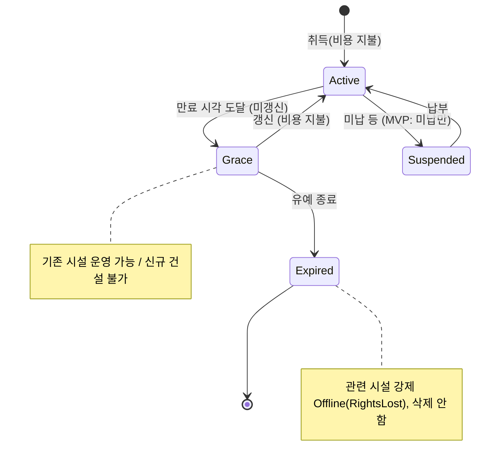
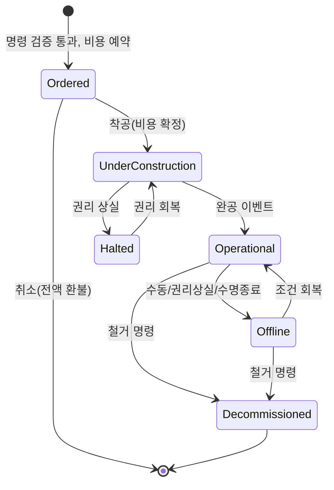

# PLANETARY GRID — V0.4 설계 검토 및 기술 감사 보고서

| 항목 | 내용 |
|---|---|
| 검토 대상 | `PLANETARY_GRID_V0.4_Design_Spec.md` (업로드 원본을 수정 없이 저장소 `docs/`에 보존) |
| 대상 버전 | **V0.4 — "Reconstructed working specification"** (원본 V0.4 파일의 복구본이 아님, 문서 머리말 1–9행·§0) |
| 검토 범위 | 내부 일관성, 시뮬레이션·엔지니어링, 경제·밸런스, 자동화·UX, 기술 아키텍처, 필수 기술 감사 12건 |
| 검토 성격 | **설계 검토 전용.** 구현·소스 수정 없음. 테스트는 **실행되지 않았다**(§10의 테스트는 제안). 수치 예시는 검토자가 스크래치 계산으로 산술만 확인했다. |
| 결론 | **구현 준비 안 됨 (Not ready for implementation)** — §12 참조 |

---

## 0. 읽는 법 — 사실·가정·권고·미결의 구분

본 보고서는 아래 표기로 모든 진술을 구분한다.

| 표기 | 의미 |
|---|---|
| **[사실-확정]** | 명세서에 **[확정]**으로 표기된 내용 |
| **[사실-제안]** | 명세서에 **[제안]**으로 표기된 내용(확정값 아님) |
| **[사실-미정]** | 명세서가 스스로 **[미정]**으로 남긴 내용 |
| **[가정]** | 검토자가 계산·예시를 위해 임의로 둔 값. **게임 확정값이 아니다.** |
| **[권고]** | 검토자의 수정 제안 |
| **[결정 필요]** | 디자이너 승인이 필요한 항목(§11) |
| **[판정 불가]** | 명세가 없어 결함 여부 자체를 판정할 수 없음 (부록 B 지침에 따름) |

명세서 인용은 `§절번호` 또는 `(L행번호)` 형식이다. 사용자 프롬프트의 "확정된 설계 결정" 목록은 명세서 [확정] 항목과 대조했으며 서로 모순되는 항목은 발견하지 못했다. 단, 프롬프트에는 "자동화 범위 지정 자동 실행"이 확정으로 있고, 명세서 §8.1도 [확정]으로 표기하나 **MVP 포함 여부**는 어느 쪽에도 명시되지 않았다(§7·OD-05).

---

## 1. 종합 판정 및 준비도

### 1.1 한 줄 판정
**구현 준비 안 됨.** 방향성(정체성·핵심 루프·권리 분리·하이브리드 판매·추천 우선 자동화)은 일관되고 보존할 가치가 크지만, **시뮬레이션의 정의 자체(시간 단위, 디스패치, 선로 용량, 손실, 저장, 수요, 시장 청산 물량, 계약 정산, 파산)가 [미정]** 이어서 엔진 코드를 작성할 수 있는 수준의 규칙이 존재하지 않는다.

### 1.2 준비도 평가

| 영역 | 준비도 | 근거 |
|---|---|---|
| 게임 정체성·범위 | 🟢 양호 | §1, §17 [확정] 항목 명확 |
| 권리(사업권/토지) 개념 | 🟡 개념만 | 분리 원칙 [확정], 상태·효과 전부 [미정] (§4.3, §5.2) |
| 시간·틱 모델 | 🔴 부재 | §3.2 전체 [미정], 단위 혼재 (ISS-06) |
| 전력 그래프·디스패치 | 🔴 부재 | §6.4–6.7 핵심 규칙 [미정] |
| 시장·계약 | 🔴 결함 있음 | 가격 함수 불연속·바닥/천장 무력화 [증명]. 가정 하에서 50% 공급 억제가 유일 최적 [증명], 평활가 정산 시 주기 진동 이득 [증명] (ISS-07–09, §5A) |
| 경제 밸런스 | 🔴 판정 불가에 가까움 | 예시값만으로도 회수 기간이 비정상적으로 짧음 (ISS-12) |
| 자동화 | 🟡 경계 목록만 | 멱등성·예약·취소 [미정] (§8.2) |
| 저장·결정론 | 🔴 부재 | 보존 목록만 있음 (§13) |
| 아키텍처 | 🟡 방향만 | UE5 [제안], 단계 순서에 의존성 역전 (ISS-29) |

### 1.3 문서 자체의 지위 (중요)
명세서는 스스로 "과거 V0.4 원본을 복구한 것이 아니다"(§0, L4·L15)라고 밝힌다. 따라서 이 보고서는 **"V0.4라는 이름의 재구성 초안"** 을 검토한 것이며, 원본 V0.4에 존재했을 수 있는 규칙의 결함 여부는 판정할 수 없다. 원본이 존재한다면 재검토가 필요하다(OD-01).

---

## 2. 보존할 가치가 있는 강점

1. **사업권과 토지 사용권의 분리** [사실-확정] (§4.1, §5.1) — 미래 다중 회사·양도·임대 시장으로 자연스럽게 확장되는 올바른 정규화이다. 유지 권고.
2. **[확정]/[제안]/[미정] 상태 표기** — 결정 추적성이 매우 좋다. V0.5 이후에도 유지하고, 결정 ID(OD-xx)와 연결할 것을 권고.
3. **"경로 추천 ≠ 실제 할당" 원칙** (§6.4 L188, §6.5 L193, §8.3 L269) — 많은 타이쿤 게임의 고질적 버그 원인을 미리 짚었다.
4. **단일 자원 예약 원칙** (§6.5 L192, §7.4 L243) — 이중 계산 방지의 필요성을 명시. 다만 규칙화되지 않음(ISS-02).
5. **정수 최소 화폐 단위 + 거래 ID 원장** [사실-제안] (§9.1) — 결정론·저장·감사에 유리. 강력 유지 권고.
6. **만료 시 시설 자동 삭제 금지** [사실-제안] (§5.3) — 플레이어 상실감 방지, 좋은 UX 원칙.
7. **추천 기본 + 범위 지정 자동 실행** [사실-확정] — 미세관리 부담과 통제감을 균형 있게 다루는 올바른 방향.
8. **AI 경쟁사 제외하되 아키텍처는 수용** [사실-확정] — 범위 관리 측면에서 적절.
9. **시뮬레이션/렌더링 분리, 독립 테스트 가능 코어** [사실-제안] (§15) — 결정론 확보의 전제 조건.
10. **§16 수용 기준 초안** — 올바른 질문들을 담고 있으며, 본 보고서 §10에서 구체 수치로 확장했다.

---

## 3. 치명적·높은 우선순위 이슈

### 3.1 우선순위 이슈 표

심각도 정의: **Critical** = 규칙 부재/오류로 핵심 루프가 성립하지 않거나 에너지·화폐가 생성/소멸됨. **High** = 명백히 악용 가능하거나 핵심 경험을 훼손. **Medium** = 품질·확장성 저하, 우회 가능. **Low** = 문서/표현 문제.

| ID | Severity | Subsystem | Issue | Impact | Recommended Action | MVP Blocker |
|---|---|---|---|---|---|---|
| ISS-01 | Critical | 디스패치 (§6.4) | 같은 우선순위 그룹 내 "비례 배분 고려"만 있고, 네트워크 제약 하의 공정성 기준·잔여량 재분배·그룹 간 처리 규칙 없음 | 공급이 있는데 부하가 끊기는 낭비 또는 용량 초과 할당 | 우선순위별 **점진 충전(progressive filling, max-min 공정)** + 결정적 동률 처리 (§4.2.2) | **예** |
| ISS-02 | Critical | 선로·발전 할당 (§6.5) | 소비자별 독립 경로 계산 시 공유 선로·발전량 이중 사용 가능 | 에너지 무에서 생성, 매출 부풀림 | 틱당 **단일 할당 패스 + 잔여 용량 차감**, 경로 추천과 분리 | **예** |
| ISS-03 | High | 선로 용량 (§6.5) | 용량 기준(송전단/수전단), 양방향, 역류 상계 미정 | 같은 선로가 최대 1/(1−l)배 차이 | **송전단(입력) 기준 + 순(net) 단방향 흐름** 채택 | **예** |
| ISS-04 | Critical | 손실 (§6.6) | 손실 계산 위치·기준·원장 기록 미정; 음수 손실(연구 효과) 미방지 | 에너지 보존 위반, 계약 인도 부족 오판 | 엣지 이득계수 `g=1−l`, `0≤l<1` 클램프, 손실을 별도 계정으로 기록 | **예** |
| ISS-05 | Critical | 계약·시장 (§6.4, §7.1, §7.3, §7.4) | 부하 등급(Critical/Contracted/…)과 판매 경로(시장/PPA/직접)의 매핑이 없음; 같은 MWh가 계약·시장에 이중 판매 가능 | 이중 매출, 위약금 회피 | **인도 원장(delivery ledger)** : MWh 하나당 정확히 하나의 판매 경로에 귀속 | **예** |
| ISS-06 | Critical | 시간·틱 (§3) | tick 길이·순서·주기 미정; "1초=1분", "120초", "CR/시간", "MW/시간"의 시간 기준 혼재 | 배속·프레임률에 따라 결과 상이, 밸런스 계산 불가 | **고정 시뮬레이션 스텝 + 게임 시간 단위 단일화** (§4.1) | **예** |
| ISS-07 | Critical | 시장 구조 (§7.2–7.3) | 싱글 플레이에서 지역 공급자가 플레이어뿐인지 불명; ρ의 공급 정의·청산 물량(시장이 얼마를 사는가) 미정 | 가정 A1–A10 하에서 20 < c < 180이면 **수요의 50%만 공급하는 것이 유일 최적** [증명, §5A.2]. 결과는 가격 결정자 구조에 의존 | MC-1–MC-5 + 시장지배력 억제 장치 1개(M2/M3/M4) 선택 [결정 필요, §5A.7] | **예** |
| ISS-08 | High | 가격 함수 (§7.2) | ρ=0.5에서 1.8→1.4 불연속; 하한 30·상한 500이 예시값에서 절대 작동하지 않음; E_demand=0 시 0나누기 | 경계 악용, 가격 상·하한이 장식 | 연속 함수로 교정, 0수요 처리, 상·하한 재설계 (§5.1) | **예** |
| ISS-09 | High | 가격 평활화 (§7.2) | α=0.25가 "틱당"이라 틱 길이에 따라 반응 시간이 수십 배 달라짐. 평활가로 정산하면 α < 2/3에서 출력 주기 진동이 상시 운영보다 이익 (c=0에서도 +3.6%) [증명, §5A.3] | 배속/틱 변경 시 경제 결과 변화, 주기 진동 악용 | `α = 1 − exp(−Δt/τ)` + **순시가 정산**(MC-4) | **예** |
| ISS-10 | High | 자동화 (§8.2) | 멱등성·예산 예약·순환 추천·취소 미정 | 과지출, 중복 건설, 무한 루프 | 명령 버스 + 멱등 키 + 예산 커밋/예약 + 히스테리시스 (§4.4) | 추천만: 아니오 / 자동실행 포함 시: **예** |
| ISS-11 | High | 권리·시설·계약 수명주기 (§4.3, §5.3, §12) | 만료·정지·양도·소유권 이전 상태 전이와 시설·계약 효과 미정 | 만료 시 불가능 상태(권리 없는 가동 등) | 상태 기계 4종 정의 (§4.5) | **예** |
| ISS-12 | High | 경제 밸런스 (§6.3, 부록 A) | 예시값 기준 발전소 회수 16.7 게임시간, 수명 순이익이 건설비의 3,000배; 임대/사업권(연 단위)과 발전 경제(시간 단위) 시간 척도 불일치 | 초반 수 시간 내 지수 성장, 권리 비용 무의미화 | 경제를 "게임 일/년" 기준으로 재정의, 회수 목표 먼저 결정 (§5.3) | **예** (밸런스 1차값 필요) |
| ISS-13 | High | 저장·불러오기 (§13) | 포맷·버전·틱 경계·대기 명령·예약 보존 규칙 없음 | 불러오기 후 이중 정산/누락 | 틱 경계 저장 + 상태 해시 + 스키마 버전 (§4.6) | **예** |
| ISS-14 | High | 저장 시설 (§6.7) | 효율·SOC·충방전 동시성·공급 스택 내 위치 전부 미정; "잉여만 충전"이면 차익거래 불가 | 에너지 생성 버그 또는 저장 무용화 | 단일 방향/스텝, η_c·η_d 분리, SOC 클램프 (§4.2.5) | MVP에 저장 포함 시 **예** [결정 필요] |
| ISS-15 | High | 수요 (§6.8) | 지역 수요·시간대 곡선 전무 | 시장·계약·가격이 계산 불가 | MVP용 결정적 일주기 곡선 + 성장률만 정의 | **예** |
| ISS-16 | High | 재무·파산 (§9.1, §9.3) | 시작 자본(과거 제안 100,000)만 있고 음수 현금·대출·파산 규칙 없음 | 유동성 실패 시 게임 상태 정의 불가 | MVP 최소 규칙: 의무비용 우선, 음수 허용 한도, N일 후 파산/샌드박스 구제 [결정 필요] | **예** |
| ISS-17 | High | 다중 회사 확장성 (§11) | 회사 데이터 모델 [미정]; 권리·시설·원장에 소유 회사 키 없음 | 후일 전면 리팩터링 | 모든 소유 엔티티에 `CompanyId` 포함 (기능은 1사만) | 아니오 (단, 데이터 모델은 착수 전 결정) |
| ISS-18 | High | 토지 임대 vs 매입 (§5.2) | 가격 규칙 전무; 강제 엔딩 없는 무한 지평에서는 매입이 항상 우월해질 위험 | 임대 기본 정책이 사문화 | 매입가 = 임대료 × k년 + 보유세/기회비용 (§5.4) | 아니오 (임대만으로 MVP 가능) |
| ISS-19 | Medium | 계약 위약금 (§7.4) | 위약금 상한 [제안]이 시장가와 무관하면 의도적 계약 위반이 이득 | 계약 신뢰성 붕괴 | 대체비용(make-whole) 기반 + 상한은 그 이상 | MVP에 계약 포함 시 예 |
| ISS-20 | Medium | 발전 데이터 (§6.3) | "연료 1.0 단위/MWh"와 "효율 0.35"가 같은 양을 이중 정의 | 중복 진실 원천, 불일치 | 하나만 원천으로(권고: 효율), 다른 하나는 파생 | 아니오 |
| ISS-21 | Medium | 최소 출력·램프 (§6.3) | 최소 출력 0.25와 출력 제한/정지·기동 규칙 충돌; 램프 단위 시간 기준 불명 | 수요<최소출력 시 해 없음 | 기동/정지(unit commitment) 단순 규칙 | 아니오 (MVP는 0~정격 연속 허용 가능) |
| ISS-22 | Medium | 사업권 가격 (§4.2) | 4개 계수 곱셈 누적으로 범위 폭증, 수요·희소성 상관으로 이중 반영; 희소성의 의미 불명 | 지역 간 가격 수백 배 차이 | 계수 범위 명시 + 최종 클램프, 희소성 정의 | 아니오 |
| ISS-23 | Medium | 사업권 한도 (§4.2 L116) | 수량 한도와 MW 한도 동시 사용 여부, MW 집계 기준(정격/출력) 미정 | 한도 우회(소형 다수/대형 1기) | 권고: MW(정격) 한도 하나만 MVP 적용 | 아니오 |
| ISS-24 | Medium | 운영 모드 (§8.1) | AUTO/MANUAL/HYBRID(그리드 운영)와 "추천/범위 실행"(자동화 권한)이 한 축으로 혼동 | 권한 판정 모호 | 두 축으로 분리 (§4.4) | 아니오 |
| ISS-25 | Medium | 수동 경로 보호 (§8.2) | "경로"가 할당 결과가 아닌 추천 산출물인데 무엇을 보호하는지 불명 | 자동화가 수동 설정을 덮어씀 | 보호 대상을 "자산(선로/노드) 잠금"과 "운전 지시(출력 고정)"로 한정 | 아니오 |
| ISS-26 | Medium | 수치·반올림 (§9.1) | 에너지 단위 정밀도, 비례 배분 잔여, 화폐 반올림 규칙 없음 | 원장 1 minor unit 불일치 누적 | 에너지 정수(kWh), 최대 잔여법, 거래당 반올림 1회 | **예** (원장 일치 테스트 전제) |
| ISS-27 | Medium | 연구 (§10) | 기술 트리·효과 전무; 효과가 손실<0, 효율>1 등 불변식을 깰 수 있음 | 에너지 생성 버그 | 효과를 "매개변수 수정자 + 불변식 클램프"로 제한 | MVP 포함 여부 [결정 필요] |
| ISS-28 | Medium | MVP 범위 (§17) | 12지역·4권리·임대+매입·3판매경로·자동실행·연구·저장·3D 직접 배치가 모두 포함 방향 → 최소가 아님 | 일정·품질 위험 | §7의 축소안 | 아니오 (범위 결정 사안) |
| ISS-29 | Medium | 아키텍처·단계 (§15) | 원장(Finance)이 7단계, Save가 8단계 — 건설(4단계)이 원장을 필요로 하고, 결정론 검증은 1단계부터 필요 | 후반 대규모 재작업 | 의존성 순서 교정 (§9) | 아니오 |
| ISS-30 | Medium | 배치 (§2.3, §12) | 지역 선택 건설과 표면 직접 배치 공존 시 시설의 소속 지역 결정 규칙(좌표→지역) 없음; 경계 위 배치 | 권리 검사 우회 | 소속 지역 = 배치 좌표의 지역 셀(단일 원천) | 아니오 (규칙 1줄로 해결) |
| ISS-31 | Medium | 샌드박스 옵션 (§14) | 설정 변경이 세이브·업적·밸런스에 미치는 영향 미정 | 세이브 비교·업적 무결성 훼손 | 설정 스냅샷·변경 이력·"수정됨" 플래그 저장 | 아니오 |
| ISS-32 | Medium | 원장 회계 (§9.2) | 발생주의/현금주의, 정산 주기, 미수금 개념 없음 | 계약 월정산 vs 틱 매출 혼재 | MVP: 정산 구간마다 확정 거래, 미수 없음 | **예** (단순 규칙 필요) |
| ISS-33 | Low | 만료 알림 (§5.3) | 90/30/7일은 1초=1분 기준 36/12/2.8 실시간 시간 — 척도는 적절하나 임대 기간 자체가 미정이라 의미 판정 불가 | — | 임대 기간 확정 후 재검토 | 아니오 |
| ISS-34 | Low | UX 계층 (§8.4) | 정보 계층·오버레이·경고 우선순위 미정 | 정보 과부하 | MVP 화면 4종 최소 정의 (§4.7) | 아니오 |
| ISS-35 | Low | 문서 | §6.4 오타 "curta ilment" → "curtailment"; §1.1 "현실감 있는 SF"와 "단순화 모델" 관계 설명 부재 | 경미 | 수정 | 아니오 |
| ISS-36 | High | 시장·계약 회계 (§7.3) | 계약 물량을 ρ의 공급에서만 빼고 수요에서는 빼지 않으면, 수요를 100% 충족해도 가격이 부풀려짐 (k=0.5 → 상시 180) [조건부, §5A.4.2] | 계약 체결로 시장가 조작 (EX-3) | 공급·수요 대칭 회계 (MC-1) | **예** (계약을 MVP에 넣는 경우) |
| ISS-37 | High | 시장 청산·배분 (§7.1, §7.3) | 전량 구매(R2)에서는 c < 70이면 과잉 공급 이익에 상한이 없음. 비례 배분에서는 과잉 제시로 점유율 탈취 가능 [조건부, §5A.2, §5A.4.1] | 무한 과잉 건설, 물리적으로 불가능한 판매 | `Q = min(S,D)` + 메리트 오더 (MC-3) | **예** |
| ISS-38 | Medium | 송전·시장 상호작용 (§6.5, §7.3) | 인도량 기준 ρ + 가격 결정자 구조에서는 선로를 수요의 50% 이하로 과소 건설하면 상시 최고가. 설치 용량 기준 ρ에서는 물리적 부족이 가격에 반영되지 않음 [조건부, §5A.4.4] | 의도적 혼잡(EX-4) 또는 가격 신호 왜곡 | MC-1(인도량 기준) + MC-6 | 아니오 (MC-6 결정에 종속) |
| ISS-39 | Medium | 비용 구조 (§6.3) | 예시 운영비 500 CR/h ÷ 20 MW = 25 CR/MWh로 억제 임계값 20을 넘음. 운영비를 회피할 수 있으면 연료비 0에서도 억제 영역 [조건부, §5A.2] | 예시 밸런스값이 그대로 악용 영역 | 운영비 성격(고정/회피 가능)을 확정하고 시장 설계와 함께 검증 | 아니오 |

### 3.2 Critical 이슈 요약 서술
- **ISS-01/02/03/04 (그리드 코어)**: 현재 문서는 "중복 소비하지 않도록 규칙이 필요하다"(L192)고 요구만 할 뿐 규칙이 없다. 이 넷은 하나의 결정, 즉 **"틱당 단일 패스 네트워크 수송 할당 모델"** 로 함께 해결해야 한다.
- **ISS-05/07 (판매 구조)**: 확정된 하이브리드 판매 모델이 성립하려면 "MWh 하나의 귀속처"와 "시장이 누구에게서 얼마를 사는가"가 먼저 정의되어야 한다. 이것이 없으면 가격 함수(ISS-08)를 고쳐도 무의미하다.
- **ISS-06 (시간)**: 다른 모든 수치(MW↔MWh 변환, 램프, 평활화, 회수 기간, 만료)의 분모이다. **가장 먼저** 결정해야 한다.

---

## 4. 세부 하위 시스템 감사

### 4.1 시간·틱·결정론 (§3)

**사실**: 실시간 + 일시정지 + 복수 배속 [확정]; 1초=1분 [제안]; tick·순서·정밀도·결정론 방식 [미정].

**발견된 단위 혼재 (ISS-06)**

| 값 (§6.3 / 부록 A) | 문서 표기 | 해석 A (게임 시간) | 해석 B (실시간) | 차이 |
|---|---|---|---|---|
| 건설 시간 | 120초, "기준 불명확" | 120 게임초 = 실시간 2초 | 120 실초 = 게임 2시간 | 60배 |
| 운영비 | CR 500/시간 | 게임 1시간 = 실시간 60초 | 실시간 1시간 = 게임 60시간 | 60배 |
| 램프 | 20 MW/시간 | 게임 시간이어야 물리적으로 의미 | — | — |
| 수명 | 50,000시간 | 게임 시간 = 실시간 약 833시간 | — | — |

**[권고] 시간 모델 (MVP용, 단순·결정적)**
1. **모든 게임 규칙 수치는 게임 시간으로만 표기**한다. 실시간은 배속 표시용으로만 존재한다.
2. 시뮬레이션은 **고정 스텝** `Δt_sim`(권고 후보: 게임 1분) 으로 진행하고, 배속은 "실시간 1초당 처리 스텝 수"로만 구현한다. **Δt를 배속에 따라 늘리지 않는다.**
3. 무거운 계산은 정수 배수 주기로 분리한다(모두 [결정 필요] 후보값):

| 주기 | 후보값 | 비고 |
|---|---|---|
| 시뮬레이션 스텝 | 게임 1분 | 건설·연구 진척, 이벤트 시각 해상도 |
| 디스패치·정산 구간 (DI) | 게임 15분 (=15 스텝) | MW → MWh 변환 `E = P × 0.25h` |
| 시장 가격 갱신 | DI마다 | 평활화 τ는 게임 시간으로 정의 |
| 만료·임대료·사업권 수수료 | 게임 1일 경계 | 알림은 이벤트 큐에서 |
| UI | 렌더 프레임 | 시뮬레이션 상태 **읽기 전용** |

4. 배속 상한은 "DI 1회 계산 비용 × 초당 DI 수 < 프레임 예산"으로 결정한다. 하드웨어 사양은 명세에 없으므로(§15 L344) 성능 목표는 [판정 불가].

**[권고] 틱 순서 (의사코드)**
```text
for each sim_step t:                              # 고정 Δt_sim
  1. commands = CommandQueue.drain(issued_before=t)    # 플레이어 + 자동화, seq 번호 순
     for c in commands: validate(c, state) → apply or reject   # 같은 검증 경로
  2. events = EventQueue.pop_due(t)                # (시각, 유형우선순위, 엔티티ID) 순 정렬
     for e in events: apply(e)                     # 만료, 건설 완료, 계약 시작/종료
  3. advance(construction, research, Δt_sim)
  4. if t % DI == 0:
       a. availability = compute_availability()    # 권리·상태·정비 반영
       b. demand      = DemandModel(t, region)     # 결정적
       c. dispatch    = Allocate(graph, availability, demand, contracts)   # §4.2
       d. storage.apply(dispatch)
       e. price       = Market.clear(dispatch)     # 이 구간의 실제 결과 사용
       f. Settlement.post(dispatch, price) → Ledger  # 거래 ID = (DI번호, 계정, 엔티티)
  5. if t % day == 0: post_periodic_fees(); schedule_expiry_alerts()
  6. Automation.evaluate(state) → CommandQueue (다음 스텝에 적용)   # 동일 스텝 반영 금지
  7. (디버그) state_hash[t] = hash(state)
```
핵심 불변식: **(a) 자동화 출력은 항상 다음 스텝에 적용, (b) 같은 스텝 내 순서는 정렬 키로 완전 결정, (c) UI는 상태를 직접 변경하지 않고 명령만 발행.**

### 4.2 전력 시스템 (§6)

#### 4.2.1 그래프 모델 [권고]
명세는 "단순화된 그래프 기반 모델"[확정]을 요구한다. 전압·위상·조류(power flow)를 배제한 **수송(transport) 네트워크 흐름 모델**을 권고한다. 이는 실제 전력계통의 물리를 재현하지 않으며 게임용 근사임을 명시한다.

- 노드: 발전 접속점, 부하 지점, 저장, 접속점. 각 노드는 정확히 하나의 지역에 속한다.
- 엣지 `e = (u, v)`: 용량 `Cap_e` (MW, **송전단 입력 기준**), 손실률 `l_e ∈ [0, 0.5]`, 이득계수 `g_e = 1 − l_e`.
- 흐름 `x_e ≥ 0` (방향 고정 엣지 2개 대신, 한 DI 내 **순 흐름 한 방향만** 허용).
- 노드 수지: `Σ_in g_e·x_e + 발전 + 방전 = Σ_out x_e + 부하공급 + 충전 + 출력제한`

#### 4.2.2 감사 1 — 우선순위 그룹 내 공정 배분

**사실**: 우선순위 1–5 [제안], 그룹 내 "비례 배분을 고려" [제안], 부족 처리·동률·가중치 [미정] (§6.4).

**재현 시나리오** [가정 수치]
- 발전 G: 100 MW. 부하 A(Ordinary): 50 MW, G에 직결. 부하 B(Ordinary): 100 MW, 용량 30 MW 선로 뒤.
- 단순 비례(총수요 150, 공급 100): A=33.3, B=66.7 → **B는 30 MW 선로를 초과** → 실행 불가.
- 선로를 반영한 뒤 B=30으로 자르고 재분배하지 않으면: A=33.3, B=30 → 공급 63.3 MW, **36.7 MW 낭비**(A 미충족 16.7이 남아 있는데도).
- 올바른 결과(max-min 공정): B는 30에서 포화, A는 50 전량 → 총 80 MW, 잔여 20 MW는 다음 우선순위로.

**[권고] 알고리즘** — 우선순위별 점진 충전(progressive filling)
```text
for prio in [Critical, Contracted, Ordinary, Flexible]:
  active = loads(prio) with unmet > 0 and reachable
  while active not empty:
     # 모든 active 부하의 충족률 φ를 같은 속도로 올림
     Δφ = 최대 증가량 s.t. 어떤 엣지/발전기 잔여용량도 음수가 되지 않음 (+ 어떤 부하도 100% 초과 안 함)
     assign Δφ × demand_i to each i in active   (경로는 최소손실 경로, 결정적 동률 처리)
     freeze loads that hit 100% or whose every path is saturated
  residual capacity carries to next prio
surplus → storage charge (§4.2.5) → curtailment
```
- 공정성 기준: **같은 그룹 내 충족률(served/demand)을 max-min 공정으로 균등화**. 경로가 막힌 부하만 낮은 비율 허용.
- 동률: 엔티티 ID 오름차순. 부동소수 대신 정수 kW 단위(ISS-26), 잔여분은 최대 잔여법(largest remainder).
- MVP 단순화 허용안: 지역 내부는 "구리판(copper plate, 손실·혼잡 없음)", 지역 간만 선로로 모델링하면 그래프가 12노드 수준으로 줄어 위 반복이 수 회 내 종료된다. [결정 필요 OD-07]
- **엄격 우선순위의 함정**: Ordinary 부하가 **도달 불가**일 때 Flexible을 막지 않도록, 우선순위는 "도달 가능한 부하 사이에서만" 적용한다(위 `reachable` 조건).

**판정**: 현재 규칙으로는 공정 배분이 **보장되지 않음**. Critical, MVP 차단.

#### 4.2.3 감사 2 — 공유 선로·발전량 이중 계산

**재현 시나리오** [가정]: 선로 L 용량 50 MW. 소비자 C1, C2 각 40 MW가 모두 L을 지나는 경로를 "경로 추천"(§8.3)이나 소비자별 최단경로로 **독립적으로** 평가하면, 각자 잔여 50 MW를 본다 → 80 MW 할당 → **30 MW 초과**. 발전기 20 MW를 두 계약이 각각 "공급 가능"으로 보는 경우도 동일.

**원인**: §6.5 L192가 원칙만 제시. 할당이 소비자 단위로 이뤄질지, 전역 단일 패스일지 미정.

**[권고]**: 할당은 **DI당 정확히 한 번, 전역 단일 패스**에서 이뤄지며 모든 엣지·발전기의 `residual`을 차감한다. 경로 추천·시장 공급 추정·UI 미리보기는 이 결과를 **읽기만** 한다. 불변식 테스트: `Σ_flows_on_e ≤ Cap_e`, `Σ_assigned_from_g ≤ Output_g` (§10 T-GRD-02).

**판정**: 현재 규칙으로 이중 계산 **가능**. Critical, MVP 차단.

#### 4.2.4 감사 3·4 — 선로 용량 기준과 손실 회계

**용량 기준 차이** [가정: Cap=10 MW, l=10%]

| 정의 | 송전단 입력 | 수전단 출력 | 손실 |
|---|---|---|---|
| 송전단 기준 `x ≤ Cap` | 10.00 | 9.00 | 1.00 |
| 수전단 기준 `g·x ≤ Cap` | 11.11 | 10.00 | 1.11 |

두 정의가 시스템마다 섞이면(예: 디스패치는 송전단, UI·계약 검증은 수전단) 같은 선로에서 **11% 불일치**. **[권고]**: 용량은 **송전단 입력 기준 하나**로 고정하고 UI에는 "최대 입력 10 MW / 최대 도착 9 MW"를 함께 표기.

**양방향**: 같은 DI에 A→B 30, B→A 20이 동시에 있으면 손실이 두 번 부과되고(5 MW) 용량도 이중 소모된다. **[권고]**: 엣지당 DI마다 순 흐름 한 방향만. (상계 후 A→B 10만 흐름.)

**손실 산술 확인** (§6.6 예시): `10 × 0.90 × 0.95 = 8.55 MWh`, 손실 1.45 MWh — 산술은 맞다. 곱셈형이므로 구간 순서와 무관하다.

**에너지 보존 회계 [권고]**: DI마다 다음 등식이 정수 kWh로 **정확히** 성립해야 한다.
```
Σ발전 + Σ방전 = Σ부하공급(계량기) + Σ충전(입력) + Σ선로손실 + Σ출력제한
```
- 손실을 별도 계정(`LOSS`)으로 기록해야 위 등식이 감사 가능하다.
- **에너지 생성 위험**: 연구가 손실률을 **가산적으로** 줄이면(예: l=0.03에 −0.05) l<0 → g>1 → 순환 경로에서 무한 에너지. 불변식 `0 ≤ l_e < 1` 클램프 필수(ISS-27).
- **선로 길이**: 손실률이 길이 무관 고정값이면 "긴 선로 1개 < 짧은 선로 여러 개 연결"이 되어 직관과 반대(분할이 손해). 손실률은 `l_e = 1 − (1 − l_per_km)^len` 또는 `min(l_max, k·len)` 중 하나로 정의 권고 [결정 필요].
- **계약 인도 기준**: §7.4가 "고객 계량기 측"[제안]이므로 계약 10 MWh 이행에는 위 예시 경로에서 송전단 `10 / 0.855 = 11.70 MWh` 발전이 필요하다. 시장 판매도 **같은 계량 지점(부하 노드)** 에서 측정해야 한다. 시장은 발전단, 계약은 계량기로 측정하면 손실이 계약에만 부과되는 비대칭이 생긴다.

**판정**: 감사 3 — 현재 **일관되지 않음(미정)**, High. 감사 4 — 현재 규칙으로는 보존 여부 **판정 불가**, 음수 손실 경로로 생성 가능성 존재. Critical.

#### 4.2.5 저장 (§6.7) — ISS-14
모든 매개변수 [미정]. 규칙이 없으므로 결함 판정은 불가하나, 다음 **최소 불변식**이 없으면 에너지 생성 버그가 거의 확실하다.

[권고] MVP 저장 모델:
```
SOC_{t+1} = SOC_t + η_c · C_t · Δt − D_t · Δt / η_d          (자가방전은 MVP 제외)
0 ≤ SOC ≤ E_max,   0 ≤ C_t ≤ P_c_max,   0 ≤ D_t ≤ P_d_max,   C_t · D_t = 0 (한 DI 한 방향)
```
- 왕복효율 `η_rt = η_c·η_d` 를 하나만 데이터로 두고 `η_c = η_d = √η_rt` 로 파생(중복 원천 방지).
- **[가정]** η_rt = 0.81이면 10 MWh 충전 → 8.1 MWh 방전. 손실 1.9 MWh는 `STORAGE_LOSS` 계정.
- **공급 스택 내 위치 결함**: §6.4는 저장을 "5. 잉여 충전"으로만 둔다. 그러면 (a) 방전이 어디서 공급되는지 없고, (b) 가격이 낮을 때 그리드에서 충전하는 차익거래가 불가능하다. [결정 필요 OD-09]: 저장은 MVP에서 (i) "잉여 흡수 + 부족 시 방전"만, 또는 (ii) 가격 임계값 기반 충방전 정책까지.
- **시장 공급 산정 이중 계산**: 방전량이 ρ의 E_supply에 들어가고 충전량이 E_demand에 들어가지 않으면, 충전·방전을 반복하는 것만으로 가격을 움직일 수 있다. 충전은 수요에, 방전은 공급에 대칭으로 포함해야 한다.

#### 4.2.6 발전 (§6.3) — ISS-20, ISS-21
- **중복 원천**: "연료 1.0 단위/MWh"와 "효율 0.35"가 동시에 존재. 효율 0.35에서 1 MWh 전기 = 연료 열량 2.857 MWh이므로, 연료 단위가 "열량 1 MWh"라면 1.0 단위/MWh와 **모순**이다. 연료 단위 정의가 없어 판정 불가이나, 둘 중 하나만 원천이어야 한다.
- **최소 출력 0.25 (5 MW)**: 가동 중인 발전기가 수요 < 5 MW 상황에 놓이면 "출력 제한(curtailment)"은 최소 출력과 모순. 기동/정지(on/off) 결정이 필요하다. [권고] MVP: 정지/가동 2상태 + 가동 시 `[P_min, P_max]`, 정지 전환은 즉시, 기동은 1 DI 지연. 또는 MVP에서 최소 출력 자체를 제외 [결정 필요 OD-10].
- **램프**: 20 MW/게임시간이면 DI=15분에 5 MW/DI. 정지→정격까지 4 DI(1시간). 램프는 DI 간 출력 차로 검사.
- 수명 50,000시간 도달 시 처리(폐기/감가/성능 저하) [미정] → §4.5 시설 상태에 "EndOfLife" 이벤트 필요.

#### 4.2.7 수요 (§6.8) — ISS-15
수요가 전혀 정의되지 않아 시장·계약·디스패치 테스트 불가. [권고] MVP 최소: `D_region(t) = D_base_region × shape(hour_of_day) × (1 + g)^years`, `shape`는 24점 정적 테이블, 난수 없음. 탄력성·계절성은 MVP 제외.

### 4.3 시장·계약 (§7)

#### 4.3.1 감사 5 — 계약과 시장의 같은 전력 경쟁

**사실**: 이중 판매 방지 규칙 [미정] (§7.1 L216, §7.4 L243). 우선순위상 Contracted(2)가 Ordinary(3)보다 앞선다 [제안]. 그러나 **부하 등급과 판매 경로의 매핑이 없다**: "Critical 부하"는 누가 돈을 내는가? "Ordinary"는 지역 시장 수요인가? 직접 공급 계약은 Contracted인가?

**재현 시나리오** [가정]: 발전 20 MWh/DI. PPA 15 MWh 계약(CR 80/MWh). 시장 가격 180.
- (a) 디스패치가 PPA 부하에 15를 배정하고, 시장 매출은 "발전량 × 가격"으로 계산 → 20×180 + 15×80 = **35 MWh분 매출**. 이중 판매.
- (b) 수동 모드(§8.1)에서 플레이어가 우선순위를 바꿔 시장에 20 MWh 판매, PPA 위약금 < 15×(180−80)=1,500 이면 **계약 위반이 이득** (ISS-19).

**[권고] 인도 원장(delivery ledger)**:
1. 디스패치 결과는 `(DI, 부하ID, 공급량 kWh)`의 목록이다.
2. 각 부하는 정확히 하나의 판매 경로(`MARKET`, `PPA:id`, `DIRECT:id`)에 속한다. Critical은 판매 경로가 아니라 **시장 부하의 하위 우선순위 속성**으로 정의(또는 MVP 제외) [결정 필요 OD-11].
3. 정산은 이 목록에서만 매출을 만든다. "발전량 × 가격" 같은 별도 계산 경로 금지.
4. 계약 부족분은 `shortfall = 계약량 − 인도량` 으로 같은 원장에서 계산.
5. 수동 모드가 계약 부하의 우선순위를 내릴 수 있게 할지 [결정 필요]. 허용 시 위약금이 대체비용 이상이어야 한다.

**위약금 [권고]**: `Penalty = shortfall × max(P_market − P_contract, 0) + shortfall × P_contract × k_adder`, 상한은 계약 총액의 일정 비율. 상한이 `shortfall × (P_cap − P_contract)` 보다 낮으면 상한 이하 구간에서 위반이 합리적 선택이 될 수 있음을 문서화.

**판정**: 현재 규칙으로 경쟁·이중 판매 **가능**. Critical, MVP 차단(계약을 MVP에 넣는 경우; 시장만 넣어도 매핑 규칙은 필요).

#### 4.3.2 감사 6 — 가격 함수의 경제적 일관성
§5.1·§5.2에서 수치 검증. 요약:
1. **ρ=0.5 불연속**: 1.8 → 1.4 (가격 180 → 140, 40 CR/MWh 점프). ρ=1, ρ=2는 연속.
2. **ρ=1의 꺾임**: 기울기 −0.8 → −0.3. 연속이므로 허용 가능.
3. **상·하한 무력화**: `f ∈ [0.7, 1.8]` → `P* ∈ [70, 180]`. 하한 30·상한 500은 `P_base`가 지역·이벤트로 바뀌지 않는 한 **절대 작동하지 않는다**. "[확정] 하한·상한을 가진다"를 충족하는 듯 보이나 기능은 없다.
4. **0 수요**: `E_demand = 0` → ρ 정의 불가.
5. **완전 정전 시 가격 180**: 공급 0(ρ=0)에서도 1.8배. 희소성 신호가 약하다.
6. **독점 조작**: 공급자가 플레이어뿐이면 공급 억제가 이득(§5.2).
7. **청산 물량 미정**: 시장이 `min(S, D)`를 사는가, `S` 전량을 사는가? 후자면 ρ≥2에서 70 CR/MWh에 **무한 매입** → 과잉 건설이 항상 이득(§5.2 표).
8. **평활화의 틱 의존성**(ISS-09) 및 상·하한 이중 적용(`P_t`는 이미 클램프된 값들의 볼록결합이므로 두 번째 클램프는 상·하한이 시간에 따라 바뀔 때만 의미).

### 4.4 자동화·운영 (§8) — 감사 7

**사실**: 추천 기본 + 범위 지정 자동 실행 [확정]; 정책 제한 목록 [제안]; 멱등성·순환·오차·취소 [미정].

**재현 시나리오**
1. **중복 건설**: 같은 DI에서 자동화 정책 P1(지역 R 공급 부족 해소)과 P2(지역 R 계약 이행)가 같은 상태를 읽고 각각 "R에 20 MW 발전소 건설" 발행 → 2기 건설. 플레이어도 같은 스텝에 수동으로 1기 → 3기.
2. **과지출**: 총예산 100,000, 잔액 확인 후 명령 3건(각 40,000)을 같은 스텝에 평가 → 모두 "잔액 100,000 ≥ 40,000" 통과 → 120,000 지출. 또 건설비는 사업권 가격 변동(희소성 계수)으로 추정치와 달라질 수 있다.
3. **무한 루프/진동**: 가격 > 임계값이면 가동, < 임계값이면 정지 정책 → 가동이 가격을 낮추고 정지가 가격을 높여 DI마다 토글. 또는 "혼잡 선로 증설 → 다른 경로 손실 비교로 철거 추천 → 재증설".
4. **실패 재시도 폭주**: 토지 권리 없음으로 거부된 명령을 매 스텝 재시도.

**[권고]**
- **두 축 분리 (ISS-24)**:
  - 축 1 — *그리드 운전 모드*(자산별): `AUTO_DISPATCH` / `MANUAL_SETPOINT`. MANUAL 자산은 디스패치가 출력을 바꾸지 않는다(고정 setpoint, 단 물리 제약 클램프).
  - 축 2 — *자동화 권한*(정책별): `RECOMMEND_ONLY`(기본) / `EXECUTE_SCOPED`. HYBRID는 별도 모드가 아니라 "자산별 축1 + 정책별 축2"의 조합.
- **명령 버스**: 플레이어 UI와 자동화가 **같은 명령 타입·같은 검증 함수**를 통과(§16.1 L365와 일치).
- **멱등 키**: `key = hash(policyId, intentType, targetRegion/site, DI 창)`. 같은 키의 미완료 명령이 있으면 신규 발행 거부.
- **예산 커밋**: `available = cash − Σreserved − mandatory_buffer`. 명령 발행 시 추정비용을 예약, 실행 시 실제비용으로 정산, 실제 > 예약×(1+허용오차)면 실행 거부 후 사용자 알림.
- **순차 검증**: 같은 스텝의 명령은 seq 순서로 **갱신된 상태**에 대해 차례로 검증(2번째 명령은 1번째의 예약을 본다).
- **히스테리시스/쿨다운**: 운전 토글 명령은 임계값 이중화(`on > θ_hi`, `off < θ_lo`) + 최소 유지 DI 수.
- **재시도**: 지수 백오프, 최대 N회, 같은 원인(거부 코드)으로 실패 시 정책 일시정지 + 알림.
- **취소/롤백**: 건설 착공 전 취소는 전액 환불, 착공 후는 [결정 필요 OD-13].
- **설명 가능성**: 모든 추천에 `(근거 지표, 예상 비용, 예상 효과 MW/CR, 위험, 이를 만든 정책 ID)` 를 첨부하고, 자동 실행은 원장 거래 ID와 연결된 로그를 남긴다.

**수동 경로 보호 (ISS-25)**: "경로"는 추천 산출물이고 실제 흐름은 할당 결과이므로(§8.3 L269) "경로를 보호"할 수 없다. 보호 대상을 (a) **자산 잠금**(자동화가 이 선로/노드를 철거·변경·업그레이드하지 않음)과 (b) **운전 setpoint 고정**(축 1 MANUAL)으로 재정의할 것을 권고.

**판정**: 현재 규칙으로 과지출·중복·루프 **모두 가능**. High. 추천만 MVP에 넣으면 차단 아님.

### 4.5 수명주기·소유권 — 감사 8

**사실**: 권리 상태 전이 [미정] (§4.3), 임대 만료 시 자동 삭제 금지·유예 [제안] (§5.3), 시설 상태 [미정] (§12), 계약 종료·양도 [미정] (§7.4), 회사 파산 후 자산 [미정] (§11).

**재현 시나리오**
- 사업권 만료(유예 규칙 없음) → 발전소가 권리 없이 계속 가동 → 매출 발생, PPA는 계속 이행. 또는 반대로 즉시 정지 → PPA 위약금 자동 발생 → 플레이어가 통제할 수 없는 손실.
- 토지 임대 만료 + 사업권 유효: "시설 삭제 안 함"이면 시설은 남는데 무엇이 가능한가?
- 계약 만료 시각이 DI 중간: 해당 DI의 인도분 귀속 불명.
- 발전소 수명 50,000시간 도달: 효과 없음.

**[권고] 상태 기계 (MVP 최소)**


(사업권·임대 공통 RightState. 양도·취소는 MVP 제외, 상태만 예약.)


- 시설 `Offline.reason ∈ {Manual, RightsLost, EndOfLife, Bankrupt}` 로 원인 하나만 저장(원인이 여러 개면 비트셋).
- 시설 가동 조건 = `license(region, type).state ∈ {Active, Grace} AND land(parcel).state ∈ {Active, Grace}` — §12 L315의 "자연스러운 방향"을 **규칙으로 승격** 권고.
- 계약: `Pending → Active → Expired/Terminated`. 시작·종료 시각은 **DI 경계로 정렬**(정렬 규칙: 시작은 올림, 종료는 내림).
- 공급 불가가 권리 만료(플레이어 귀책)로 생긴 경우 위약금 정상 부과; 게임 이벤트(사건 시스템) 귀책은 면책 [결정 필요].
- 소유권 이전·양도: MVP 제외. 다만 `ownerCompanyId` 필드를 두어 이후 상태 전이만 추가하도록(감사 12).

**판정**: 현재 정의 없음 — High, MVP 차단(최소 만료 규칙 필요).

### 4.6 저장·불러오기 — 감사 9

**사실**: 보존 대상 목록 존재(§13 L320–331), 포맷·버전·마이그레이션·복구 [미정].

**실패 시나리오**
1. DI 계산 중간(디스패치 후, 정산 전) 저장 → 불러오기 후 같은 DI를 다시 정산 → **이중 매출**.
2. 자동화 예산 예약(§4.4)을 저장하지 않음 → 불러오기 후 예약 해제 → 이미 발행된 명령과 신규 명령이 함께 실행.
3. 가격 평활화의 `P_{t−1}`, 램프 직전 출력, 저장 SOC, 이벤트 큐 시퀀스 카운터, RNG 상태 누락 → 불러오기 후 결과 분기.
4. 원장 다음 거래 ID 카운터 누락 → ID 충돌.

**[권고]**
- **저장은 시뮬레이션 스텝 경계에서만**(UI 요청은 다음 경계까지 지연). DI 중간 상태를 저장하지 않는다.
- 저장 내용 = 정규 상태(canonical state)만: 엔티티 테이블, 이벤트 큐(시각·seq 포함), 명령 큐와 멱등 키, 예산 예약, 원장 전체(또는 체크포인트+이후 거래), 시장 내부 상태(`P_{t−1}`), 발전기 직전 출력, SOC, 건설·연구 진척(정수 스텝), RNG 시드·상태, 샌드박스 설정 스냅샷, `schemaVersion`, `buildVersion`, `stateHash`.
- 파생 상태(경로 캐시, 추천 목록, UI)는 저장하지 않고 재계산.
- 포맷: 엔진 독립 형식(예: 버전 태그가 있는 이진 또는 압축 JSON). UE `USaveGame`에 UObject 그래프를 직렬화하는 방식은 엔진 버전·클래스 변경에 취약하므로 코어 상태에는 비권장.
- 마이그레이션: `schemaVersion` 단조 증가 + 버전별 변환 함수 체인. 미지원 버전은 **읽기 거부 + 명확한 메시지**(조용한 손상 금지).
- 무결성: 저장 시 `stateHash`, 불러오기 직후 재계산 비교. 원자적 쓰기(임시 파일 → 이름 변경) + 이전 세이브 1개 백업.

**판정**: 현재 **판정 불가**(규칙 부재). High, MVP 차단(샌드박스 게임에서 저장 없이는 플레이 불가).

### 4.7 UX·글로브 (§2.3, §8.4) — ISS-30, ISS-34

**사실**: 3D 글로브 회전·확대 [확정], 지역 선택 건설 + 표면 직접 배치 공존 [확정], 좌표계·적합성·표현 [미정], UI 계층 [미정].

- **중복 원천 위험**: 시설이 "지역 선택 건설"로 지역 ID를 받고, "직접 배치"로 좌표를 받으면 둘이 불일치할 수 있다. [권고] **좌표가 유일 원천**, 지역은 좌표→지역 셀 조회로 파생. 지역 선택 건설은 "그 지역 안의 유효 좌표를 자동 선택"하는 UI 단축일 뿐.
- 경계 위 배치·선로가 여러 지역을 지날 때 필요한 송전 사업권(어느 지역들?) [결정 필요 OD-12]. [권고] 선로는 지나가는 모든 지역의 Transmission 권리 필요(단순·명확), MVP는 인접 지역 간 직결만 허용.
- **정보 계층 최소안 (MVP)**: ① 행성 뷰(지역 색상 = 선택한 오버레이 1개: 가격/수급비/권리 상태), ② 지역 패널(수요·공급·가격·권리 만료·시설), ③ 그리드 오버레이(선로 이용률 색, 손실, 혼잡), ④ 알림 센터(만료·부족·자동화 결과, 심각도 순). 이 넷 외는 MVP 이후.
- **미세관리 부담**: 96지역(§2.1 목표) × 권리 4종 × 임대·만료 알림 3회 = 지역당 최대 12건 알림 → 1,000건 이상. 권리 **자동 갱신 옵션**(예산 내) 기본 제공 권고. 이는 "추천 기본" 확정 원칙과 충돌할 수 있으므로 **[결정 필요 OD-14]**(갱신만은 예외로 자동 실행 허용할지).

### 4.8 기술 아키텍처 (§15)

**사실**: UE5는 [제안]이며 미확정. 엔진 버전·하드웨어·성능 목표 [미정]. 따라서 본 검토는 **특정 하드웨어나 GPU 사양을 가정하지 않는다.**

**[권고] 모듈 경계**
```text
SimCore (순수 C++ 라이브러리, 엔진 의존 0, 헤드리스 빌드)
 ├─ Kernel: Time, FixedStep, EventQueue, CommandBus, RNG, IDs, Units(정수 kWh, minor CR)
 ├─ World: Region, Parcel, (좌표→지역 조회)
 ├─ Rights: License, Lease  (상태 기계)
 ├─ Assets: Facility, Construction
 ├─ Grid: Graph, Allocate(), Storage
 ├─ Demand
 ├─ Market & Contracts: Clear(), Settlement
 ├─ Finance: Ledger(append-only), Budget/Reservation
 ├─ Automation: Policies → Commands (읽기 전용 상태 접근)
 ├─ Research: ParameterModifiers (+ 불변식 클램프)
 └─ Persistence: Serialize/Migrate/Hash
EngineAdapter (UE5 또는 대체 엔진)
 ├─ Globe/Placement/Overlays: 상태 스냅샷 읽기, 명령 발행
 └─ UI
```
- **데이터 소유권**: 각 엔티티 테이블은 정확히 한 모듈이 쓰기 권한을 가진다(예: 시설 상태는 Assets만, 원장은 Finance만). 다른 모듈은 명령/이벤트로 요청.
- **결정론**: 단일 스레드 SimCore(MVP), 부동소수 대신 정수 고정소수점(에너지 kWh, 가격 minor CR/MWh, 비율은 1e-6 단위 정수). 같은 빌드 내 재현성 목표; 플랫폼 간 부동소수 재현은 요구하지 않음(싱글 플레이).
- **확장성**: 96지역은 콘텐츠 목표이지 성능 보증이 아니다(§2.1 L50). 지역 간 그래프만 할당하는 MVP 모델은 노드 수가 지역 수에 비례하므로 96에서도 점진 충전 반복이 작다. 지역 내부까지 세밀 그래프를 쓰면 성능 목표를 먼저 정해야 한다.
- **테스트 전략**: ① 단위 테스트(할당·가격·원장), ② 불변식 속성 테스트(무작위 그래프에서 에너지 수지·용량), ③ 골든 리플레이(명령 로그 재생 → 해시 일치), ④ 배속 불변 테스트, ⑤ 저장·불러오기 왕복 해시 테스트. ①–⑤ 모두 SimCore 헤드리스에서 실행 가능해야 한다.

---

## 5. 수학·경제 검증

> 이 절의 모든 수치는 명세의 **[제안]·예시값** 또는 검토자 **[가정]** 을 사용한 산술 검증이다. 실제 산업·물리 데이터로 검증된 값이 아니며, 게임 확정값도 아니다.

### 5.1 가격 함수 `f(ρ)` 표 (명세 §7.2 시험용 함수 그대로)

| ρ | f(ρ) | P* (P_base=100) | 비고 |
|---:|---:|---:|---|
| 0.00 | 1.800 | 180 | 완전 정전에도 180 |
| 0.50 | 1.800 | 180 | 구간 1 |
| 0.5001 | 1.400 | 140 | **−40 CR 점프** |
| 0.75 | 1.200 | 120 | |
| 1.00 | 1.000 | 100 | 연속, 기울기 −0.8→−0.3 |
| 1.50 | 0.850 | 85 | |
| 2.00 | 0.700 | 70 | 연속 |
| ≥2 | 0.700 | 70 | |

- 하한 30·상한 500 대비 실제 범위 70–180 → **상·하한 미작동** (ISS-08).

**교정안 [권고, 결정 필요 OD-15]**

| 안 | 정의 | 장점 | 단점 |
|---|---|---|---|
| A. 상단 평탄 하향 | ρ≤0.5: f=1.4 | 기존 기울기 유지, 독점 수입 증가 없음(§5.2) | 최대 배수 1.8→1.4 |
| B. 기울기 상향 | 0.5<ρ<1: f=1+1.6(1−ρ) | 최대 1.8 유지 | 독점 시 수입 자체가 억제로 증가(§5.2) |
| C. 부족 가격(권고 보완) | 미충족 수요 > 0 이면 P = P_cap (또는 VOLL) | 상한이 실제로 기능, 부족 신호 명확 | 가격 급등 → 평활화 필수 |

권고: **A + (선택) C**, 그리고 `E_demand = 0` 이면 `P* = P_floor` 로 정의.

### 5.2 독점 공급 억제(withholding) 분석 — ISS-07

[가정] 지역 수요 D=100 MWh/구간, 공급자는 플레이어뿐, 시장은 `min(S, D)` 를 구매, 한계비용 c (CR/MWh, 연료비 미정이므로 가정), s = S/D.

이익 `Π(s) = (P_base·f(s) − c) · s · D`

| c | s=0.5 | s=0.6 | s=0.8 | s=0.8125 | s=0.9 | s=1.0 | 최적 |
|---:|---:|---:|---:|---:|---:|---:|---|
| 0 | 9,000 | 7,920 | 9,280 | 9,344 | 9,720 | **10,000** | s=1 |
| 20 | **8,000** | 6,720 | 7,680 | 7,719 | 7,920 | **8,000** | 동률 |
| 30 | **7,500** | 6,120 | 6,880 | 6,906 | 7,020 | 7,000 | s=0.5 |
| 50 | **6,500** | 4,920 | 5,280 | 5,281 | 5,220 | 5,000 | s=0.5 |
| 80 | **5,000** | 3,120 | 2,880 | 2,844 | 2,520 | 2,000 | s=0.5 |

해석 (요약 — **엄밀한 유도·가정·시나리오는 §5A**):
- 0.5<s<1 구간 한계수입 `MR = P_base(1.8 − 1.6s)`, s=1⁻에서 **MR=20 CR/MWh**. 한계비용이 20을 넘으면 수요를 다 채우는 것이 이익 최대가 아니다.
- 가정 A1–A10(§5A.1) 하에서 **20 < c < 180 이면 s=0.5가 유일한 전역 최적**, c=20이면 s=0.5와 s=1 동률, c≥180이면 생산 0이 최적이다(§5A.2 정리 1). (초판의 "지배 전략"은 게임이론 용어로 부정확하여 "유일 최적"으로 정정.)
- 교정안 B(기울기 1.6)는 c=0에서도 s=0.8125가 수입 최대(수입지수 1.056 vs 1.0) → **악화**. 교정안 A는 c=0에서 억제 이득이 없으나 c>20이면 내부 최적(c=50 → s*=0.8125)이 남는다.
- 결과는 "가격 산정 공급 = 플레이어 출력" 가정에 결정적으로 의존한다. 외생 공급·청산 규칙·계약 회계·송전 제약에 따른 변화와 대안 시장 설계는 §5A.4–§5A.7.

**시장이 공급 전량을 구매하는 경우** (청산 물량 규칙 R2): 수입지수 `s·f(s)` = 1.0(s=1), 1.4(s=2), 2.1(s=3), 3.5(s=5) → c < 0.7p(=70) 이면 이익 `(70−c)·s·D` 가 s에 대해 **상한 없이 증가**. **반드시 `min(S, D)` 또는 공급곡선 청산을 명시**해야 한다.

### 5.3 평활화 — ISS-09

`P_t = 0.75·P_{t−1} + 0.25·P*_t`. 반감기 = ln 0.5 / ln 0.75 ≈ **2.41틱**, 시간상수 ≈ 3.48틱.

| 틱 길이 | 게임 1시간 후 남은 괴리 | 반감기(게임 시간) |
|---|---:|---:|
| 1분 | ≈ 0% (0.75⁶⁰ ≈ 3×10⁻⁸) | 2.4분 |
| 15분 | 31.6% | 36분 |
| 60분 | 75% | 2.4시간 |

→ 틱 정의에 따라 같은 α가 **완전히 다른 시장**을 만든다. [권고] `α = 1 − exp(−Δt_DI / τ)`, τ는 게임 시간(예: 1시간)으로 확정.

**평활화 지연 악용** [가정 D, s 전환]: 장기간 s=0.5로 P=180에 도달시킨 후 s=1로 전환하면 P*=100이지만 정산가 P_t = 160, 145, 133.75, 125.3, 119.0 … → 처음 5구간 평균 ≈ 136.6. 초판에서 [판정 불가]로 두었던 주기 전략의 수익성은 §5A.3에서 **닫힌 형태로 증명**했다: 평활가로 정산하면 α < 2/3일 때 50%/100% 교대가 상시 100%보다 이익이 크고, **c=0에서도** 성립한다(α=0.25에서 +3.6%, 3주기 패턴 +4.3%). 순시가로 정산하면 이 이득은 사라진다. **정산가를 평활가로 할지 순시가(P*)로 할지** 결정이 필요하다(OD-03). [권고] 정산은 순시가 `P*_t`, 평활가는 UI 표시·자동화 판단용. 명세 §7.2는 평활가 `P_t`를 정의할 뿐 정산에 쓴다고 하지 않으므로 이 권고는 확정 사항 변경이 아니다. 다만 디자이너가 평활가 정산을 의도했다면 승인이 필요하다.

### 5.4 투자 회수 — ISS-12

[명세 예시값] 20 MW, 건설비 25,000, 운영비 500/시간, 가격 100/MWh. [가정] 정격 상시 가동, 전량 판매, 연료비 0(연료 가격 미정), 운영비는 게임시간 기준.

| 항목 | 값 |
|---|---:|
| 시간당 매출 | 20 MWh × 100 = 2,000 CR |
| 시간당 순현금 | 2,000 − 500 = 1,500 CR |
| 단순 회수 기간 | 25,000 / 1,500 = **16.7 게임시간** (1초=1분이면 실시간 약 16.7분) |
| 수명(50,000h) 순현금 | 75,000,000 CR = 건설비의 **3,000배** |
| 최소 출력(5 MW) 시 | 매출 500 = 운영비 500 → 손익분기 |
| 시작 자본 100,000(과거 제안) | 발전소 4기분(권리·토지·선로 제외) |

해석:
- 사업권·토지·선로비를 포함해도 회수 기간이 게임 수 일 수준이면, **연 단위 임대료·사업권 수수료는 체감되지 않는다**(게임 1년 = 실시간 146시간).
- 재투자 시 자본 배증 시간 ≈ 회수 기간 → 실시간 수 시간 안에 수백 배 성장, 이후 돈이 의미를 잃음. 샌드박스라도 "성장 곡선의 목표 형태"가 먼저 필요하다.
- [권고] 밸런스 앵커를 먼저 결정: 예) "표준 발전소 단순 회수 = 게임 2–4년", "시작 자본으로 첫 지역 1개(권리+토지+발전소 1기+선로) 가능". 그 뒤 모든 비용을 역산. 이것은 경제 수치 확정이 아니라 **결정 절차** 권고다 [OD-16].

### 5.5 사업권 가격 — ISS-22

`C_license = C_base × M_demand × M_resource × M_access × M_scarcity` [제안].

[가정] 각 계수 ∈ [0.5, 2.0] → 곱 ∈ [0.0625, 16] → **256배 범위**. 계수가 독립이 아니라(고수요 지역은 접근성도 좋고 희소성도 높음) 함께 움직이면 상단에 몰린다.

| 지역 [가정] | M_d | M_r | M_a | M_s | 곱 | C_base=10,000 [가정] |
|---|---:|---:|---:|---:|---:|---:|
| 수도권형 | 2.0 | 1.0 | 1.5 | 2.0 | 6.0 | 60,000 |
| 변방 자원형 | 0.5 | 2.0 | 0.6 | 0.8 | 0.48 | 4,800 |
| 비율 | | | | | **12.5배** | |

- 민감도: 계수 하나 ±10% → 가격 ±10%(곱셈형은 각 계수 탄력성 1). 네 계수가 모두 +10%면 +46%.
- **희소성의 의미 불명**: 남은 발급 수? 플레이어 보유 수? 싱글 플레이에서 플레이어 보유 수 기반이면 확장할수록 비싸지는 "확장세"가 되며, 다중 회사에서는 전체 발급 수 기반이어야 한다(감사 12).
- [권고] 계수 범위 명시 + 최종 클램프 `[C_min, C_max]`(이미 [제안]), 수요·희소성 중 하나를 다른 하나에서 파생하거나 기하평균 사용. 희소성 = 지역 발급 MW / 지역 한도 MW (회사 무관).

### 5.6 임대 vs 매입 — ISS-18

규칙이 전무하므로 구조만 검증한다. [가정] 연 임대료 L, 매입가 B, 할인율(또는 기회비용) r.
- 할인 없음(r=0, 대출·이자 미정이므로 현재 사실상 r=0): 보유 기간 T년이 `B/L` 를 넘으면 매입 우월. **강제 엔딩 없는 샌드박스에서 T→∞ 이므로 매입이 항상 결국 우월.**
- r>0: 영구 보유 시 임대 현재가치 `L/r`. B < L/r 이면 매입 우월.
- 위 §5.4처럼 현금 수익률이 매우 높으면(회수 16.7h) 실질 기회비용 r이 극히 커져 **임대가 항상 우월**해진다 — 극단이 반대로 뒤집힌다.

[권고] 매입이 의미 있는 선택이 되려면 최소 하나의 비대칭: (a) 매입 토지에 보유세(연 B×τ), (b) 매입은 재판매 가능(유동성) vs 임대는 갱신가 인상 위험, (c) 매입 시 개발권(용량 상한 증가). MVP는 **임대만** 구현하고 매입은 데이터 필드만 예약 가능 — 단, "선택적 매입 지원"이 [확정]이므로 MVP 제외는 **확정 범위 축소에 해당하여 승인 필요**(OD-04).

### 5.7 수치 안정성·반올림 — ISS-26

- 손실 예시 8.55 MWh는 부동소수에서 `8.549999999999999`로 계산된다(검토자 확인). 화폐 = 에너지 × 가격이므로 이런 오차가 원장 1 minor unit 불일치로 번진다.
- [권고] 에너지 kWh 정수, 가격 minor CR/MWh 정수, 곱 결과는 `round_half_even(kWh × price / 1000)` 1회만. 비례 배분(100 MW를 3부하에 1:1:1)은 최대 잔여법: 33,334 / 33,333 / 33,333 kW(잔여는 ID 오름차순).
- 손실 계수는 1e-6 정수(ppm)로 저장.

---

## 5A. 공급 억제(withholding) 정밀 분석과 시장 설계 대안

> **범위와 지위.** 명세 §7.2의 가격 함수와 예시값은 모두 **[제안]·시험용**이며 확정이 아니다. 이 절은 그 함수를 그대로 둘 때 어떤 일이 일어나는지 검증한다. 명세가 정하지 않은 항목(누구의 공급이 ρ에 들어가는가, 시장이 얼마를 사는가, 비용 구조 등)은 **가정 A1–A10** 또는 **"가상 시나리오"** 로 명시했다. 어떤 가정도 확정 명세로 취급하지 않는다.
>
> **판정 등급.**
> - **[증명]**: 명시된 가정 하에서 대수적으로 유도됨. 별도로 결정적(deterministic) 수치 계산으로 교차 확인함.
> - **[조건부]**: 명세가 정하지 않은 선택지 중 특정 선택을 할 때만 성립.
> - **[미해결]**: 명세 또는 분석이 부족하여 결론을 내리지 않음.
>
> **실행한 것 / 하지 않은 것.** 검토자는 스크래치 디렉터리의 Python 스크립트로 아래 표의 산술(격자 탐색, 고정 패턴 재귀 계산, 가치 반복)을 실제로 계산했다. 이것은 **가격 함수의 수학 모델 계산**이며, 게임 빌드나 시뮬레이션 코드의 테스트가 아니다. 게임 테스트는 실행되지 않았다(구현이 없음).

### 5A.1 기호와 가정

| 기호 | 의미 |
|---|---|
| D | 디스패치 구간(DI)당 지역 수요 (MWh). 표에서는 D = 100 |
| S | 가격 산정에 쓰이는 공급량. 기본 모델에서는 플레이어 출력 |
| s = S/D | 공급 비율 = 명세의 ρ (A2 하에서) |
| p | P_base. 예시값 100 CR/MWh [사실-제안] |
| P(s) | `clamp(p·f(s), 30, 500)` [사실-제안] |
| c | 플레이어의 **회피 가능 한계비용** (CR/MWh). 연료 가격이 미정이므로 [가정] 매개변수 |
| x = c/p | 정규화 한계비용 |
| π(s) | DI당 이익 |

| 가정 | 내용 | 명세 근거 / 상태 |
|---|---|---|
| A1 | 단일 지역, 정적(한 DI) 분석. 평활화 없음 → §5A.3에서 완화 | §7.2 평활화는 [제안] |
| A2 | **ρ의 E_supply = 플레이어가 실제로 공급한 양 S** | §7.2는 `rho = E_supply/E_demand`만 정의. 누구의 공급인지 [미정] (§7.3 L236) |
| A3 | 수요 D 고정·비탄력 | §6.8 수요·탄력성 [미정] |
| A4 | 시장 판매량 Q = min(S, D). 초과분은 비용 없이 출력 제한 (규칙 R1a) | 청산 물량 [미정] → R1b, R2와 비교 |
| A5 | 정산은 순시가 P* | 정산 가격 [미정] → §5A.3 |
| A6 | p = 100, 하한 30, 상한 500 | [사실-제안] 예시값 |
| A7 | 한계비용 c 일정. 고정비는 단기 매몰 | 운영비 성격(고정/변동) [미정] |
| A8 | 미공급 페널티·평판·규제 없음 | 명세에 해당 규칙 없음 |
| A9 | s를 [0, ∞) 범위에서 연속 선택 가능 (출력 제어 또는 발전소 정지). 최소 출력·램프 제약 비구속 | §6.3 최소 출력·램프 [제안], §8.1 수동 제어 [확정] |
| A10 | 송전 제약·손실 없음 (또는 S를 계량기 기준으로 측정) | §6.5–6.6 [미정] |

### 5A.2 정적 독점 분석 — 정리와 유도

이익: `π(s) = D · (P(s) − c) · min(s, 1)` (A4)

p = 100이면 P의 범위가 [70, 180]이므로 하한·상한이 비구속(§5A.5)이고, `P(s) = p·f(s)` 이다.

**구간 I: 0 < s ≤ 0.5** — `f = 1.8`
`π_I(s) = D(1.8p − c)·s` → c < 1.8p 이면 증가함수, 최댓값은 경계 s = 0.5:
`π_A = D(0.9p − 0.5c)`

**구간 II: 0.5 < s < 1** — `f = 1 + 0.8(1 − s)`
`π_II(s) = D[(1.8p − c)s − 0.8p·s²]` (오목)
일계조건: `dπ/ds = D(1.8p − c − 1.6p·s) = 0` → `s* = (1.8p − c) / (1.6p)`
- x ≤ 0.2 이면 s* ≥ 1 → 구간 내 증가, s → 1에서 `D(p − c)`
- 0.2 < x < 1 이면 내부해: `π_B = D(1.8p − c)² / (3.2p)`
- x ≥ 1 이면 s* ≤ 0.5 → 상한(sup)은 s → 0.5⁺ 에서 `D(0.7p − 0.5c)` < π_A
- s=1⁻ 한계수입 `MR = p(1.8 − 1.6) = 0.2p = 20 CR/MWh`

**구간 III: s ≥ 1** — 판매량은 D로 고정되고 f는 감소함수 → 최댓값은 s = 1:
`π_C = D(p − c)`. R1b(초과분도 비용 발생)에서는 더 낮다.

**비교**
- `π_A − π_C = D(0.5c − 0.1p)` > 0 ⇔ **c > 0.2p**
- `π_A − π_B = D·p·g(x)`, `g(x) = 0.9 − 0.5x − (1.8 − x)²/3.2`
  `g(0.2) = 0.8 − 0.8 = 0`, `g'(x) = (1.8 − x)/1.6 − 0.5 = (1 − x)/1.6 > 0` (0.2 < x < 1) → **g(x) > 0**
- `π_A > 0` ⇔ c < 1.8p

> **정리 1 [증명 — A1–A10 하에서]**
> - c < 0.2p (=20): **s = 1 (수요 전량 공급)이 유일 최적**
> - c = 0.2p: s = 0.5와 s = 1 **동률** (둘 다 0.8pD = 8,000)
> - **0.2p < c < 1.8p (20 < c < 180): s = 0.5가 유일한 전역 최적**
> - c ≥ 1.8p: 생산 0 (c = 1.8p에서는 [0, 0.5] 전체가 무차별)
>
> 수치 확인: s ∈ [0, 3]을 0.0001 간격으로 격자 탐색한 결과가 모든 c에서 정리와 일치함(아래 표).

**s = 0.5 경계 점프의 크기**: `π(0.5) − lim π(0.5⁺) = D·0.5·(1.8p − 1.4p) = 0.2pD` = **2,000 CR/DI** (D=100). 이 이득은 비용과 무관하게 불연속에서 나온다.

**이익 표 (R1a: 판매 = min(S,D), 초과분 비용 없음), D = 100, p = 100** — 단위 CR/DI

| c \ s | 0% | 25% | 50% | 50.01% | 75% | 81.25% | 100% | 125% | 150% | 200% | **최적 s** |
|---:|---:|---:|---:|---:|---:|---:|---:|---:|---:|---:|---|
| 0 | 0 | 4,500 | 9,000 | 7,001 | 9,000 | 9,344 | **10,000** | 9,250 | 8,500 | 7,000 | 100% |
| 10 | 0 | 4,250 | 8,500 | 6,501 | 8,250 | 8,531 | **9,000** | 8,250 | 7,500 | 6,000 | 100% |
| 20 | 0 | 4,000 | **8,000** | 6,001 | 7,500 | 7,719 | **8,000** | 7,250 | 6,500 | 5,000 | 동률 |
| 25 | 0 | 3,875 | **7,750** | 5,751 | 7,125 | 7,312 | 7,500 | 6,750 | 6,000 | 4,500 | 50% |
| 30 | 0 | 3,750 | **7,500** | 5,501 | 6,750 | 6,906 | 7,000 | 6,250 | 5,500 | 4,000 | 50% |
| 50 | 0 | 3,250 | **6,500** | 4,500 | 5,250 | 5,281 | 5,000 | 4,250 | 3,500 | 2,000 | 50% |
| 80 | 0 | 2,500 | **5,000** | 3,000 | 3,000 | 2,844 | 2,000 | 1,250 | 500 | −1,000 | 50% |
| 100 | 0 | 2,000 | **4,000** | 2,000 | 1,500 | 1,219 | 0 | −750 | −1,500 | −3,000 | 50% |
| 150 | 0 | 750 | **1,500** | −501 | −2,250 | −2,844 | −5,000 | −5,750 | −6,500 | −8,000 | 50% |
| 180 | **0** | 0 | 0 | −2,001 | −4,500 | −5,281 | −8,000 | −8,750 | −9,500 | −11,000 | 0 (무차별) |

**청산 물량 규칙 비교** (명세 미정 → 가상 규칙 3종)

| 규칙 | 정의 | 결과 | 등급 |
|---|---|---|---|
| R1a | Q = min(S,D), 초과분 출력 제한(비용 0) | 위 표, 정리 1 | [증명] |
| R1b | Q = min(S,D), 초과분도 비용 c 발생 | s ≤ 1 구간은 R1a와 동일, s > 1은 더 나쁨 → 정리 1 동일 | [증명] |
| R2 | 시장이 S 전량 구매 | c < 0.7p(=70) 이면 s ≥ 2에서 `π = (70 − c)·s·D` → **상한 없음**. c ≥ 70 이면 정리 1과 동일하게 50% | [증명], 규칙 자체가 결함 |

**운영비가 이미 임계값을 넘는가?** [조건부] 명세 예시 운영비 CR 500/시간, 20 MW → 정격 가동 시 **25 CR/MWh**. 운영비를 발전소 정지로 회피할 수 있다면(성격 [미정]) 연료비 0에서도 c ≥ 25 > 20 이 되어, 예시값만으로 정리 1의 50% 영역에 들어간다. 운영비가 가동 여부와 무관한 고정비라면 이 경로는 성립하지 않는다.

### 5A.3 평활화를 포함한 동적 분석

명세: `P_t = (1 − α)P_{t−1} + α·P*_t`, α = 0.25 [사실-제안]. 정산에 P_t를 쓰는지 P*_t를 쓰는지는 [미정].

**2주기 전략 닫힌 형태 [증명]** — c = 0, 독점(A2–A4, A9–A10), β = 1 − α
주기: (억제 s=0.5, P* = 1.8p) → (전량 s=1, P* = p) 반복. 정상상태 평활가:
```
P_a = β·P_b + 1.8αp,   P_b = β·P_a + αp
⇒ P_a = p(β + 1.8)/(1 + β),   P_b = p(1 + 1.8β)/(1 + β)
평균 매출/DI = (0.5·P_a + 1·P_b)/2 = p(1.9 + 2.3β) / (2(1 + β))
```
상시 100%의 매출 p보다 큼 ⇔ `1.9 + 2.3β > 2 + 2β` ⇔ **β > 1/3 ⇔ α < 2/3**.
α = 0.25 (β = 0.75): P_a = 145.71, P_b = 134.29, 평균 매출 = **103.57 p/100** → c = 0에서도 상시 100%보다 **+3.57%**.

**수치 확인 (결정적 재귀 계산, 4,000 DI 중 후반 2,000 DI 평균)** — CR/DI, D = 100

| 정산 가격 | c | 상시 100% | 상시 50% | 최적 패턴 (탐색 범위: 길이 ≤ 5, s ∈ {0.5, 0.75, 1}) | 최적 이익 | 상시 최선 대비 |
|---|---:|---:|---:|---|---:|---:|
| 평활가 P_t | 0 | 10,000 | 9,000 | (1, 0.5, 1) | 10,425 | **+4.3%** |
| 평활가 P_t | 20 | 8,000 | 8,000 | (1, 0.5) | 8,857 | **+10.7%** |
| 평활가 P_t | 50 | 5,000 | 6,500 | (1, 0.5, 0.5, 0.5) | 6,759 | **+4.0%** |
| 순시가 P*_t | 0 / 10 / 20 / 30 / 50 | — | — | 가치 반복 결과 상시 정책(100% 또는 50%)으로 수렴 | 정적 해와 동일 | 0% |

가치 반복(P 격자 0.5 CR, 행동 s ∈ {0, 0.05, …, 1}, 할인율 0.995)으로도 같은 결론을 얻었다. 평활가 정산에서는 50%/100% 혼합 주기, 순시가 정산에서는 정적 최적과 같은 상시 정책이다. 격자 이산화에 따른 근사가 있으므로 이 결과는 **수치 결과**로 분류한다. 닫힌 형태로 증명된 것은 2주기 결과뿐이다.

**α 민감도 (c = 0)** — 2주기 / 탐색된 최적 패턴 (s ∈ {0.5, 1}, 길이 ≤ 4)

| α | 0.10 | 0.25 | 0.50 | 0.90 | 1.00 |
|---|---:|---:|---:|---:|---:|
| 2주기 | 10,447 | 10,357 | 10,167 | 9,682 | 9,500 |
| 최적 패턴 | 10,510 | 10,425 | 10,240 | 10,000 (상시 100%) | 10,000 (상시 100%) |

**메커니즘**: 선형 필터의 이득이 1이므로 장기 평균 P_t는 평균 P*_t와 같다. 그러나 매출은 `Σ q_t·P_t` 이고, 억제 구간에 쌓인 높은 가격 기억(β·P_{t−1})을 다음 구간에 **큰 물량으로 수확**할 수 있다. 즉 q와 P 사이에 양의 공분산을 만들 수 있다. 평활화를 강하게 할수록(α가 작을수록) 이득이 커지는데, 이는 "평활화가 안정성을 준다"는 직관과 반대다.

**결론 [증명 — 평활가 정산 + 플레이어 출력이 ρ를 결정할 때]**: α = 0.25에서 **주기적 출력 진동(flicker)이 상시 운영보다 이익**이며 c = 0에서도 성립한다. 자동화(§8) 정책이 이를 학습하거나 플레이어가 수동으로 반복하면 미세관리 강요 + 악용이 된다. **순시가 정산이면 사라진다.** 틱 길이에 따라 α의 실효값이 달라지는 문제(ISS-09)와 결합되면, 같은 전략의 수익성이 배속·틱 설정에 따라 달라진다.

### 5A.4 "시장 공급 = 플레이어 출력" 가정(A2)에 대한 의존성

| ρ의 공급 정의 (명세 [미정]) | 출력 억제로 ρ 조작? | 결과 | 등급 |
|---|---|---|---|
| (i) 플레이어 실제 공급(계량기) | 가능 | 정리 1 그대로 | [증명] |
| (ii) 플레이어 **가용 용량**(가동 가능 설비) | 출력 억제로는 불가. 설비 정지(mothball)로는 가능 | 정지 설비가 용량에서 빠지면 (i)과 같다. 빠지지 않으면 **투자 단계 억제**로 이동: c 대신 "회피 가능 용량비용/MWh"로 같은 정리가 적용된다. 예시값에서 건설비는 25,000 / (20 MW × 50,000 h) = 0.025 CR/MWh로 무시할 수준이지만, 회피 가능 고정 운영비 25 CR/MWh(§5A.2)가 임계값 20을 넘는다 → **수요의 50%만 건설**하는 것이 최적 | [조건부] |
| (iii) **설치 용량**(정지 포함) | 불가. 미건설로만 가능 | (ii)의 투자 단계 억제와 동일. 물리적 공급과 무관하게 가격이 낮아지는 왜곡도 있다(§5A.4.4) | [조건부] |
| (iv) 플레이어 + **외생 공급** | 부분 가능 | §5A.4.1 | [조건부] |
| (v) 플레이어를 **제외**한 기준 공급 (가격 수용자) | 불가 | (P − c)·s 가 s에 대해 증가 → 수요(또는 잔여 수요)까지 전량 공급 | [증명] |

> **결론 [증명]**: 50% 억제 결과는 **플레이어가 자신의 공급으로 ρ를 결정하는 가격 결정자(price-maker) 구조**에서만 성립하며, (v)의 가격 수용자 구조에서는 성립하지 않는다. (ii)·(iii)은 억제를 운영 단계에서 투자 단계로 옮길 뿐 없애지 못한다.

#### 5A.4.1 가상 시나리오 — 경쟁(외생) 발전기
**가정**: 지역마다 AI가 아닌 고정 외생 공급 `I = i·D`가 있다(**명세에 없는 개념**, 가상). `ρ = s + i`. 판매 배분 규칙 3종을 비교한다. 이익은 CR/DI, 괄호 안은 최적 s.

| i | 배분 규칙 | c=0 | c=20 | c=50 | c=80 | 해석 |
|---:|---|---|---|---|---|---|
| 0 | (독점) | 10,000 (1.0) | 8,000 (0.5/1.0) | 6,500 (0.5) | 5,000 (0.5) | 정리 1 |
| 0.25 | 플레이어 우선 | 9,250 (1.0) | 7,250 (1.0) | 4,250 (1.0) | 2,500 (**0.25**, ρ=0.5) | c ≤ 50이면 억제 해소. 고비용에서는 **ρ=0.5 점프를 여전히 겨냥** |
| 0.25 | 외생 우선(플레이어 잔여) | 7,500 (0.75) | 6,000 (0.75) | 3,781 (0.687) | 2,500 (0.25) | 잔여 수요 독점 → 약한 억제 |
| 0.25 | 비례 배분 | 7,505 (0.791) | 6,000 (0.75) | 3,781 (0.687) | 2,500 (0.25) | — |
| 0.5 | 플레이어 우선 | 8,500 (1.0) | 6,500 (1.0) | 3,500 (1.0) | 1,125 (0.375) | 점프 도달 불가(ρ ≥ 0.5). 고비용에서만 완만한 쿠르노형 억제 |
| 0.5 | 외생 우선 | 5,000 (0.5) | 4,000 (0.5) | 2,500 (0.5) | 1,125 (0.375) | 잔여 전량 공급 |
| 0.5 | 비례 배분 | 5,668 (**0.972**) | 4,376 (0.854) | 2,572 (0.655) | 1,125 (0.375) | **잔여 수요를 넘는 과공급으로 점유율 탈취** |
| 0.75 | 비례 배분 | 4,667 (**1.5 = 탐색 상한**) | 3,333 (1.5) | 1,765 (0.664) | 542 (0.368) | c가 낮으면 과공급이 계속 이득 → **상한 없는 과잉 제시** |

**가상 시나리오 — 가격 반응형 외생 공급** `I = i₀·(P/100)^η` (플레이어 우선, 고정점 반복):

| i₀, η | c=20 | c=50 | c=80 |
|---|---|---|---|
| 0.5, 1 | 1.0 (P=87) | 1.0 (P=87) | 0.645 (P=96) |
| 0.5, 3 | 1.0 (P=89) | 1.0 (P=89) | 0.715 (P=95) |
| 1.0, 3 | 1.0 (P=83) | 1.0 (P=83) | 0.585 (P=90) |

해석:
- **[조건부]** 외생 공급이 충분하면(i ≥ 0.5 또는 가격 반응형) 중간 비용대(c ≤ 50)에서 억제가 사라진다. 다만 i < 0.5이면 고비용 플레이어는 여전히 ρ = 0.5 점프를 겨냥한다. **외생 공급만으로는 불연속 결함이 해결되지 않는다.**
- **[조건부]** 비례 배분은 "과잉 제시로 점유율 탈취"라는 새 악용을 만든다. 물리적으로 공급과 수요는 같아야 하므로 비례 배분 + 과잉 제시는 비현실적이다. 배분은 **메리트 오더(비용순) 또는 명시적 우선순위**여야 한다.
- 남는 완만한 억제(고비용, 높은 점유율)는 쿠르노형 시장지배력으로, 결함이 아니라 **경제적으로 정당한 결과**일 수 있다(§5A.6).

#### 5A.4.2 가상 시나리오 — 계약 물량의 ρ 반영 방식
**가정**: 계약 물량 K = k·D, 계약가 80 CR/MWh [가상], 우선 공급. 시장 출력 m. 명세 §7.3은 "계약 전력 제외 방식"을 [미정]으로 둔다.

| 회계 방식 | ρ 정의 | k | c=0 최적 m (이익) | c=50 최적 m (이익 / 전량 공급 시) | 전량 공급 시 가격 | 등급 |
|---|---|---:|---|---|---:|---|
| (a) 공급·수요 모두 제외 (잔여 시장) | m/(1−k) | 0.25 | 0.75 (9,500) | **0.375** (5,625 / 4,500) | 100 | [조건부] 잔여 시장에서 정리 1이 그대로 재현됨 |
| (a) | | 0.5 | 0.5 (9,000) | **0.25** (4,750 / 4,000) | 100 | 〃 |
| (b) 공급·수요 모두 포함 | (k+m)/1 | 0.25 | 0.75 (9,500) | 0.687 (4,531 / 4,500) | 100 | [조건부] 계약이 ρ를 받쳐 점프 도달이 어려워짐. 억제 약화 |
| (b) | | 0.5 | 0.5 (9,000) | 0.5 (4,000 / 4,000) | 100 | 〃 억제 소멸 |
| (c) **공급에서만 제외** | m/1 | 0.25 | 0.5 (11,000) | 0.5 (7,250 / 6,000) | **120** | [조건부] **계약 체결만으로 시장가 상승** |
| (c) | | 0.5 | 0.5 (13,000) | 0.5 (8,000 / 8,000) | **180** | 〃 수요를 100% 충족해도 최대 가격 |

> **새 발견 [조건부 — 방식 (c)]**: 계약을 공급에서만 빼면 수요를 모두 충족한 상태에서도 ρ < 1이 되어 가격이 부풀려진다. 수요의 50%를 계약하면 시장가가 상시 180이다. 이는 "계약 체결 → 시장가 인상" 악용이며, **에너지가 아니라 회계 정의에서 생기는 결함**이다. (a)나 (b)처럼 공급과 수요를 **대칭**으로 다뤄야 한다.

#### 5A.4.3 고정 수요 vs 탄력적 수요
- 고정 수요(A3)에서는 억제의 유일한 비용이 "팔지 못한 물량"이다. 미공급 수요에 대한 페널티가 없다(A8).
- **가상 장치 — 미공급 페널티 u (CR/MWh)** `π(s) = D[(P − c)·min(s,1) − u·(1 − s)⁺]`
  - 구간 I 최댓값: `D(0.9p − 0.5c − 0.5u)`. 구간 II 일계조건: `s* = (1.8p − c + u)/(1.6p)` ≥ 1 ⇔ `u ≥ c − 0.2p`
  - 전량 공급 `D(p − c)` ≥ 50% ⇔ `u ≥ c − 0.2p`

> **정리 2 [증명 — A1–A7, A9–A10 + 페널티 u]**: **`u ≥ c − 0.2p`** 이면 수요 전량 공급이 최적이다(등호에서는 동률). 수치 확인: c = 30 → u = 15에서 100%, u = 10에서 동률(탐색은 50% 선택). c = 50 → 35 / 30. c = 80 → 65 / 60. 모두 일치.
> 함의: 모든 지역·기술에 대해 `u ≥ c_max − 0.2·p_min` 이 성립하도록 설정하면, 가격 결정자 구조를 유지하면서도 억제를 제거할 수 있다.

- 탄력적 수요(가격이 오르면 수요 감소)는 ρ를 다시 올려 억제를 **약화**시키는 방향으로 작용할 것으로 예상된다. 수요 모델이 전무하므로 **[미해결]**.

#### 5A.4.4 가상 시나리오 — 송전 제약
**가정**: 플레이어 발전은 지역 A, 수요는 지역 B. A→B 선로가 수요의 L 비율까지만 인도 가능.

| L | c=0 최적 (가격) | c=50 최적 (가격) | ρ를 B의 "설치 용량 기준"으로 계산할 때 가격 |
|---:|---|---|---:|
| 0.3 | 0.3 (180) | 0.3 (180) | 100 |
| 0.5 | 0.5 (180) | 0.5 (180) | 100 |
| 0.6 | 0.5 (180) | 0.5 (180) | 100 |
| 0.8 | 0.8 (116) | 0.5 (180) | 100 |
| 1.0 | 1.0 (100) | 0.5 (180) | 100 |

- **[조건부 — ρ가 인도량 기준일 때]** 선로를 수요의 50% 이하로 **일부러 작게 지으면** 출력 조작 없이 상시 180을 받는다. 같은 억제가 "의도적 혼잡"의 형태로 나타나며, 수동으로 출력을 줄이는 것보다 발견하기 어렵다.
- **[조건부 — ρ가 설치 용량 기준일 때]** 실제로는 30%만 인도되는데 가격은 100이다. 물리적 부족이 가격에 반영되지 않으며, 이는 §7.3 [제안](공급 추정은 송전 제약을 반영해야 함)과 모순된다.
- 결론: 송전 제약은 억제 문제를 해결하지 않는다. 억제의 수단을 출력에서 투자(선로 규모)로 바꿀 뿐이다.

#### 5A.4.5 가격 수용자 vs 가격 결정자

| 구조 | 플레이어 이익 함수 | 최적 | 등급 |
|---|---|---|---|
| 가격 결정자 (ρ가 플레이어 공급에 의존) | `(P(s) − c)·min(s,1)` | 정리 1 (20 < c < 180이면 50%) | [증명] |
| 가격 수용자 (P가 플레이어 행동과 무관) | `(P − c)·min(s, s_max)` | P > c이면 판매 상한까지 전량 공급, P ≤ c이면 0 | [증명] |
| 부분 결정자 (외생 공급 존재) | §5A.4.1 | 점유율이 커질수록 결정자 쪽으로 이동 | [조건부] |

### 5A.5 가격 함수 경계·불연속·평활화·하한·상한

| 항목 | 내용 | 등급 |
|---|---|---|
| ρ = 0.5 | 좌극한 1.8 = f(0.5), 우극한 1.4 → **점프 0.4p**. ρ ≤ 0.5가 닫힌 구간이라 정수 kWh 해상도에서 ρ = 0.5를 정확히 맞출 수 있다 | [증명] 결함 |
| ρ = 1 | 연속(1.0). 기울기 −0.8 → −0.3 꺾임. s=1⁻ MR = 0.2p | [증명] 결함 아님, 억제 임계값의 원천 |
| ρ = 2 | 연속(0.7) | [증명] |
| ρ = 0 | f = 1.8, 공급 0에서도 1.8배 | [증명] 설계 판단 사항 |
| E_demand = 0 | ρ 정의 불가(0으로 나누기) | [증명] 결함 |
| 하한 30 | `0.7p < 30` ⇔ **p < 42.86** 일 때만 작동 | [증명] |
| 상한 500 | `1.8p > 500` ⇔ **p > 277.8** 일 때만 작동. **p ≥ 357.2**이면 `1.4p ≥ 500`이 되어 ρ = 0.5의 점프가 상한에 덮여 사라진다 | [증명] |
| 비구속 범위 | **42.86 ≤ p ≤ 277.8 에서는 하한·상한 모두 무력** (예시 p = 100 포함) | [증명] |
| 지역별 p | 지역 데이터 후보에 "시장 가격 관련 기준값 및 제한"(§2.2 L61)이 있어 p가 지역별일 수 있다 → 상한이 작동하는 지역에서는 억제 임계값이 달라진다 | [조건부] |
| 이중 클램프 | `P_t`는 클램프된 값들의 볼록결합이므로 두 번째 클램프는 상·하한이 시간에 따라 변할 때만 의미가 있다 | [증명] 무해, 중복 |
| α의 틱 의존성 | §5.3 | [증명] 결함 |
| 평활가 정산 | §5A.3 주기 악용 | [증명 — 조건부 구조에서] |

**p에 따른 최적 s** (A1–A10, 상·하한 적용, 격자 탐색)

| p | 가격 범위 | ρ=0.5 점프 | c = 0 | c = 0.2p | c = 0.5p |
|---:|---|---|---|---|---|
| 40 | 30–72 (하한 작동) | 72 → 56 | 1.0 | 0.5 (동률) | 0.5 |
| 100 | 70–180 | 180 → 140 | 1.0 | 0.5 (동률) | 0.5 |
| 200 | 140–360 | 360 → 280 | 1.0 | 0.5 (동률) | 0.5 |
| 300 | 210–500 (상한 작동) | 500 → 420 | 1.0 | **1.0** | 0.5 |
| 400 | 280–500 | 500 → 500 (점프 소멸) | 1.0 | 1.0 | **0.8125** (내부해) |

해석: 상한이 작동하면 점프가 줄거나 사라져 억제 임계값이 올라간다. 그러나 내부해 억제(쿠르노형)는 남는다. **상한만으로는 억제를 제거할 수 없다.**

### 5A.6 결함·악용·정당한 설계 선택의 구분

| 분류 | ID | 내용 | 등급 | 처리 권고 |
|---|---|---|---|---|
| **수학적 결함** (플레이어 행동과 무관하게 함수·정의 자체가 잘못됨) | MD-1 | ρ = 0.5 불연속 (점프 0.4p) | [증명] | 연속 함수로 교체 |
| | MD-2 | E_demand = 0에서 정의 불가 | [증명] | 명시적 예외 규칙 |
| | MD-3 | 42.86 ≤ p ≤ 277.8에서 하한·상한 무력 | [증명] | 범위를 재설계하거나 "안전 레일"로만 문서화 |
| | MD-4 | α가 틱당 값이라 틱·배속 의존 | [증명] | `α = 1 − exp(−Δt/τ)` |
| | MD-5 | 이중 클램프 중복 | [증명] | 정리(무해) |
| | MD-6 | 계약을 공급에서만 제외하는 회계(방식 c)의 비대칭 | [조건부] | 대칭 회계 (a) 또는 (b) |
| | MD-7 | 청산 물량 R2(전량 구매)와 비례 배분 + 과잉 제시 | [조건부] | min(S,D) + 메리트 오더 |
| **악용 가능 전략** (규칙을 따르면서도 의도하지 않은 최적해) | EX-1 | 50% 공급 억제 (불연속 기인) | [증명 — A1–A10] | MD-1 수정으로 대부분 제거 |
| | EX-2 | 평활가 정산 하의 출력 주기 진동 (c = 0에서도 이득) | [증명 — 평활가 정산 + 가격 결정자] | 순시가 정산 |
| | EX-3 | 계약 체결로 시장가 부풀리기 | [조건부 — 방식 c] | MD-6 |
| | EX-4 | 의도적 송전 과소 건설(혼잡 지대) | [조건부 — 인도량 기준 ρ + 가격 결정자] | 시장지배력 억제 장치(§5A.7) |
| | EX-5 | 투자 단계 억제(수요의 50%만 건설) | [조건부 — 용량 기준 ρ + 회피 가능 고정비] | 시장지배력 억제 장치 |
| | EX-6 | 비례 배분에서 과잉 제시로 점유율 탈취 | [조건부] | MD-7 |
| **정당한 경제 설계 선택** (의도했다면 결함이 아님) | LD-1 | 연속 함수에서의 내부해 억제(쿠르노형 마크업). s=1⁻ MR = 0.2p | [증명] | "독점 사업자" 판타지를 원하면 허용 가능. 원하지 않으면 정리 2의 u 또는 외생 공급 |
| | LD-2 | 희소성 프리미엄(ρ < 1에서 가격 상승) | — | [확정] "수요 기반 가격"에 부합 |
| | LD-3 | 하한·상한을 극단값 방지 안전 레일로만 사용 | — | 의도를 문서화하면 결함이 아님 |
| | LD-4 | 평활가를 UI·자동화 판단에 사용 | — | 정산과 분리하면 정당 |

### 5A.7 대안 시장 설계와 비교

모든 대안은 [확정] "수요 기반 가격 + 하한·상한"과 "하이브리드 판매"를 유지한다. **AI 경쟁사 제외** [확정]과의 관계는 따로 표시했다.

| 설계 | 요지 | 확정 사항과의 관계 | 구현 복잡도 | 억제 저항 | 설명 가능성 | 전략 깊이 | 추가 데이터 |
|---|---|---|---|---|---|---|---|
| **M0** 현행 (§7.2 그대로) | 플레이어 공급으로 ρ, 불연속 함수 | — | 낮음 | ✗ (EX-1, EX-2) | 중 | 왜곡됨 | 없음 |
| **M1** 최소 교정 | 연속 f + D=0 규칙 + min(S,D) + 순시가 정산 + 대칭 계약 회계 | 변경 없음 ([제안] 함수 수정) | 낮음 | △ (EX-1·2·3·6 제거, LD-1 잔존: c > 0.2p에서 내부해 억제) | 높음 | 중 | 없음 |
| **M2** M1 + 공급 의무 페널티 u | 미공급 MWh당 u ≥ c_max − 0.2p_min | **새 개념**(공급 의무). 확정과 충돌 없음 | 낮음 | ◎ (정리 2) | 높음 ("미공급 벌금") | 중 | 기술별 c_max |
| **M3** M1 + 외생 기존 공급 | 지역별 정적·가격 반응형 공급곡선, 메리트 오더 | **새 개념**(비AI 외생 공급자). "AI 경쟁사 제외"와 충돌하지 않도록 행동 없는 정적 곡선으로 한정해야 함 → 승인 필요 | 중 | ○ (점유율이 작을 때 강함, 커지면 LD-1) | 중 | **높음** (점유율 성장 → 시장지배력이라는 자연스러운 진행) | 지역별 곡선 |
| **M4** 가격 수용자 | ρ는 외생 기준 공급/수요(플레이어 제외)로 계산하거나 지역 가격 경로를 외생으로 둠. 판매량 ≤ 잔여 수요 | 변경 없음. 단 플레이어가 가격에 영향을 줄 수 없음 | **가장 낮음** | ◎ | 높음 | 낮음 (가격 조작 전략 없음) | 지역별 기준 공급 |
| **M5** 단일가격 경매 (메리트 오더 입찰) | 공급곡선 + 입찰, 한계 공급자가 가격 결정 | 변경 없음. 미래 다중 회사에 가장 적합 | 높음 | ○ (입찰 규칙에 따라 다름) | 낮음–중 | 높음 | 입찰 데이터·AI 없는 외생 입찰 |
| **M6** 규제 요금 (원가 + 적정 이윤) | 가격 = f(원가) | ⚠ [확정] "수요 기반 시장가격"을 **변경**함 → 비권장. 채택하려면 명시적 승인 필요 | 낮음 | ◎ | 높음 | 낮음 | 원가 데이터 |

#### 견고한 MVP를 위한 최소 변경 (검토자 권고 — 결정은 디자이너)
아래 MC-1–MC-5는 어떤 시장 구조를 고르든 필요하다. MC-6은 구조 선택이다.

| ID | 최소 변경 | 해결 대상 | 확정 사항 변경? |
|---|---|---|---|
| MC-1 | ρ 입력을 정의한다: **지역 내 계량기 기준 실제 인도량 / 같은 DI의 지역 수요**. 계약은 공급·수요에 **대칭**(방식 a 또는 b)으로 반영한다 | MD-6, A2 모호성, EX-3 | 아니오 |
| MC-2 | f를 **연속·단조 비증가** 함수로 바꾼다 (예: §5.1 안 A) | MD-1, EX-1 | 아니오 ([제안] 함수) |
| MC-3 | 청산 물량 `Q = min(S, D)`. 초과분은 출력 제한. 배분은 메리트 오더 또는 명시적 우선순위로 하고 비례 배분 + 과잉 제시는 금지한다 | MD-7, EX-6 | 아니오 |
| MC-4 | **정산은 순시가 P*_t**로 하고 평활가는 표시·자동화용으로만 쓴다. α는 게임 시간 상수 τ로 정의한다 | MD-4, EX-2 | 아니오 (정산 가격 [미정]) |
| MC-5 | `E_demand = 0 ⇒ P = P_floor`. 하한·상한의 역할(안전 레일 vs 활성 제약)을 문서화한다 | MD-2, MD-3 | 아니오 |
| MC-6 | 시장지배력 억제 장치 **하나**를 선택한다: M2(u), M3(외생 공급), M4(가격 수용자) 중 하나. 또는 LD-1을 의도된 설계로 수용한다 | LD-1, EX-4, EX-5 | M2·M3은 새 개념 → 승인 필요 |
| MC-7 | 수용 테스트: §10의 T-MKT-06(주기 진동 무이득)과 T-MKT-07(억제 무이득)을 모든 지역 p, 모든 기술 c에 대해 통과해야 한다 | 회귀 방지 | 아니오 |

### 5A.8 미해결 사항

| ID | 미해결 | 이유 |
|---|---|---|
| U-1 | 탄력적 수요에서의 억제 크기 | 수요 모델 전무 (§6.8) |
| U-2 | 다지역 판매(A 발전 → B 시장)의 ρ 귀속과 지역 간 차익 | 지역 간 시장 구조 [미정] (E-13) |
| U-3 | 최소 출력 0.25·램프 20 MW/h가 정확히 50%를 맞추는 능력을 제한하는 정도 | 발전기 구성·DI 길이 미정. 출력 제한(curtailment)이 허용되면 제약이 되지 않을 가능성이 큼 |
| U-4 | 자동화가 EX-2(주기 진동)를 자동으로 수행할 수 있는지 | 자동화 정책 언어 [미정] (§8) |
| U-5 | 연료 가격과 운영비 성격(고정/회피 가능) → 실제 c 범위 | §6.3 [미정] |
| U-6 | M3 외생 공급의 크기·가격 반응도의 밸런스 값 | 새 개념이므로 데이터 없음 |

### 5A.9 디자이너를 위한 간결한 권고 (최종 결정은 디자이너)
1. **어떤 시장 구조를 고르든** MC-1–MC-5를 V0.5에 넣을 것을 권고한다. 모두 [제안]·[미정] 항목의 정의 보완이며 확정 결정을 바꾸지 않는다. 이것만으로 **증명된 결함(MD-1–MD-5)과 EX-1·EX-2·EX-3·EX-6**이 제거된다.
2. 그다음 남는 질문은 하나다. **"플레이어가 지역 전력시장의 가격 결정자여야 하는가?"**
   - "아니오"이고 가장 단순한 MVP를 원하면 → **M4** (가격 수용자).
   - "예, 하지만 억제는 원하지 않는다"이면 → **M2** (공급 의무 페널티). 정리 2로 임계값을 계산할 수 있다.
   - "점유율이 커지면서 시장지배력이 생기는 진행을 원한다"이면 → **M3** (외생 공급). 비AI 정적 곡선이므로 [확정] "AI 경쟁사 제외"와 양립하지만, 새 개념이므로 승인이 필요하다.
3. 평활가 정산을 의도했다면 EX-2를 수용할지 명시적으로 결정해야 한다(OD-03).
4. 이 절의 결정 항목: **OD-03, OD-08, OD-15, OD-21, OD-22, OD-23, OD-24** (§11).

---

## 6. 누락 요구사항과 엣지 케이스

| # | 영역 | 누락 / 엣지 케이스 | 근거 | 필요 결정 |
|---|---|---|---|---|
| E-01 | 시간 | 일시정지 중 명령 발행 가능? 적용 시점? | §3.3 | 권고: 큐에 쌓고 재개 첫 스텝 적용; 일시정지 중 상태 불변(§16.4) |
| E-02 | 시간 | 최고 배속에서 한 프레임에 여러 DI 처리 시 알림 폭주 | §3.3 | 알림 묶음 처리 |
| E-03 | 지역 | 지역 경계·크기·인접 관계 | §2.2 L64 | 인접 그래프 필수(선로·지역 간 거래) |
| E-04 | 권리 | 권리 4종 중첩: 저장 시설이 발전 권리도 필요? 소매 공급 권리가 시장 판매에 필요? | §4.1 | OD-12 |
| E-05 | 권리 | 취득 비용 일시불 + 연간 수수료 + 갱신비 — 세 가지가 모두 있는지 | §4.2 L115 | 지불 구조 확정 |
| E-06 | 토지 | 필지 1개에 시설 여러 개, 선로가 지나는 필지의 권리 | §5.2 | 선로는 필지 권리 불필요(사업권만) 권고 |
| E-07 | 토지 | 임대 만료 유예 중 생산·송전 가능 여부 | §5.3 L138 | §4.5 권고: Grace=운영 가능·신규 불가 |
| E-08 | 그리드 | 고립 노드(연결 없는 발전소), 섬 그리드 분리 | §6.5 | 연결 성분별 독립 할당 |
| E-09 | 그리드 | 선로 건설 중·고장 상태의 용량 0 처리 | §6.2 | 상태 = Operational일 때만 용량 |
| E-10 | 그리드 | 순환 경로(루프) | §6.5 | 손실>0이면 순환 흐름 비이득; 할당은 최소손실 경로라 루프 미발생 |
| E-11 | 디스패치 | 공급 > 모든 부하 + 저장 한도 → 출력 제한 순서(어느 발전기부터) | §6.4 | 한계비용 높은 순, 동률 ID |
| E-12 | 디스패치 | 공급 부족 시 발전기 선택(경제 급전?) | §6.4 L187 | MVP: 한계비용 낮은 순(merit order) |
| E-13 | 시장 | 지역 간 시장은 분리? 가격은 지역별? 플레이어가 A지역 발전을 B지역 시장에 팔 수 있는가 | §7.3 | OD-08 |
| E-14 | 계약 | 계약 체결 주체(누가 제안하나), 협상 UI | §7.4 | MVP: 지역별 고정 계약 제안 목록 |
| E-15 | 계약 | 부분 인도·허용 오차 | §7.4 | 허용 오차 ±x% 내 위약금 면제 |
| E-16 | 재무 | 의무 비용(임대·수수료·운영비)을 낼 수 없을 때 순서 | §9.1 | OD-17 |
| E-17 | 재무 | 건설 취소 환불, 시설 매각가(잔존가치) | §12 | OD-13 |
| E-18 | 연구 | 연구 효과가 기존 시설에 소급 적용? | §10 | 권고: 신규만 또는 업그레이드 명령 필요 |
| E-19 | 자동화 | 플레이어가 자동화가 예약한 예산을 수동 지출로 침범 | §8.2 | 예약분은 수동 지출도 차감 대상(가용잔액 단일 정의) |
| E-20 | 저장 | 자동 저장 주기, 저장 슬롯, 손상 시 백업 복원 | §13 | §4.6 |
| E-21 | 샌드박스 | 게임 중 난이도 변경 시 기존 계약 가격·사업권 가격 재계산 여부 | §14 | 권고: 신규 거래부터만 적용 |
| E-22 | 배치 | 지역 경계에 걸친 시설, 해양·극지 등 건설 불가 지형 | §2.3 | 좌표→지역 단일 원천 + 지형 마스크 |
| E-23 | 회사 | 회사가 0이 아닌 자산과 함께 파산할 때 | §11 | OD-17 |

---

## 7. 권장 MVP 범위와 제외 항목

**원칙**: 명세 §17의 [확정] MVP 항목(싱글 플레이, 가상 행성, 샌드박스, 지역 사업권·토지 권리, 발전·전력망·판매·경제 핵심 루프, 자동 추천+수동 제어 공존)은 **모두 유지**한다. 축소는 [제안]·[미정] 항목에서만 하며, [확정] 항목을 줄이는 경우 명시적으로 표시했다.

| 구분 | MVP 포함 (권고) | MVP 제외 / 연기 (권고) | 확정 사항 변경 여부 |
|---|---|---|---|
| 지역 | 12지역 [제안] 유지 가능. 단, 첫 수직 슬라이스는 3–4지역으로 검증 후 확장 권고 | 96지역 | 변경 없음(12는 제안) |
| 배치 | 글로브 + 지역 선택 + 표면 직접 배치(좌표 단일 원천, 단순 지형 마스크) | 정밀 지형 적합성·경사 | 변경 없음 |
| 권리 | Generation, Transmission 2종 (Storage는 저장 포함 시) | Retail Supply, 양도·취소·정지(미납 제외) | 권리 유형은 [제안]이라 변경 아님 |
| 토지 | 임대 + 만료·유예 | **매입** (데이터 필드만 예약) | ⚠ **[확정] "선택적 매입 지원" 의 MVP 연기 — 승인 필요(OD-04)** |
| 발전 | 1–2종(연료형 1, 비연료형 1) | 고장·정비, 상세 연료 시장 | 변경 없음 |
| 그리드 | 지역 간 선로 수송 모델, 지역 내부 구리판 | 지역 내부 세밀 그래프, 혼잡 위험 | 변경 없음(모델 [미정]) |
| 저장 | 선택: 단순 배터리 1종 (잉여 흡수/부족 방전) | 차익거래 정책, 열화, 자가방전 | [결정 필요 OD-09] |
| 판매 | 지역 시장 + **1종 계약(고정 물량 PPA)** | 직접 공급 계약, 유연 공급 계약 | ⚠ **[확정] 하이브리드 판매 3경로 중 직접 공급을 MVP 연기 — 승인 필요(OD-05)**. 데이터 모델은 3경로 지원 |
| 가격 | 교정된 연속 함수 + MC-1–MC-5 + MC-6(시장지배력 억제 장치, 디자이너 선택) | 수요 탄력성, 경매(M5) | OD-08, OD-15, OD-21–23 |
| 자동화 | 추천(설명 포함) + 그리드 운전 AUTO/MANUAL | **범위 지정 자동 실행** (명령 버스·멱등 키는 MVP에 구현) | ⚠ [확정] 기능의 시점 연기 — 승인 필요(OD-05) |
| 재무 | 원장, 시작 자본, 의무 비용, 최소 파산 규칙 | 대출·이자·세금·보험 | OD-17 |
| 연구 | 선택: 5–8개 노드의 매개변수 수정자 | 대형 트리 | [확정] "핵심 루프 포함"과 MVP 관계 불명 — OD-06 |
| 이벤트 | 없음 | 사건 시스템 | 변경 없음([제안]) |
| 저장 | 단일 세이브 형식, 버전, 해시, 자동 저장 | 클라우드, 마이그레이션 다단계 | 변경 없음 |
| 샌드박스 | 시작 자금·비용 배율 2–3개 옵션(신규 게임 시에만) | 게임 중 옵션 변경 | 변경 없음 |
| 회사 | 1사, 모든 엔티티 `CompanyId` | AI 경쟁사(확정 제외), 다중 회사 | 변경 없음 |

**독립 플레이 가능성 검증**: 위 MVP로 "사업권 취득 → 임대 → 발전소 건설 → 선로 연결 → 시장 판매/PPA 이행 → 수익 → 확장 → 만료 대응 → 저장/불러오기"의 핵심 루프가 닫힌다. 연구·저장시설을 제외해도 루프는 성립한다. 명세 원안 그대로의 MVP는 하위 시스템 대부분이 [미정]이므로 "최소"인지 판정할 수 없고, 포함 방향만 보면 최소가 아니다(ISS-28).

---

## 8. 심각도순 수정 제안

### Critical (V0.5에서 반드시 확정)
1. **시간 모델** — 고정 스텝, DI, 모든 수치의 게임 시간 표기, 틱 순서(§4.1). → ISS-06, 감사 10
2. **그리드 할당 모델** — 수송 모델, 송전단 용량, 순 흐름 단방향, 우선순위별 점진 충전, 단일 패스 잔여 차감, 손실 이득계수와 `LOSS` 계정, `0≤l<1`(§4.2). → ISS-01–04, 감사 1–4
3. **판매 귀속** — 부하 ↔ 판매 경로 매핑, 인도 원장, 계량 지점 통일(§4.3.1). → ISS-05, 감사 5
4. **시장 구조** — 최소 변경 MC-1–MC-5(ρ 입력 정의, 연속 f, `min(S,D)` + 메리트 오더, 순시가 정산, D=0 규칙)와 시장지배력 억제 장치 MC-6 선택(§5A.7). → ISS-07, ISS-36, ISS-37

### High
5. 가격 함수 연속화, 0수요, 상·하한 기능 회복, 평활화 τ 정의, 정산가 선택(§5.1, §5.3). → ISS-08, ISS-09, 감사 6
6. 권리·시설·계약 상태 기계와 가동 조건 규칙화(§4.5). → ISS-11, 감사 8
7. 저장 경계·정규 상태 목록·버전·해시(§4.6). → ISS-13, 감사 9
8. 수요 모델 최소 정의(§4.2.7). → ISS-15
9. 파산·유동성 최소 규칙. → ISS-16
10. 밸런스 앵커(회수 기간 목표) 결정 후 예시값 재산정(§5.4). → ISS-12
11. 자동화 명령 버스·멱등·예산 예약·히스테리시스(§4.4). → ISS-10, 감사 7
12. `CompanyId` 소유 키 및 권리 키 `(Region, RightType, Company)`. → ISS-17, 감사 12
13. 저장 시설 불변식(포함 시). → ISS-14

### Medium / Low
14. 연료·효율 단일 원천, 최소 출력·기동 규칙(ISS-20, 21) · 15. 사업권 계수 범위·희소성 정의·한도 단일화(ISS-22, 23) · 16. 운영 모드 두 축 분리·수동 보호 재정의(ISS-24, 25) · 17. 정수 단위·반올림(ISS-26) · 18. 연구 효과 불변식(ISS-27) · 19. 좌표 단일 원천(ISS-30) · 20. 샌드박스 설정 스냅샷(ISS-31) · 21. 정산 회계 규칙(ISS-32) · 22. 임대/매입 비대칭(ISS-18) · 23. 위약금 대체비용(ISS-19) · 24. 개발 단계 순서 교정(ISS-29) · 25. 문서 오타(ISS-35).

---

## 9. 교정된 시스템 의존성 순서

명세 §15의 순서(Simulation Core → Planet/Region → Rights/Land → Construction → Generation/Grid → Dispatch/Market → Finance/Automation → Save/Sandbox)에는 두 가지 역전이 있다.
1. **원장(Finance)이 7단계** 인데, 4단계 건설이 비용 지불을 위해 원장을 필요로 한다.
2. **Save/결정론이 8단계** 인데, 결정론은 첫 커널부터 설계되지 않으면 후반에 보장할 수 없다.

```text
0. Kernel        : 단위(정수 kWh/minor CR), ID, CompanyId, 고정 스텝, 이벤트 큐, 명령 버스, RNG, 상태 해시
                   + Ledger(append-only, 최소) + Persistence 골격(버전·해시)  ← 앞으로 이동
1. World         : Region, 인접, 좌표→지역, Parcel
2. Rights        : License, Lease 상태 기계, 수수료 이벤트
3. Assets        : Facility 상태 기계, Construction (Rights·Ledger 의존)
4. Grid          : Graph, Generation 가용성, Allocate() — 테스트: 보존·용량·공정
5. Demand        : 결정적 곡선
6. Market        : Clear() (Grid 결과 의존), 가격 함수
7. Contracts     : 인도 원장·정산·위약금 (Grid·Market 의존)
8. Finance+      : 의무 비용 순서, 파산 규칙, 예산 예약
9. Storage       : (선택) Grid 확장
10. Recommendation: 읽기 전용 분석 + 설명
11. Automation Exec: 명령 버스로만 실행 (8·10 의존)
12. Research     : 매개변수 수정자 + 불변식
13. Sandbox      : 신규 게임 옵션, 설정 스냅샷
병렬 트랙: Presentation(글로브·배치·오버레이·UI) — 1단계 이후 SimCore 스냅샷만 읽으며 병행
상시 트랙: 결정론·저장 왕복 테스트 — 0단계부터 매 단계 추가
```

---

## 10. 수용 기준 및 테스트 케이스 (제안 — 미실행)

> 아래 기대값은 **본 보고서의 권고 규칙**을 채택했을 때의 값이다. 명세가 다른 규칙을 확정하면 기대값도 바뀐다. 어떤 테스트도 실행되지 않았다.

| ID | 감사 | 설정 | 기대 결과 |
|---|---|---|---|
| T-GRD-01 | 1 | G=100 MW; A(Ordinary) 50 MW 직결; B(Ordinary) 100 MW, 30 MW 선로 뒤, l=0 | A=50, B=30, 잔여 20 MW는 다음 우선순위/저장/출력 제한. A·B 모두 경로 포화 전까지 같은 충족률 |
| T-GRD-02 | 2 | 선로 L 50 MW; C1, C2 각 40 MW가 L 경유만 가능 | `x_L ≤ 50`; C1+C2 ≤ 50; 동률 → 25/25 (max-min) |
| T-GRD-03 | 2 | G 20 MW; 계약 2건 각 15 MWh/h | Σ인도 ≤ 20; 부족분 10이 두 계약에 비례(7.5/7.5)로 기록 |
| T-GRD-04 | 3 | Cap 10 MW, l=0.10, 수요 무한 | 송전단 10, 수전단 9, 손실 1 (MW) |
| T-GRD-05 | 3 | 같은 DI에 A→B 30, B→A 20 요청 | 순 흐름 A→B 10만 존재, 손실은 10에만 |
| T-GRD-06 | 4 | 10 MWh가 l=0.10, 0.05 두 구간 통과 | 도착 8,550 kWh, LOSS 1,450 kWh, 수지 차 0 kWh |
| T-GRD-07 | 4 | 무작위 그래프 1,000개(속성 테스트) | 모든 DI에서 `Σ발전+Σ방전 − Σ공급 − Σ충전 − ΣLOSS − Σ출력제한 = 0` |
| T-GRD-08 | 4 | 연구 효과로 l=0.03에 −0.05 적용 | l=0으로 클램프, g ≤ 1 |
| T-STO-01 | — | E_max 10 MWh, η_rt 0.81, 10 MWh 충전 후 전량 방전 | 방전 8,100 kWh, STORAGE_LOSS 1,900 kWh, SOC ∈ [0, E_max] |
| T-STO-02 | — | 같은 DI에 충전·방전 동시 요청 | 순 방향 1개만 실행 |
| T-MKT-01 | 6 | ρ = 0.5, 0.5+ε (교정안 A) | |f(0.5) − f(0.5+ε)| ≤ 0.8ε + 반올림 1단위 |
| T-MKT-02 | 6 | E_demand = 0 | 오류 없음, P* = P_floor |
| T-MKT-03 | 6 | P_base 100, 모든 ρ | P ∈ [P_floor, P_cap]; 부족 가격(안 C) 채택 시 미충족>0이면 P=P_cap |
| T-MKT-04 | 6 | 시장 S=300, D=100 | 판매량 = 100 MWh (청산 물량 규칙) |
| T-MKT-05 | 6 | 독점 시뮬레이션, c=50 [가정] | 채택된 MC-6 설계에서 s=1이 이익 최대, 또는 억제 이득 < 디자이너가 정한 허용치 |
| T-MKT-06 | 6 | 출력 패턴 전수 탐색(길이 ≤ 5, s ∈ {0.5, 0.75, 1}), c ∈ {0, 20, 50}, 4,000 DI | 어떤 주기 패턴도 최선의 상시 정책보다 이익 > 0.1% 높지 않음 (현행 평활가 정산은 +4.3% → 실패해야 정상) |
| T-MKT-07 | 6 | 모든 지역 p, 모든 기술 c에 대해 s ∈ [0, 1] 격자(0.001) 탐색 | MC-6이 M2/M4이면 argmax s = 1 (P > c일 때). M3이면 억제 이득 ≤ 허용치. 현행 함수에서는 20 < c < 180에서 argmax = 0.5 → 실패해야 정상 |
| T-MKT-08 | 6 | 계약 k = 0.5, 수요 100% 충족 | 시장가 = 계약 없이 같은 ρ일 때의 가격 (대칭 회계). 방식 c였다면 180 → 실패 |
| T-CON-01 | 5 | PPA 15 MWh, 발전 20 MWh, 시장 수요 충분 | 인도 원장: PPA 15 + 시장 5 = 20; 매출 행 2개; 이중 매출 0 |
| T-CON-02 | 5 | 발전 10, PPA 15 | PPA 인도 10, shortfall 5, 위약금 1건, 시장 판매 0 |
| T-CON-03 | 5 | 계약 종료 시각이 DI 중간 | 종료는 DI 경계로 내림 정렬, 해당 DI는 귀속 1곳 |
| T-AUT-01 | 7 | 두 정책이 같은 스텝에 같은 지역 같은 의도로 건설 발행 | 명령 1건만 수락(멱등 키), 1건 `DUPLICATE` 거부 |
| T-AUT-02 | 7 | 잔액 100,000, 명령 3건 각 40,000 같은 스텝 | 2건 수락·예약 80,000, 3번째 `INSUFFICIENT_AVAILABLE` |
| T-AUT-03 | 7 | 가격 임계 토글 정책, 가격이 임계 근처 진동 | 최소 유지 DI 내 토글 0회; 1,000 DI 동안 토글 ≤ 설정 상한 |
| T-AUT-04 | 7 | 권리 없음으로 실패 반복 | N회 후 정책 일시정지 + 알림 1건 |
| T-AUT-05 | 7 | 자산 잠금된 선로 | 자동화 명령 중 해당 자산 변경 0건 |
| T-LIF-01 | 8 | 사업권 만료, 미갱신 | Grace: 가동 계속·신규 건설 거부; Expired: 시설 Offline(RightsLost), 삭제 0, 계약 shortfall 기록 |
| T-LIF-02 | 8 | Grace 중 갱신 | Active 복귀, 시설 상태 변화 없음 |
| T-LIF-03 | 8 | 임대 만료 + 사업권 유효 | 시설 Offline(RightsLost) — 두 권리 독립 검사(§16.1) |
| T-LIF-04 | 8 | 건설 중 권리 상실 | UnderConstruction → Halted, 진척 보존 |
| T-SAV-01 | 9 | 임의 스텝 k에서 저장 → 불러오기 → N스텝 진행 vs 저장 없이 N스텝 | 최종 stateHash 동일 |
| T-SAV-02 | 9 | 건설 50% 진행·예산 예약 2건·대기 명령 1건·평활가 상태 존재 시 저장 | 불러오기 후 모두 동일, 원장 다음 ID 연속 |
| T-SAV-03 | 9 | DI 계산 중 저장 요청 | 다음 스텝 경계에 저장; 해당 DI 정산 1회 |
| T-SAV-04 | 9 | 미래 schemaVersion 세이브 | 읽기 거부 + 메시지, 기존 파일 손상 0 |
| T-SPD-01 | 10 | 같은 명령 로그를 1×, 4×, 최대 배속, 다양한 프레임률로 재생 | 모든 스텝의 stateHash 동일 |
| T-SPD-02 | 10 | 일시정지 중 60초 실시간 경과 | 상태 해시 불변 |
| T-SBX-01 | 11 | 비용 배율 0.5로 신규 게임 | 세이브에 설정 스냅샷, `modified` 플래그; 업적(향후) 판정 함수가 플래그 참조 |
| T-SBX-02 | 11 | 구버전 설정 키가 없는 세이브 | 기본값으로 채우되 "기본값 적용" 기록 |
| T-MCO-01 | 12 | 테스트 전용 2번째 CompanyId로 같은 지역 사업권 발급 | 데이터 모델이 충돌 규칙(배타/비배타) 판정을 수행할 수 있음; 원장 회사별 분리 |
| T-LED-01 | — | 1,000 DI 진행 | Σ원장 = 현금 잔액(minor unit 정확 일치), 거래 ID 중복 0 |
| T-RND-01 | — | 100 MW를 3부하 1:1:1 | 33,334/33,333/33,333 kW, 합 100,000 |

---

## 11. 디자이너 승인이 필요한 미결 결정

| ID | 결정 사항 | 선택지 (검토자 권고 ★) | 관련 이슈 |
|---|---|---|---|
| OD-01 | 이 재구성본을 V0.4 정본으로 인정할지, 원본 V0.4 탐색 후 재검토할지 | ★재구성본을 V0.5 작업 기반으로 공식화 / 원본 확보 후 재검토 | §1.3 |
| OD-02 | 시간 변환과 스텝 | 1초=1분 유지 + 스텝 1분·DI 15분 ★ / 다른 비율 | ISS-06 |
| OD-03 | 정산가 = 순시가 vs 평활가 | ★순시가 정산·평활가 표시 / 평활가 정산 (α < 2/3이면 주기 진동 악용 EX-2를 수용하는 셈, §5A.3) | ISS-09 |
| OD-04 | **[확정] 토지 매입의 MVP 연기** | 연기(필드 예약) ★ / MVP 포함(비대칭 규칙 필요) | ISS-18 |
| OD-05 | **[확정] 직접 공급 계약·범위 자동 실행의 MVP 연기** | 연기(데이터·명령 버스는 지원) ★ / MVP 포함 | ISS-10, ISS-28 |
| OD-06 | 연구의 MVP 포함 | 소형(5–8 노드) ★ / 제외 / 전체 | ISS-27 |
| OD-07 | 그리드 해상도 | ★지역 간 선로 + 지역 내 구리판 / 지역 내 세밀 그래프 | ISS-01–04 |
| OD-08 | 시장 공급 구조 (= MC-6) | M2 공급 의무 페널티 / M3 외생 기존 공급곡선 (새 개념, 비AI) / M4 가격 수용자 / LD-1 독점 마크업을 의도로 수용 — **검토자는 우열을 정하지 않음**. 트레이드오프는 §5A.7 | ISS-07 |
| OD-09 | 저장 MVP 포함·정책 | 잉여 흡수/부족 방전만 ★ / 차익거래 정책 / 제외 | ISS-14 |
| OD-10 | 최소 출력·기동 규칙 | ★on/off + [Pmin,Pmax] / MVP에서 최소 출력 제외 | ISS-21 |
| OD-11 | 부하 등급 ↔ 판매 경로 매핑, Critical 부하의 정체 | ★Critical=시장 부하 하위 속성(또는 MVP 제외) / 별도 고객 | ISS-05 |
| OD-12 | 권리 유형 범위 (선로가 지나는 지역, 저장 권리 필요성) | ★통과 지역 모두 Transmission 필요 / 시작·끝 지역만 | E-04 |
| OD-13 | 건설 취소·철거 환불 | 착공 전 100%, 착공 후 진척 비례 x% / 0% | E-17 |
| OD-14 | 권리 자동 갱신을 "추천 기본" 원칙의 예외로 둘지 | ★옵트인 자동 갱신(예산 한도) / 항상 수동 | ISS-34 |
| OD-15 | 가격 함수 교정안 | ★A(평탄 1.4) + C(부족 가격) / B(기울기 1.6: 독점 시 c=0에서도 억제 → 비권장, §5A.2) / 신규 연속 함수 | ISS-08 |
| OD-16 | 밸런스 앵커 | 표준 발전소 회수 목표(게임 N년), 시작 자본 구매력 | ISS-12 |
| OD-17 | 파산·유동성 | 음수 허용 한도·유예 일수·결과(게임오버/샌드박스 구제) | ISS-16 |
| OD-18 | 사업권 배타성(미래 다중 회사) | 지역·유형별 배타 / ★MW 한도 내 비배타 | ISS-17 |
| OD-19 | 엔진 확정·하드웨어 최소/권장 사양 | UE5(버전) / 대안 | §4.8 |
| OD-20 | 사업권 한도 방식 | ★MW(정격) 단일 / 수량 / 둘 다 | ISS-23 |
| OD-21 | ρ의 공급·수요 정의 | ★지역 계량기 인도량 / 가용 용량 / 설치 용량 (뒤의 둘은 투자 단계 억제로 이어짐, §5A.4) | ISS-07, ISS-38 |
| OD-22 | 시장 청산·배분 | ★min(S,D) + 메리트 오더 / 명시적 우선순위 / 비례 배분 (과잉 제시 악용, 비권장) | ISS-37 |
| OD-23 | 계약 물량의 ρ 반영 | (a) 공급·수요 모두 제외 / (b) 모두 포함 — 둘 다 대칭. (c) 공급만 제외는 비권장 (EX-3) | ISS-36 |
| OD-24 | 운영비 성격 | 고정(가동과 무관) / 가동 시에만 발생(회피 가능 → c에 포함, §5A.2) | ISS-39 |

---

## 12. 최종 판정

### ❌ 구현 준비 안 됨 (Not ready for implementation)

**근거**
1. **명세 자체가 규칙이 아니라 요구 목록이다.** 필수 감사 12건 중 7건(1, 2, 3, 4, 5, 7, 9)은 "현재 규칙이 잘못됐다"가 아니라 **"규칙이 존재하지 않아 잘못된 결과를 막을 수 없다"** 는 판정이며, 8, 10, 11, 12는 규칙이 아예 없어 판정 불가에 가깝다. 감사 6만이 실제 수식을 검증할 수 있었고, 그 수식은 불연속·상하한 무력화·독점 억제 유인이라는 결함을 가진다.
2. **에너지·화폐 보존 위반 경로가 열려 있다** (ISS-02, 04, 05). 이것은 밸런스 문제가 아니라 시뮬레이션 정합성 문제로, 이후 모든 테스트의 전제를 무너뜨린다.
3. **시간 단위가 정의되지 않아** 예시 밸런스 값조차 60배 범위에서 해석이 갈린다(ISS-06). 밸런스 검증의 분모가 없다.
4. 문서는 재구성본이며(§0), V0.4 원본과의 일치는 확인 불가하다.

**"수정 후 준비"로 전환되는 조건** — 아래가 V0.5에 **확정** 규칙으로 들어오면 "Ready after specified corrections"로 재판정 가능하다.
- §8 Critical 1–4 전부, High 5–9 전부 확정.
- OD-02, 03, 07, 08, 11, 15, 16, 17, 21, 22, 23 결정.
- §5A.7의 최소 변경 MC-1–MC-5 반영, MC-6(시장지배력 억제 장치) 선택.
- §10의 T-GRD, T-MKT, T-CON, T-SAV, T-SPD 테스트의 기대값이 디자이너 확정 규칙으로 갱신.

**지금 착수 가능한 범위(위험 낮음)**: §9의 0단계 Kernel(정수 단위, ID·CompanyId, 고정 스텝, 이벤트 큐, 명령 버스, 원장, 해시)은 위 미결 사항의 대부분과 독립적이다. 단, OD-02(시간 스텝) 결정 후에 시작하는 것이 안전하다. 이 권고는 구현 지시가 아니라 일정 판단을 위한 정보다.

---

## 부록 A. 필수 기술 감사 12건 요약

| # | 질문 | 판정 | 심각도 | 영향 하위 시스템 / 규칙 | MVP 차단 | 본문 |
|---|---|---|---|---|---|---|
| 1 | 그룹 내 공정 배분 보장? | **보장 안 됨** (규칙 부재, 네트워크 제약 미반영) | Critical | §6.4 디스패치 | 예 | §4.2.2 |
| 2 | 공유 선로·발전량 이중 계산? | **가능** | Critical | §6.5 선로, §8.3 경로 | 예 | §4.2.3 |
| 3 | 용량 송/수전단 일관성? | **미정, 불일치 위험 11%** | High | §6.5 | 예 | §4.2.4 |
| 4 | 손실이 에너지를 생성·소멸? | **판정 불가**, 음수 손실 경로로 생성 가능 | Critical | §6.6, §10 | 예 | §4.2.4 |
| 5 | 계약·시장이 같은 전력 경쟁? | **가능** (매핑·귀속 규칙 없음) | Critical | §6.4, §7.1, §7.4 | 예 | §4.3.1 |
| 6 | 가격 함수 일관성? | **결함 [증명]**: ρ=0.5 불연속(0.4p), D=0 정의 불가, 42.86≤p≤277.8에서 상·하한 무력, 틱 의존 α. **악용 [증명/조건부]**: 20<c<180에서 50% 억제가 유일 최적, 평활가 정산 시 주기 진동 이득, 계약 회계에 따른 가격 부풀리기 | High (구조 ISS-07은 Critical) | §7.2, §7.3 | 예 | §5.1–5.3, **§5A** |
| 7 | 자동화 과지출·루프·중복? | **모두 가능** | High | §8.1, §8.2 | 자동 실행 포함 시 예 | §4.4 |
| 8 | 만료·소유권 변경 시? | **정의 없음** | High | §4.3, §5.3, §7.4, §11, §12 | 예 | §4.5 |
| 9 | 저장/불러오기 일관성? | **판정 불가** (이중 정산 경로 존재) | High | §13 | 예 | §4.6 |
| 10 | 배속이 결과 변경? | **변경 가능** (α 틱당, 가변 Δt 금지 규칙 없음) | Critical (ISS-06) | §3, §7.2 | 예 | §4.1, §5.3 |
| 11 | 샌드박스가 업적·밸런스·호환성 훼손? | **판정 불가**, 설정 스냅샷 부재 | Medium | §14 | 아니오 | ISS-31 |
| 12 | 라이선스가 다중 회사 지원? | **재설계 위험**: 소유 키·배타성·희소성 정의 없음 | High | §4, §11 | 아니오(데이터 모델은 착수 전) | §5.5, ISS-17 |

## 부록 B. 검토 방법과 한계
- 대상 파일: 업로드된 `PLANETARY_GRID_V0.4_Design_Spec.md` 1개(452행). 저장소에는 그 외 파일이 없었다(검토 시점에 저장소는 빈 상태). 원본은 수정 없이 `docs/PLANETARY_GRID_V0.4_Design_Spec.md`로 보존했다.
- §5·§5A의 표는 검토자가 스크래치 디렉터리의 Python 스크립트로 **가격 함수 수학 모델**을 계산한 것이다(격자 탐색, 고정 패턴 재귀, 가치 반복). 스크립트는 저장소에 넣지 않았다. 게임 시뮬레이션·게임 테스트는 실행하지 않았다(구현이 없음).
- 실제 전력계통 공학의 정확성을 주장하지 않는다. 모든 권고 모델은 게임용 단순화다.
- 하드웨어·GPU 사양은 명세에 없어 가정하지 않았다.
