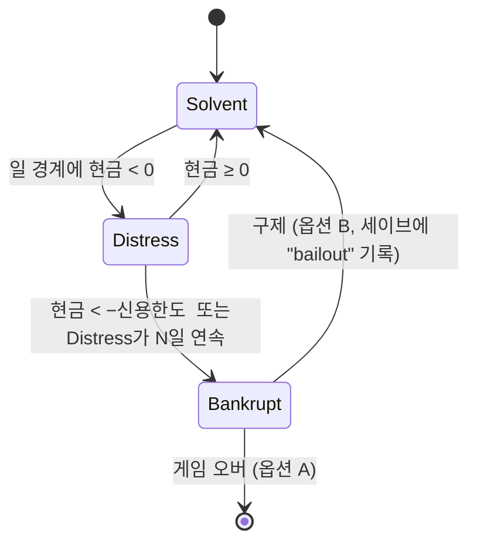

# PLANETARY GRID — V0.5 설계 결정 패키지 (Design Decision Package)

| 항목 | 내용 |
|---|---|
| 문서 성격 | **결정 제안서.** V0.5 명세가 아니다. 이 문서에 있는 어떤 규칙도 디자이너 승인 전에는 확정이 아니다. |
| 기반 문서 | `docs/PLANETARY_GRID_V0.4_Design_Spec.md` (재구성된 V0.4 작업 명세, 수정 없음) · `PLANETARY_GRID_V0.4_Design_Review.md` (V0.4 검토, 수정 없음) |
| 추적 단위 | 검토 이슈 **ISS-01–39**, 미결 결정 **OD-01–24**, 최소 변경 **MC-1–7**, 필수 감사 **#1–12**, 엣지 케이스 **E-01–23** → 본 문서의 결정 항목 **DR-01–30** |
| 구현 | 없음. 게임 코드·명세·검토 보고서를 수정하지 않았다. |
| 테스트 | §6의 수용 테스트는 **제안이며 실행되지 않았다.** §5의 경제 수치는 검토자가 스크래치 Python 스크립트로 **산술만** 계산했다(게임 테스트가 아님). |

---

## 0. 먼저 답해야 할 질문 (결정 요약)

아래 8개는 나머지 결정의 **전제 조건**이다. 이 답이 없으면 수치·테스트 기대값·구현 순서를 고정할 수 없다. 각 질문에는 검토자의 기본 제안(★)이 있지만, **답하기 전까지는 어떤 것도 채택되지 않는다.**

| # | 질문 | 선택지 (★ 제안) | 왜 먼저인가 | DR |
|---|---|---|---|---|
| Q1 | **시간 척도와 시뮬레이션 단위**를 무엇으로 할까? | ★ 1× 배속에서 실시간 1초 = 게임 1분, 고정 스텝 1 게임분, 정산 구간(DI) 15 게임분 / 다른 비율 | 모든 비용·수익·만료·램프 값의 분모 | DR-01 |
| Q2 | **MVP 시장 모델**은? | ★ **M4 가격 수용자** (M3로 확장할 경로 유지) / M3 외생 기존 공급 / M2 공급 의무 페널티 / 독점 마크업을 의도로 수용 | 가격·판매·계약·자동화·테스트 전부가 이 선택에 의존 | DR-02 |
| Q3 | **경제 속도 기준점**: 표준 발전소의 단순 회수 기간 목표는? | 7 / ★ **30** / 60 / 365 게임일 | V0.4 예시값은 회수 17–114 게임시간이라 권리·임대·수명 시스템이 무의미해짐 (§5) | DR-13 |
| Q4 | **운영비는 고정비인가**(건설 후 항상 발생), **가동 시에만 발생**하는가? 연료 가격은 어떤 기준으로 정하나? | ★ 고정비 + 연료가 유일한 변동비 / 가동 시에만 발생 | 한계비용 c를 결정. 억제 유인과 회수 기간 계산이 바뀜 (V0.4 검토 ISS-39) | DR-08 |
| Q5 | **전력망 해상도**는? | ★ 지역 = 노드(지역 내부는 손실·혼잡 없음), 지역 간 선로만 모델링 / 지역 내부까지 세밀한 그래프 | 할당 알고리즘·성능·UI 오버레이의 범위를 결정 | DR-05 |
| Q6 | **파산 결과**는? | ★ 신규 게임 옵션으로 선택: "게임 오버" 또는 "구제 후 계속(세이브에 기록)" / 항상 게임 오버 / 파산 없음 | 재무 상태 기계·샌드박스 옵션·세이브 필드가 달라짐 | DR-14 |
| Q7 | **확정 기능의 MVP 최소 형태**를 승인하나? (토지 매입, 직접 공급 계약, 범위 지정 자동 실행, 연구 — 모두 축소 형태로 **포함**) | ★ 승인 / 일부 연기(어느 것인지 지정) | 기존 확정 기능을 빼지 않기 위한 최소 형태 정의 (§8) | DR-27 |
| Q8 | 재구성된 V0.4를 **공식 기준선**으로 인정하나? | ★ 인정하고 V0.5를 그 위에 작성 / 원본 V0.4 확보 후 재검토 | 원본에 다른 규칙이 있었다면 이 패키지 전체를 다시 봐야 함 | DR-30 |

나머지 22개 결정(§2)은 위 8개가 정해진 뒤 순서대로 확정하면 된다.

---

## 1. 표기와 결정 원칙

### 1.1 상태 표기

| 표기 | 의미 | 채택 상태 |
|---|---|---|
| **[확정-V0.4]** | V0.4 명세에서 디자이너가 확정한 사항 | 유지. 이 문서는 변경하지 않음 |
| **[권고-기술]** | 설계 의도를 바꾸지 않는 기술 규칙(단위, 정렬, 원장, 저장 방식 등) | **미확정.** 이의가 없으면 V0.5 확정 후보 |
| **[승인 필요]** | 게임 경험·밸런스·범위에 영향을 주는 선택 | **미확정.** 디자이너가 답하기 전에는 채택하지 않음 |
| **[예시값]** | 계산을 보여주기 위한 숫자 | 밸런스 값이 아님 |
| **[미해결]** | 정보가 부족해 제안하지 않음 | — |

### 1.2 원칙
1. [확정-V0.4] 기능은 하나도 제거하지 않는다. 범위를 줄일 때는 **최소 형태로 포함**하는 것이 기본이다. 연기는 디자이너가 승인할 때만 한다.
2. 검토에서 [증명]된 결함(가격 함수 불연속, 0 수요, 틱 의존 평활화 등)은 **어떤 시장 모델을 고르든** 고친다.
3. 모든 규칙은 게임 시간과 정수 단위로 표기한다. 실제 전력계통의 공학적 정확성을 주장하지 않는다(게임용 단순화).
4. V0.4 검토의 일부 권고는 이 패키지에서 **철회하거나 수정했다.** 변경 내역은 §2.3에 있다.

---

## 2. 결정 레지스터

### 2.1 우선순위 정의

| 우선순위 | 의미 |
|---|---|
| **P0** | 다른 결정의 전제. 구현 착수 전에 필요 (§0의 Q1–Q8) |
| **P1** | 해당 하위 시스템 구현 착수 전에 필요 |
| **P2** | MVP 콘텐츠·밸런스 고정 전에 필요 |
| **P3** | MVP 이후 또는 문서 정리 |

### 2.2 레지스터 (중복 제거, 30개)

| DR | P | 주제 | 결정할 질문 | 제안 (★) | 상태 | 추적 (검토 ID) |
|---|---|---|---|---|---|---|
| DR-01 | P0 | 시간·단위 | 시간 변환, 고정 스텝, DI, 배속 단계, 정수 단위 | ★ 1초=1분, 스텝 1분, DI 15분, 배속 ×1/×2/×4/×8/×16, 에너지 kWh·화폐 minor CR | 승인 필요 (변환비) + 권고-기술 (정수 단위) | ISS-06, ISS-33, OD-02, 감사 #10 |
| DR-02 | P0 | 시장 모델 | 플레이어가 가격 결정자인가, 외생 공급이 있는가, ρ의 입력은 무엇인가 | ★ M4 가격 수용자, ρ_ref = 외생 기준공급 / 지역 수요, 계약은 가격에 영향 없음 | 승인 필요 | ISS-07, ISS-36, ISS-38, OD-08, OD-21, OD-23, MC-1, MC-6, 감사 #6 |
| DR-03 | P1 | 가격 함수 | 연속화 방식, 0 수요, 하한·상한의 역할 | ★ 안 A(ρ≤0.5: 1.4), D=0 ⇒ 하한가, 하한·상한은 안전 레일 + 지역별 P_base 허용 | 승인 필요 | ISS-08, OD-15, MC-2, MC-5 |
| DR-04 | P1 | 정산 가격·평활화 | 정산에 순시가를 쓸지 평활가를 쓸지, α의 정의 | ★ 순시가 정산, 평활가는 표시용, α = 1−exp(−Δt/τ) | 권고-기술 (정산 가격 선택은 승인 필요) | ISS-09, OD-03, MC-4 |
| DR-05 | P0 | 전력망 할당 | 그래프 해상도, 할당 알고리즘, 공정성, 용량 기준, 역류 | ★ 지역 노드 + 지역 간 선로, 송전단 용량, 순 흐름 단방향, 계층별 최대-최소 공정 배분 | 해상도는 승인 필요, 알고리즘은 권고-기술 | ISS-01, ISS-02, ISS-03, ISS-04, OD-07, 감사 #1–#4 |
| DR-06 | P1 | 손실 모델 | 손실률의 길이 의존성, 상한 | ★ l = min(l_max, λ·길이), 0 ≤ l < 1 클램프 | 승인 필요 (λ, l_max) | ISS-04, 감사 #4 |
| DR-07 | P1 | 저장 | MVP 포함 여부, 효율, 충방전 정책 | ★ 배터리 1종 포함, η_rt 단일 값, 잉여 충전 + 가격 임계 방전, 시장 구매 충전 없음 | 승인 필요 | ISS-14, OD-09 |
| DR-08 | P0 | 발전 매개변수 | 운영비 성격, 연료 단위·가격, 효율과의 중복, 최소 출력·기동 | ★ 운영비 고정, 연료 = 유일한 변동비, "연료 단위/MWh"를 원천으로 하고 효율은 표시용, on/off + [Pmin, Pmax] | 승인 필요 | ISS-20, ISS-21, ISS-39, OD-10, OD-24 |
| DR-09 | P1 | 수요 | 지역 수요 곡선의 형태, 성장 | ★ D_base × 24점 일주기 형태 × (1+g)^연, 난수 없음 | 승인 필요 (형태·값) | ISS-15 |
| DR-10 | P1 | 판매 귀속 | 부하 등급 ↔ 판매 경로 매핑, Critical·Flexible 등급 | ★ MVP 계층: T1 계약(PPA·직접) → T2 시장 → T3 저장 충전 → T4 출력 감소. Critical·Flexible은 예약(미사용) | 승인 필요 | ISS-05, OD-11, 감사 #5 |
| DR-11 | P1 | 계약 | PPA·직접 공급의 정의, 부족 정산, 위약금, 조기 종료 | ★ 같은 계약 엔진에 인도점만 다름. 위약금 = 부족량 × [max(P_시장 − P_계약, 0) + λ_c·P_계약], λ_c = 0.1 | 승인 필요 | ISS-19, ISS-36, OD-23, 감사 #5 |
| DR-12 | P1 | 청산·판매 한도 | 시장이 얼마를 사는가, 배분 순서 | ★ 지역 판매(시장+PPA) ≤ σ·D_R(t), σ = 1.0. 초과분은 출력 감소. 비례 배분 금지 | 승인 필요 (σ) | ISS-37, OD-22, MC-3 |
| DR-13 | P0 | 경제 기준점 | 회수 기간 목표, 수명/회수 비율, 권리 비용 비중, 시작 자본 | ★ 회수 30 게임일, 수명 = 회수의 10–15배, 연간 권리비 = 발전 순현금의 5–15%, 시작 자본 = 첫 패키지의 1.5배 | 승인 필요 | ISS-12, OD-16 |
| DR-14 | P0 | 재무·파산 | 음수 현금, 신용 한도, 이자, 파산 결과 | ★ Solvent → Distress → Bankrupt 상태, 결과는 신규 게임 옵션 | 승인 필요 | ISS-16, OD-17, E-16, E-23 |
| DR-15 | P1 | 권리 수명주기 | 사업권·임대 상태, 기간, 유예, 만료 효과, 알림 | ★ Active → Grace(30일: 운영 가능, 신규 건설 불가) → Expired(시설 Offline, 삭제하지 않음), 알림 90/30/7일 | 승인 필요 (기간·유예) | ISS-11, ISS-33, E-07, 감사 #8 |
| DR-16 | P1 | 사업권 범위·가격 | 권리 4종의 적용, 가격 계수 범위, 한도 방식 | ★ 4종 모두 사용(GEN/TRN/STO/RET), 계수 ∈ [0.75, 1.5], 최종 클램프, MW 한도 단일 | 승인 필요 | ISS-22, ISS-23, OD-12, OD-20, E-04, E-05 |
| DR-17 | P1 | 다중 회사 대비 | 소유 키, 배타성, 희소성 정의 | ★ 모든 소유 엔티티에 CompanyId, 권리 키 (Region, Type, Company), 비배타적·지역 MW 한도, 희소성 = 지역 전체 발급 MW / 한도 | 키는 권고-기술, 배타성은 승인 필요 | ISS-17, OD-18, 감사 #12 |
| DR-18 | P2 | 토지 임대·매입 | 임대료, 갱신 인상률, 매입가, 재판매 | ★ 매입가 = k년치 임대료(k = 1), 재판매 80%, 갱신 시 임대료 +10% | 승인 필요 | ISS-18, OD-04 |
| DR-19 | P1 | 건설 수명주기 | 상태, 비용 시점, 취소 환불, 권리 상실 | ★ Ordered(예약) → UnderConstruction(청구) → Operational. 착공 전 취소 100% 환불, 착공 후 50% | 승인 필요 (환불률) | ISS-11, OD-13, E-17 |
| DR-20 | P1 | 운영 모드 | AUTO/MANUAL/HYBRID의 의미, 수동 보호의 대상 | ★ 두 축 분리: 자산별 운전 모드 × 정책별 자동화 권한. 보호 = 자산 잠금 + setpoint 고정 | 권고-기술 | ISS-24, ISS-25 |
| DR-21 | P1 | 자동화 안전 | 멱등성, 예산 예약, 루프 방지, 재시도 | ★ 명령 버스, 멱등 키, 예산 예약, 히스테리시스, 재시도 상한 | 권고-기술 | ISS-10, E-19, 감사 #7 |
| DR-22 | P2 | 미세관리·UX | 권리 자동 갱신, 알림, MVP 화면 | ★ 옵트인 자동 갱신(범위 지정 자동 실행의 한 종류), MVP 화면 4종 | 승인 필요 | ISS-34, OD-14 |
| DR-23 | P1 | 저장·불러오기 | 저장 시점, 내용, 버전, 무결성 | ★ 스텝 경계에서만 저장, 정규 상태만 저장, schemaVersion, 상태 해시, 원자적 쓰기 | 권고-기술 | ISS-13, E-20, 감사 #9 |
| DR-24 | P1 | 수치·원장 | 반올림, 비례 잔여, 원장 구조, 정산 주기 | ★ 정수 단위, 거래당 반올림 1회, 최대 잔여법, 복식 원장, DI 정산 | 권고-기술 | ISS-26, ISS-32 |
| DR-25 | P2 | 배치 | 좌표와 지역의 관계, 경계 처리, 지형 | ★ 좌표가 유일한 원천, 셀 → 지역 조회, 건설 가능 마스크 | 권고-기술 | ISS-30, E-22 |
| DR-26 | P2 | 연구 | MVP 트리 크기, 효과 유형, 소급 적용 | ★ 6개 노드, 곱셈형 매개변수 수정자 + 불변식 클램프, 신규 건설에만 적용 | 승인 필요 | ISS-27, OD-06, E-18 |
| DR-27 | P0 | MVP 범위 | 확정 기능의 최소 형태, 연기 후보 | ★ 확정 기능 모두 최소 형태로 포함 (§8) | 승인 필요 | ISS-28, OD-05 |
| DR-28 | P2 | 아키텍처·엔진 | 엔진·버전, 하드웨어, 모듈 순서 | ★ 엔진 독립 SimCore를 먼저, 엔진(UE5 [제안]) 확정은 별도 | 엔진은 승인 필요, 순서는 권고-기술 | ISS-29, OD-19 |
| DR-29 | P2 | 샌드박스 | 옵션 목록, 변경 시점, 세이브 기록 | ★ 신규 게임 시에만 설정, 설정 스냅샷 + 해시 | 승인 필요 (옵션 목록) | ISS-31, E-21, 감사 #11 |
| DR-30 | P0 | 문서 기준선 | 재구성 V0.4를 기준으로 인정, 문서 정리 | ★ 인정 + 오타 정정 | 승인 필요 | OD-01, ISS-35 |

### 2.3 추적 매트릭스 (누락 없음 확인)

**검토 이슈 → DR**

| ISS | DR | ISS | DR | ISS | DR | ISS | DR |
|---|---|---|---|---|---|---|---|
| 01 | 05 | 11 | 15, 19 | 21 | 08 | 31 | 29 |
| 02 | 05 | 12 | 13 | 22 | 16 | 32 | 24 |
| 03 | 05 | 13 | 23 | 23 | 16 | 33 | 01, 15 |
| 04 | 05, 06 | 14 | 07 | 24 | 20 | 34 | 22 |
| 05 | 10 | 15 | 09 | 25 | 20 | 35 | 30 |
| 06 | 01 | 16 | 14 | 26 | 24 | 36 | 02, 11 |
| 07 | 02 | 17 | 17 | 27 | 26 | 37 | 12 |
| 08 | 03 | 18 | 18 | 28 | 27 | 38 | 02 |
| 09 | 04 | 19 | 11 | 29 | 28 | 39 | 08 |
| 10 | 21 | 20 | 08 | 30 | 25 | | |

**미결 결정 → DR**

| OD | DR | OD | DR | OD | DR | OD | DR |
|---|---|---|---|---|---|---|---|
| 01 | 30 | 07 | 05 | 13 | 19 | 19 | 28 |
| 02 | 01 | 08 | 02 | 14 | 22 | 20 | 16 |
| 03 | 04 | 09 | 07 | 15 | 03 | 21 | 02 |
| 04 | 18 | 10 | 08 | 16 | 13 | 22 | 12 |
| 05 | 27 | 11 | 10 | 17 | 14 | 23 | 02, 11 |
| 06 | 26 | 12 | 16 | 18 | 17 | 24 | 08 |

**최소 변경 → DR**: MC-1 → DR-02 · MC-2 → DR-03 · MC-3 → DR-12 · MC-4 → DR-04 · MC-5 → DR-03 · MC-6 → DR-02 · MC-7 → §6 AT-MKT

**V0.4 검토 권고 중 이 패키지에서 바뀐 것**

| 검토 권고 | 이 패키지 | 이유 |
|---|---|---|
| §7: 토지 매입·직접 공급 계약·범위 자동 실행을 MVP에서 연기 | **최소 형태로 포함** (§8) | 이번 요청에서 확정 기능을 승인 없이 제거하지 말라는 지시. 연기는 승인 시에만 |
| OD-08: 시장 모델 우열을 정하지 않음 | **M4를 MVP 권고안으로 제시** (§3) | 이번 요청이 권고를 요구함. 최종 결정은 여전히 디자이너 |
| OD-11: Critical 부하를 시장 부하의 하위 속성으로 | Critical·Flexible을 **예약 등급**(MVP에서 미사용)으로 | M4에서는 지역 수요가 가격 기준일 뿐 플레이어가 공급하는 물리적 부하가 아니므로 등급을 붙일 대상이 없음 |
| DR-12 판매 한도에 계약 포함 여부 미정 | PPA는 한도에 **포함**, 직접 공급은 **별도 추가 부하** | 이중 계산 방지(ISS-05)와 단순성 |

---

## 3. 시장 모델 비교와 MVP 권고 (DR-02)

### 3.1 비교 대상

| 모델 | 정의 |
|---|---|
| **M2** 공급 의무 페널티 | 플레이어 공급으로 ρ를 계산(가격 결정자). 공급하지 못한 수요 1 MWh마다 u를 부과 |
| **M3** 외생 기존 공급 | ρ = (플레이어 공급 + 외생 공급곡선 I(P)) / D. 판매는 메리트 오더(비용 순). AI가 아닌 정적 곡선 |
| **M4** 가격 수용자 | ρ_ref = 외생 기준공급 S_ref,R(t) / D_R(t). 플레이어 행동은 가격에 영향을 주지 않음. 판매량 ≤ 지역 판매 한도 |
| **LD-1** 의도적 독점 마크업 | 플레이어 공급으로 ρ를 계산하고 연속 함수 하의 쿠르노형 억제를 게임 요소로 받아들임. 페널티 없음 |

모든 모델에서 MC-1–MC-5(연속 함수, 0 수요 규칙, min(S,D), 순시가 정산, 대칭 회계)를 함께 적용한다고 가정한다.

### 3.2 초반 진행 문제 (이번 패키지에서 새로 확인)

**가정 [예시값]**: 지역 수요 D = 500 MW, 플레이어 첫 발전소 20 MW, 한계비용 c = 40 CR/MWh, p = 100.

| 모델 | 첫 발전소 시점의 ρ | 가격 | 문제 |
|---|---:|---:|---|
| LD-1 / M2 (가격 결정자, 외생 공급 없음) | 20/500 = 0.04 | 140 (안 A 상한 구간) | 나머지 480 MW를 **누가 공급하는지 정의되지 않음**. 플레이어 확장이 곧 자기 가격 인하 |
| M2 (지역 전체 공급 의무, u = c − 0.2p = 20) | 0.04 | 140 | 미공급 480 MWh/h × 20 = **9,600 CR/게임시간 페널티**. V0.4 예시 발전소 순현금(220–1,500 CR/h, §5)으로는 즉시 파산 |
| M3 (외생 공급 I ≈ 0.9D 가정) | (20+450)/500 = 0.94 | ≈ 105 | 정상. 외생 공급의 감소(퇴출) 규칙이 필요 |
| M4 | ρ_ref(t) (예: 0.77–1.43) | 87–118 | 정상. 플레이어는 가격을 바꾸지 못함 |

> **결론 [증명 — 산술]**: 외생 공급이 없는 가격 결정자 모델(M2, LD-1)은 "지역에 이미 존재하는 수요를 누가 공급하는가"에 답하지 못한다. M2를 지역 전체 수요에 적용하면 초반 파산이 생긴다. 따라서 M2의 공급 의무는 **플레이어가 약속한 물량(계약)** 으로 범위를 좁혀야 하는데, 그렇게 하면 M2는 시장 모델이 아니라 이미 DR-11의 계약 위약금 규칙이 된다.

### 3.3 비교표

| 기준 | M2 | M3 | M4 | LD-1 |
|---|---|---|---|---|
| [확정] 수요 기반 가격 + 하한·상한 | 충족 | 충족 | 충족 (ρ_ref가 수요 곡선을 따름) | 충족 |
| [확정] AI 경쟁사 제외 | 충족 | 충족 (행동 없는 정적 곡선으로 한정할 때만) | 충족 | 충족 |
| 새 개념 | 공급 의무 | 외생 공급자와 퇴출 규칙 | 외생 기준공급 (가격 기준선으로만) | 없음 |
| 공급 억제 (EX-1) | 제거 (u ≥ c_max − 0.2p_min) | 점유율이 높고 c가 클 때 부분적으로 남음 | **제거** | 남음 (의도) |
| 주기 진동 (EX-2) | 순시가 정산이면 제거 | 순시가 정산이면 제거 | **구조적으로 없음** | 순시가 정산이면 제거 |
| 의도적 혼잡 (EX-4)·투자 억제 (EX-5) | 남음 (u로 완화) | 부분적으로 남음 | **없음** | 남음 |
| 초반 진행 (§3.2) | ✗ (범위 축소가 필요) | ○ | ○ | ✗ |
| 전략 깊이 | 중 | **높음** (점유율 ↔ 가격 영향) | 중 (시간대·지역 가격 차이, 저장, 계약) | 중 (가격 조작) |
| 설명 가능성 | 중 ("미공급 벌금") | 중 (공급곡선 설명 필요) | **높음** ("이 시각 지역 가격은 X") | 낮음 (억제가 최선인 이유를 설명하기 어려움) |
| 구현 복잡도 | 낮음 | 중 (고정점 반복, 퇴출 규칙, 결정론 주의) | **가장 낮음** | 낮음 |
| 추가 데이터 | 기술별 c_max | 지역별 공급곡선·탄력성·퇴출률 | 지역별 S_ref(t) | 없음 |
| 미래 다중 회사 확장 | 재설계 필요 | 자연스러움 (회사 공급을 곡선에 추가) | 자연스러움 (ρ에 회사 공급 항을 추가하면 M3/M5가 됨) | 재설계 필요 |
| 테스트 난이도 | 중 | 높음 | **낮음** | 중 |

### 3.4 MVP 권고: **M4 가격 수용자 + M3 확장 경로** [승인 필요]

**규칙 요지**
```
ρ_ref,R(t) = S_ref,R(t) / D_R(t)                 # 플레이어 공급은 포함하지 않음 (MVP: w = 0)
P_R(t)     = clamp(P_base,R · f_A(ρ_ref,R(t)), P_floor, P_cap)
판매 한도   Q_market,R(t) + Q_PPA,R(t) ≤ σ · D_R(t)      (σ = 1.0 제안)
```
확장 경로: `ρ_R = (S_ref,R + w · Σ_회사 S_c,R) / D_R` 로 정의하고 MVP에서는 w = 0으로 둔다. 이후 w > 0 + 외생 퇴출 규칙을 넣으면 M3가 되므로 데이터 구조를 바꿀 필요가 없다.

**권고 이유**
1. 검토에서 [증명]·[조건부]로 확인된 시장 악용(EX-1–EX-6)이 **모두 구조적으로 사라진다.** 플레이어 행동이 가격에 들어가지 않기 때문이다.
2. 초반 진행 문제(§3.2)가 없다. 지역 수요의 나머지는 서사적으로 "기존 전력망"이 공급한다.
3. 결정론·저장·테스트가 가장 쉽다. 가격은 시각과 지역의 순수 함수다.
4. [확정] 수요 기반 가격, 하한·상한, 하이브리드 판매를 모두 유지한다.

**포기하는 것 (트레이드오프)**
- 플레이어가 지역 가격을 움직이는 경험이 없다. 큰 회사가 되어도 가격 영향력이 없는 것은 현실감이 떨어진다.
- 확장의 제동 장치가 가격 하락이 아니라 **판매 한도 σ** 다. 지역이 포화되면 다른 지역으로 확장해야 한다(핵심 루프 8단계 "추가 지역으로 확장"과 일치).
- 하한·상한은 p = 100에서 여전히 작동하지 않는다(안전 레일). 상한이 작동하길 원하면 지역별 P_base나 사건 시스템이 필요하다.

**디자이너가 다른 선택을 할 때의 조건**
- "플레이어의 가격 영향력"이 핵심 재미라면 → **M3**. 단, 외생 공급곡선 데이터와 퇴출 규칙, 고점유율·고비용 구간의 잔여 억제 허용치를 함께 정해야 한다.
- "독점 공기업 경영" 판타지라면 → **LD-1 + 계약 범위의 공급 의무(M2 축소형)**. 단, §3.2의 초반 문제를 해결하는 외생 공급 서사가 필요하다.

---

## 4. MVP 규칙 세트 (제안)

> 이 절의 모든 값은 [예시값]이거나 [승인 필요]다. 구조 규칙은 [권고-기술]이다. 시장 관련 규칙은 **DR-02 = M4**를 전제로 쓰였으며, 다른 모델을 고르면 §4.3을 다시 써야 한다.

### 4.1 시뮬레이션 시간과 단위 (DR-01, DR-24)

| 항목 | 제안 | 상태 |
|---|---|---|
| 시간 변환 | 1× 배속: 실시간 1초 = 게임 1분 | 승인 필요 (V0.4 [제안] 유지) |
| 시뮬레이션 스텝 Δt | 1 게임분 (고정, 배속과 무관) | 권고-기술 |
| 정산 구간 DI | 15 게임분 = 15 스텝. MW → kWh 변환: `E_kWh = P_MW × 250` | 승인 필요 (길이) |
| 일 경계 | 1,440 스텝마다. 임대료·사업권 수수료·만료 검사·알림 | 권고-기술 |
| 배속 | 일시정지, ×1, ×2, ×4, ×8, ×16 = 실시간 초당 0/1/2/4/8/16 스텝 | 승인 필요 (단계) |
| 에너지 | 정수 kWh | 권고-기술 |
| 출력 | 정수 kW | 권고-기술 |
| 화폐 | 정수 minor unit (1 CR = 100) | 권고-기술 (V0.4 [제안]) |
| 가격 | 정수 minor CR/MWh | 권고-기술 |
| 비율 (손실, 효율, 계수) | 정수 ppm (10⁻⁶) | 권고-기술 |
| 모든 비용·속도 표기 | **게임 시간 기준** (CR/게임시간, MW/게임시간, 게임일) | 권고-기술 |
| 건설 시간 120초 [V0.4 예시] | **120 게임분 = 2 게임시간**으로 해석 (1×에서 실시간 120초와 같음) | 승인 필요 |

**스텝 순서** [권고-기술]
```text
매 스텝 t:
  1. 명령 큐 비우기 (발행 seq 순) → 공통 검증 → 적용 또는 거부 (거부 코드 기록)
  2. 만기 이벤트 처리 (정렬 키: 시각, 유형 우선순위, 엔티티 ID)
  3. 건설·연구 진척 +1 스텝
  4. t % 15 == 0 이면 DI 처리:
       a 가용성(권리·상태·램프)  b 수요 D_R  c 가격 P_R  d 할당(§4.2)
       e 저장 SOC 갱신  f 정산 → 원장  g 운영비 DI분 계상
  5. t % 1440 == 0 이면 일 처리: 수수료·임대료, 만료 상태 전이, 알림, 파산 검사
  6. 자동화 평가 → 명령 큐 (다음 스텝에 적용)
  7. (디버그·테스트) 상태 해시
```

### 4.2 전력 흐름·할당·선로·손실·저장 (DR-05, 06, 07, 08, 10)

**그래프** [해상도는 승인 필요]
- 노드 = 지역 (지역 내부는 손실·혼잡 없음). 시설은 소속 지역 노드에 연결된다.
- 엣지 = 플레이어가 지은 지역 간 선로. 속성: `Cap_MW`(송전단 입력 기준), `l`(ppm), 상태.
- 한 DI에서 엣지마다 **순 흐름 한 방향만** 허용한다. DI당 용량은 `Cap_kWh = Cap_MW × 250`.

**손실** [권고-기술 + 매개변수 승인 필요]
```
l_e = min(l_max, λ · length_km),  0 ≤ l_e < 1   (예시값: λ = 50 ppm/km, l_max = 200,000 ppm = 20%)
보낸 양 send(정수 kWh) → 도착 delivered = floor(send × (1,000,000 − l_ppm) / 1,000,000)
손실 = send − delivered  (원장 LOSS 계정)
도착량 X를 보내려면 send = ceil(X × 1,000,000 / (1,000,000 − l_ppm))
```

**발전기** [승인 필요: DR-08]
- 상태: Offline / Starting(1 DI) / Online. Online이면 출력 ∈ [P_min, P_max], DI 간 변화 ≤ 램프 × 0.25h.
- 변동비 `c_var = 연료 가격 × 연료 사용률` (운영비가 고정비일 때). 운영비는 Online·Offline과 무관하게 매 DI 계상.
- 효율 0.35는 표시용으로만 쓴다. 연료 단위/MWh가 유일한 원천이다.

**할당 계층** [승인 필요: DR-10]

| 계층 | 대상 | 규칙 |
|---|---|---|
| T1 | 계약 인도 (PPA 인도점 = 지역 노드, 직접 공급 인도점 = 고객 노드) | 계층 내 **최대-최소 공정**: 이행률(인도/의무)을 같은 속도로 올린다 |
| T2 | 지역 시장 판매 | 남은 판매 한도 내에서, 경로 순가치 `P_R × g_path − c_var` 가 큰 순서로. 0 이하이면 판매하지 않음 |
| T3 | 저장 충전 | 남은 의무 최소 출력(잉여)만 충전 |
| T4 | 출력 감소 | 최소 출력 때문에 남는 에너지만 출력 제한(Curtail, 연료는 이미 사용) |
| (예약) | Critical, Flexible | MVP 미사용. 데이터 필드만 있음 |

**할당 알고리즘** [권고-기술]
```text
Allocate(DI):
  residual_gen[g]  = 해당 DI 가용 출력(kWh, 램프·최소 출력 반영)
  residual_edge[e] = Cap_kWh(e)
  for tier in [T1, T2]:
     sinks = tier의 인도점들 (요청량 req_i, 정렬 키 = 엔티티 ID)
     repeat until 진전 없음:
        for i in sinks (ID 순):                          # 한 라운드
           path = 최대 이득 경로(Dijkstra, 가중치 −log g, residual > 0인 엣지만)
           δ = min(q × req_i, 남은 요청, 경로 병목을 도착 기준으로 환산)   # q = 1%
           send를 정수로 계산하고 residual 차감, delivered 기록
        T1: 모든 sink가 같은 이행률 단계를 밟도록 라운드를 진행 (최대-최소 공정, 허용 오차 q)
        T2: sink를 순가치 순서로 정렬하고 한 sink를 채운 뒤 다음 sink로 (탐욕적, 결정적)
  잉여 = Σ residual_gen 중 최소 출력 의무분 → T3 저장 → T4 Curtail
  나머지 → 발전기 출력 감소 (연료 미사용)
```
- 이 알고리즘은 최적 해를 보장하지 않는다(탐욕적). 대신 **결정적이고, 용량을 넘지 않으며, 에너지를 보존한다.** 12개 지역에서는 라운드 수가 작다(공정성 허용 오차 q = 1%).
- 경로 추천(§4.6)과 UI 미리보기는 이 결과를 **읽기만** 한다.

**저장** [승인 필요: DR-07]
```
η_c = η_d = √η_rt   (예시값: η_rt = 810,000 ppm → η_c = η_d = 900,000 ppm)
충전: 입력 C kWh → SOC += floor(C × η_c)
방전: SOC에서 X 인출 → 도착 delivered = floor(X × η_d)
0 ≤ SOC ≤ E_max,   한 DI에는 충전 또는 방전 중 하나만
방전 조건: T1 부족이 있거나, 해당 지역 P_R ≥ θ_d (플레이어/자동화 설정)
시장에서 전력을 사서 충전하지 않음 (MVP)
```

### 4.3 수요·시장 가격·판매 한도·계약 (DR-02, 03, 04, 09, 11, 12)

**수요** [승인 필요: DR-09]
```
D_R(t) = D_base,R × shape_R[hour(t)] × (1 + g_R)^(게임연(t))   # shape는 24점 테이블, 평균 1.0
```
[예시값] shape: 03시 = 0.70, 18시 = 1.30.

**가격** (M4, 안 A) [승인 필요]
```
f_A(ρ) = 1.4               (ρ ≤ 0.5)
       = 1 + 0.8(1 − ρ)     (0.5 < ρ < 1)
       = 1 − 0.3(ρ − 1)     (1 ≤ ρ < 2)
       = 0.7                (ρ ≥ 2)
D_R(t) = 0  ⇒  P_R = P_floor
P_R(t) = clamp(round(P_base,R × f_A(ρ_ref)), P_floor, P_cap)    # 정산은 이 순시가
표시용 평활가: P̄_t = P̄_{t−1} + α(P_t − P̄_{t−1}),  α = 1 − exp(−Δt_DI / τ),  τ = 1 게임시간 [예시값]
```
[예시값] S_ref,R = D_base,R. 18시: ρ = 1/1.3 = 0.7692 → f = 1.18462 → **118.46 CR/MWh (11,846 minor)**. 03시: ρ = 1/0.7 = 1.4286 → f = 0.87143 → **87.14 CR/MWh (8,714 minor)**.

**판매 한도** [승인 필요: DR-12]
- `Q_market,R + Q_PPA,R ≤ σ × D_R(t)`, σ = 1.0.
- 직접 공급 고객의 부하는 D_R과 **별도인 추가 부하**로 둔다(이중 계산 방지).
- 시장은 한도까지는 P_R로 무제한 구매하고, 한도를 넘으면 한 단위도 사지 않는다.

**계약** [승인 필요: DR-11]

| 항목 | PPA | 직접 공급 |
|---|---|---|
| 인도점 | 지역 R 노드 | 고객 노드 (지역 R 안, 플레이어 선로로 연결) |
| 물량 | 고정 MW (24점 형태 허용) | 고객 부하 곡선 |
| 가격 | 고정 CR/MWh | 고정 요금 CR/MWh |
| 필요 권리 | GEN (지역 R) | GEN + **RET** (지역 R) |
| 판매 한도 | 포함 | 별도 부하 |
| 기간 | 게임일 단위, DI 경계에 정렬 (시작은 올림, 종료는 내림) | 같음 |
| 제안 | 지역별 주간 제안 목록 (시드 RNG, 결정적) | 같음 |
| 조기 종료 | MVP 없음 (승인 필요) | 같음 |

위약금 (DI마다):
```
shortfall = 의무 − 인도 (kWh, ≥ 0)
penalty   = shortfall/1000 × [ max(P_R − P_contract, 0) + λ_c × P_contract ],  λ_c = 0.1
```
- 불변식: MWh당 위약금 ≥ P_R − P_contract. 따라서 계약분을 시장으로 돌리는 것은 절대 이득이 아니다(λ_c > 0이면 엄격히 손해).

### 4.4 재무·파산·사업권·임대 (DR-13, 14, 15, 16, 17, 18, 24)

**원장** [권고-기술]
- 복식 원장. 모든 거래는 차변 합 = 대변 합. 계정: CASH, REV_MARKET, REV_PPA, REV_DIRECT, FUEL, OPEX, LICENSE_FEE, LEASE, CAPEX(자산), LAND(자산), PENALTY, INTEREST, RESEARCH, REFUND, LOSS_ENERGY(에너지 통계용, 화폐 아님).
- 거래 ID = (DI 또는 일 번호, 계정 쌍, 엔티티 ID, seq). 재처리할 때 같은 ID가 있으면 기록하지 않는다(멱등).
- 화폐 = 에너지 × 가격은 `round_half_even(kWh × price_minor / 1000)` 으로 거래당 한 번만 반올림한다.

**파산** [승인 필요: DR-14]

- Distress 중에는 재량 지출(건설, 토지 매입, 신규 사업권, 연구)을 거부한다. 의무 비용(운영비, 연료, 수수료, 임대료, 위약금)은 계속 계상한다.
- 음수 현금 이자: 일 r_od [예시값 0.1%/게임일]. 신용 한도 [예시값: 시작 자본의 50%]. N [예시값: 14 게임일].
- 같은 일 경계에서 비용 계상 순서: 운영비 → 연료 → 위약금 → 임대료 → 사업권 수수료 → 이자.

**사업권** [승인 필요: DR-15, 16, 17]

| 항목 | 제안 |
|---|---|
| 유형 | GEN(발전), TRN(송전: 선로가 닿는 양쪽 지역 모두 필요), STO(저장), RET(소매: 직접 공급 계약에 필요) |
| 키 | (RegionId, Type, CompanyId) |
| 배타성 | 비배타적. 지역·유형별 MW 한도 안에서 발급 |
| 한도 | GEN·STO: 회사별 정격 MW 한도. TRN·RET: 한도 없음 |
| 취득 가격 | `C = clamp(C_base,Type × M_d × M_r × M_a × M_s, C_min, C_max)`, 각 M ∈ [0.75, 1.5] |
| 희소성 | `M_s = 1 + κ × (지역 전체 발급 MW / 지역 한도 MW)`, κ = 0.5 [예시값], 회사와 무관 |
| 기간 | 365 게임일. 수수료는 게임일마다 |
| 상태 | Active → Grace(30일) → Expired. 갱신하면 Active로 복귀. 미납이면 Suspended |
| 만료 효과 | Grace: 기존 시설 운영 가능, 신규 건설 불가. Expired: 관련 시설이 Offline(RightsLost)이 되며 삭제하지 않음. 계약 부족분은 정상 정산 |
| 알림 | 만료 90/30/7 게임일 전 |

**토지** [승인 필요: DR-15, 18]
- 필지 단위로 임대한다. 임대료는 게임일마다. 기간 365 게임일. 갱신하면 임대료 +10%. 상태와 효과는 사업권과 같다.
- 매입 (확정 기능, 최소 형태): 매입가 = k × 연간 임대료(k = 1.0 [예시값]). 소유하면 임대료가 없고 만료도 없다. 재판매는 매입가의 80%. 세금은 MVP에서 없음.
- 시설 가동 조건 = `사업권 ∈ {Active, Grace} AND 토지 ∈ {Active, Grace, Owned}`.

### 4.5 건설 (DR-19)

| 상태 | 진입 조건 | 비용 |
|---|---|---|
| Ordered | 명령 검증 통과 (권리 Active, 좌표 유효, 가용 예산 ≥ 건설비) | 건설비 **예약** |
| UnderConstruction | 다음 스텝에 착공 | 예약을 **청구**로 전환 |
| Halted | 권리 상실 | 진척 보존 |
| Operational | 완공 이벤트 (예시값 2 게임시간) | — |
| Offline(reason) | 수동, RightsLost, EndOfLife, Bankrupt (비트셋) | 운영비는 계속 (고정비 선택 시) |
| Decommissioned | 철거 명령 | 잔존가치 없음 (MVP) |

취소: Ordered 상태면 100% 환불(예약 해제), UnderConstruction 상태면 50% 환불 [승인 필요].

### 4.6 자동화 (DR-20, 21, 22)

**두 축** [권고-기술]
- 자산별 운전 모드: `AUTO_DISPATCH`(할당 알고리즘이 출력을 결정) / `MANUAL_SETPOINT`(플레이어가 고정, 물리 제약으로만 클램프).
- 정책별 권한: `RECOMMEND_ONLY`(기본) / `EXECUTE_SCOPED`. V0.4의 HYBRID는 이 두 축의 조합이다.
- 수동 보호 = 자산 잠금(자동화가 변경·철거 불가) + MANUAL_SETPOINT.

**명령 버스** [권고-기술]
- UI와 자동화는 같은 명령 타입과 같은 검증 함수를 쓴다.
- 멱등 키 = hash(policyId, intent, target, DI 창). 같은 키의 명령이 미완료 상태면 거부한다(`DUPLICATE`).
- 예산: `가용 = 현금 − Σ예약 − 의무 버퍼(다음 1게임일 의무 비용)`. 정책별 상한, 일일 행동 수 상한, 총예산 상한을 둔다.
- 같은 스텝의 명령은 seq 순서로 처리하고, 각 명령은 앞 명령의 예약을 반영한 상태에서 검증한다.
- 운전 토글: 임계값 이중화(θ_on > θ_off) + 최소 유지 4 DI.
- 재시도: 같은 거부 코드로 3회 실패하면 정책을 일시정지하고 알림 1건.

**MVP 자동 실행 범위** (확정 기능의 최소 형태) [승인 필요]

| 명령 유형 | MVP 자동 실행 | 이유 |
|---|---|---|
| 사업권·임대 갱신 | 포함 | 미세관리 부담 최대 항목 (DR-22) |
| 발전기 Online/Offline, 저장 임계값 | 포함 | 되돌릴 수 있음 |
| 계약 제안 수락 | 승인 필요 | 장기 의무 발생 |
| 건설 (추천 템플릿) | 승인 필요 | 큰 지출, 되돌리기 어려움 |

**추천의 설명** [권고-기술]: 모든 추천에 근거 지표, 예상 비용(CR), 예상 효과(MW, CR/게임일), 위험, 정책 ID를 붙인다. 자동 실행 기록은 원장 거래 ID와 연결한다.

### 4.7 저장·불러오기·결정론 (DR-23, 24)

| 규칙 | 내용 |
|---|---|
| 저장 시점 | 스텝 경계에서만. DI 처리 중 요청이 오면 다음 경계까지 미룬다 |
| 저장 내용 | 엔티티 테이블, 이벤트 큐(seq 포함), 명령 큐 + 멱등 키, 예산 예약, 원장(전체 또는 체크포인트 + 이후 거래), 발전기 직전 출력·상태, SOC, 표시용 평활가, 건설·연구 진척, RNG 상태, 샌드박스 설정 스냅샷, schemaVersion, buildVersion, 상태 해시 |
| 저장하지 않음 | 경로 캐시, 추천 목록, UI 상태 (불러오기 후 재계산) |
| 포맷 | 엔진 독립 형식 + 버전 태그. 원자적 쓰기(임시 파일 → 이름 변경), 직전 세이브 1개 백업 |
| 마이그레이션 | 버전별 변환 함수 체인. 미래 버전은 읽기를 거부하고 메시지를 표시 |
| 결정론 | 단일 스레드 SimCore, 정수 연산, 정렬 키 고정, RNG는 하위 시스템별 스트림. 같은 빌드에서 같은 명령 로그 ⇒ 같은 해시 (플랫폼 간 재현성은 요구하지 않음) |
| 배속 | 배속은 실시간 초당 스텝 수만 바꾼다. Δt는 절대 바꾸지 않는다 |

### 4.8 연구·샌드박스·배치·회사 (DR-17, 25, 26, 29)

- **연구** [승인 필요]: 6개 노드. 효과는 곱셈형 매개변수 수정자다(예: 선로 손실 ×0.9, 저장 η_rt ×1.05, 건설비 ×0.95, 건설 시간 ×0.9, 램프 ×1.2, 사업권 가격 ×0.95). 효과 적용 후 불변식 클램프(0 ≤ l < 1, η ≤ 1)를 건다. 신규 건설에만 적용한다.
- **샌드박스** [승인 필요]: 신규 게임 시에만 설정한다. 시작 자본 배율, 비용 배율, 수요 배율, 파산 결과(게임 오버/구제). 세이브에 설정 스냅샷과 해시를 저장한다. 게임 중 변경은 MVP에서 없음.
- **배치** [권고-기술]: 좌표 → 셀 → 지역. 셀마다 건설 가능 마스크가 있다. "지역 선택 건설"은 해당 지역에서 비용이 가장 낮은 유효 셀을 결정적으로 고르는 UI 단축이다.
- **회사** [권고-기술]: MVP는 1개 회사지만 모든 소유 엔티티와 원장에 CompanyId를 둔다.

---

## 5. 예시 발전소 경제성 재계산 (DR-08, DR-13)

### 5.1 명시적 가정

| 항목 | 값 | 출처 |
|---|---|---|
| 정격 | 20 MW | V0.4 [예시] |
| 건설비 | 25,000 CR (일시불) | V0.4 [예시] |
| 운영비 | 500 CR/**게임시간**, **고정비** (가동과 무관) | 단위 해석과 성격은 가정 (Q1, Q4) |
| 연료 | 1.0 단위/MWh, 연료 가격 F CR/단위 → 변동비 F CR/MWh | 연료 가격은 V0.4에 없음 → F ∈ {0, 20, 40, 60} 가정 |
| 판매 가격 | 평균 100 CR/MWh (M4, P_base) | 가정 |
| 이용률 CF | 1.0 / 0.6 / 0.25 (최소 출력) | 가정 |
| 수명 | 50,000 게임시간 | V0.4 [예시] |
| 권리·토지·선로 비용 | 표 5.2에서는 제외, 표 5.4에서 따로 다룸 | — |
| 시간 변환 | 1×: 1 게임시간 = 실시간 1분, 1 게임일 = 24분, 1 게임년 = 146시간 | V0.4 [제안] |

계산식:
```
순현금/게임시간 = 20 × CF × (100 − F) − 500
단순 회수(게임시간) = 25,000 / 순현금
1× 실시간 회수(분) = 단순 회수(게임시간)
수명 순현금 = 순현금 × 50,000
```

### 5.2 V0.4 예시값 그대로의 결과

| F | CF | 매출/h | 연료/h | 순현금/h | 회수 (게임시간 = 1× 실시간 분) | 수명 순현금 / 건설비 |
|---:|---:|---:|---:|---:|---:|---:|
| 0 | 1.0 | 2,000 | 0 | 1,500 | **16.7** | 3,000× |
| 0 | 0.6 | 1,200 | 0 | 700 | 35.7 | 1,400× |
| 0 | 0.25 | 500 | 0 | 0 | 회수 불가 | 0 |
| 20 | 1.0 | 2,000 | 400 | 1,100 | 22.7 | 2,200× |
| 20 | 0.6 | 1,200 | 240 | 460 | 54.3 | 920× |
| 40 | 1.0 | 2,000 | 800 | 700 | 35.7 | 1,400× |
| 40 | 0.6 | 1,200 | 480 | 220 | **113.6** | 440× |
| 40 | 0.25 | 500 | 200 | −200 | 손실 | — |
| 60 | 1.0 | 2,000 | 1,200 | 300 | 83.3 | 600× |
| 60 | 0.6 | 1,200 | 720 | −20 | 손실 | — |

손익분기 가격 = `F + 500 / (20 × CF)`: CF 1.0 → F + 25, CF 0.6 → F + 41.67, CF 0.25 → **F + 100**.

### 5.3 발견된 비현실적·악용 가능 유인

| ID | 발견 | 근거 (계산) | 분류 | 대응 DR |
|---|---|---|---|---|
| EC-1 | 회수가 **17–114 게임시간**(1×에서 실시간 17–114분)으로 극단적으로 빠름 | 표 5.2 | 비현실적 페이싱 | DR-13 |
| EC-2 | **지수 성장**: 순현금을 계속 재투자하면 자본 ≈ K₀·e^(t/T). T = 35.7h이면 게임 1주(1×에서 2.8시간) 후 **×110**, T = 16.7h이면 ×23,000 | 연속 재투자 근사 | 경제 붕괴. 판매 한도만이 제동 | DR-13, DR-12 |
| EC-3 | 수명이 회수의 440–3,000배 → 교체·노후 시스템이 의미 없음 | 표 5.2 | 죽은 콘텐츠 | DR-13 |
| EC-4 | 권리 비용이 무의미: 연 10,000 CR 수수료 = 1.14 CR/게임시간 = 순현금(F=40, CF=0.6)의 **0.5%** | 10,000 / 8,760 / 220 | [확정] 사업권 시스템이 의사결정에 영향을 주지 못함 | DR-13, DR-16 |
| EC-5 | **토지 매입이 영원히 비합리적**: 매입이 합리적인 조건은 `k_년 × 8,760 < T`(T = 다른 투자의 회수 시간). T = 17–114h이면 k가 0.002–0.013년, 즉 임대료 0.8–4.7시간 분량보다 싸야 함 | 영구 임대의 기회비용 = L_h × T | [확정] 선택적 매입이 죽은 기능이 됨 | DR-18, DR-13 |
| EC-6 | 최소 출력(CF 0.25)의 손익분기 = F + 100 → 고정 운영비에서 최소 출력 운전은 거의 항상 손실. 다만 Offline이어도 운영비는 그대로이므로, 운영 판단은 `P ≥ F`일 때 가동으로 단순함 | 손익분기 식 | 정당 (고정비 선택의 결과) | DR-08 |
| EC-7 | 운영비를 **회피 가능**하게 하면 c가 F + 25(CF 1.0)로 늘어남. M4에서는 억제 유인이 없지만, M3·LD-1을 고르면 억제 임계값(0.2p = 20)을 넘음 | V0.4 검토 ISS-39 | 시장 모델에 조건부 | DR-08, DR-02 |
| EC-8 | 효율 0.35와 연료 1.0 단위/MWh가 같은 양을 이중 정의 | V0.4 검토 ISS-20 | 수학적 중복 | DR-08 |
| EC-9 | 건설 2 게임시간 vs 회수 17시간 → 건설 대기가 전략적 제약이 되지 못함 | 비교 | 페이싱 | DR-13 |
| EC-10 | M4 판매 한도를 넘는 과잉 건설은 고정 운영비 때문에 손실 → **자연스러운 제동** | 한도 초과분 = 0 매출, 운영비 계속 | 정당 (의도한 효과) | DR-12 |
| EC-11 | M4 하의 저장 차익: 03시 87.14 → 18시 118.46, η_rt 0.81이면 MWh당 118.46 × 0.81 − 87.14 = **+8.81 CR**. 단, MVP 저장은 잉여만 충전하므로 실제로는 "잉여 에너지 가치화" | 산술 | 정당한 전략 (차익이 작음) | DR-07 |

### 5.4 재설계 기준점 방식 (DR-13) [승인 필요 — 아래는 예시값]

**방법**: 목표 회수 기간 T*를 먼저 정하고, 다른 값을 역산한다.
```
필요 건설비 = T*(게임시간) × 순현금/게임시간
수명 = 회수의 10–15배
연간 권리비 합계 = 연간 순현금의 5–15%
시작 자본 ≈ 첫 패키지(발전소 + 사업권 + 임대 + 선로) 비용의 1.5배
```

**필요 건설비 표** (P = 100, 운영비 500/h 고정)

| 가정 (F, CF) | 순현금/h | T* = 7일 | 30일 | 60일 | 365일 |
|---|---:|---:|---:|---:|---:|
| F 40, CF 0.6 | 220 | 36,960 | **158,400** | 316,800 | 1,927,200 |
| F 20, CF 0.8 | 780 | 131,040 | 561,600 | 1,123,200 | 6,832,800 |
| F 0, CF 0.35 (재생에너지형 가정) | 200 | 33,600 | 144,000 | 288,000 | 1,752,000 |

| T* | 1× 실시간 | ×4 실시간 | ×8 실시간 |
|---|---:|---:|---:|
| 7 게임일 | 2.8시간 | 42분 | 21분 |
| **30 게임일** | **12시간** | **3시간** | **1.5시간** |
| 60 게임일 | 24시간 | 6시간 | 3시간 |
| 365 게임일 | 146시간 | 36.5시간 | 18.3시간 |

**일관된 예시 세트 (T* = 30 게임일, F = 40, CF = 0.6)** — 밸런스 확정값이 아님

| 항목 | 값 | 계산 |
|---|---:|---|
| 건설비 | 158,400 CR | 220 × 24 × 30 |
| 순현금/게임일 | 5,280 CR | 220 × 24 |
| 사업권 수수료 (순현금의 10%) | 528 CR/게임일 | |
| 임대료 (5%) | 264 CR/게임일 | |
| 권리 포함 순현금 | 4,488 CR/게임일 | |
| 권리 포함 회수 | 35.3 게임일 | 158,400 / 4,488 |
| 수명 | 10,000 게임시간 = 416.7 게임일 | 회수의 약 12배 |
| 수명 순현금 / 건설비 | 11.8× | 416.7 × 4,488 / 158,400 |
| 토지 매입가 (k = 1년) | 96,360 CR | 264 × 365 |
| 매입이 합리적인 시점 | 다른 투자의 회수가 1 게임년을 넘을 때 (지역 포화 후반) | EC-5 식 |
| 시작 자본 (예시) | ≈ 250,000 CR | 건설비 + 사업권·임대 초기분 + 선로를 1.5배로 반올림한 값 |

이 세트에서 EC-1–EC-5는 완화된다: 회수 약 1개월, 성장 배수 ≈ e^(t/35일), 권리비 비중 15%, 매입은 후반의 합리적 선택. **이 값들은 구조를 보여주기 위한 것이며 밸런스 검증을 하지 않았다.**

---

## 6. 불변식과 수용 테스트 (제안 — 미실행)

> 기대값은 §4의 **제안 규칙**을 기준으로 한다. 규칙이 승인 과정에서 바뀌면 기대값도 바뀐다. 모든 테스트는 SimCore 헤드리스 환경에서 실행할 수 있도록 설계했다. **아무것도 실행하지 않았다.**

### 6.1 불변식

| ID | 하위 시스템 | 불변식 |
|---|---|---|
| INV-T1 | 시간 | Δt는 상수. 배속은 실시간 초당 스텝 수만 바꾼다 |
| INV-T2 | 시간 | 일시정지 중 상태 해시는 바뀌지 않는다 |
| INV-T3 | 시간 | 자동화가 스텝 t에 발행한 명령은 t+1 이후에만 적용된다 |
| INV-G1 | 할당 | 모든 엣지에서 Σsend ≤ Cap_kWh. 순 흐름은 한 방향 |
| INV-G2 | 할당 | 모든 발전기에서 할당량 ≤ 가용 출력(램프·최소 출력 반영) |
| INV-G3 | 에너지 | DI마다 `Σ발전 + Σ방전 = Σ인도(계약+시장) + Σ충전입력 + Σ선로손실 + Σ저장손실 + ΣCurtail` (정수 kWh, 오차 0) |
| INV-G4 | 손실 | 0 ≤ l < 1, 0 < η ≤ 1 (연구 효과 적용 후에도) |
| INV-G5 | 공정 | 같은 T1 계층에서 경로가 포화되지 않은 두 계약의 이행률 차이 ≤ q (1%p) |
| INV-S1 | 저장 | 0 ≤ SOC ≤ E_max. 한 DI에 충전과 방전이 동시에 일어나지 않음 |
| INV-M1 | 시장 | P_floor ≤ P_R ≤ P_cap. D_R = 0이면 P_R = P_floor |
| INV-M2 | 시장 | P_R은 플레이어 상태와 무관 (M4): 같은 (R, t)에서 플레이어 행동이 달라도 P_R은 같음 |
| INV-M3 | 시장 | f_A는 연속이며 단조 비증가 |
| INV-M4 | 판매 | Q_market,R + Q_PPA,R ≤ σ·D_R |
| INV-C1 | 계약 | 인도된 kWh는 정확히 하나의 판매 경로에 귀속된다 |
| INV-C2 | 계약 | MWh당 위약금 ≥ max(P_R − P_contract, 0) |
| INV-F1 | 원장 | 모든 거래에서 차변 = 대변. Σ CASH 거래 = 현금 잔액 |
| INV-F2 | 원장 | 거래 ID는 유일하다. 같은 ID를 다시 기록하면 아무 일도 일어나지 않음 |
| INV-F3 | 예산 | 가용 예산 ≥ 0일 때만 재량 명령을 수락한다 |
| INV-B1 | 파산 | Distress·Bankrupt 상태에서 재량 지출 명령은 0건 수락 |
| INV-R1 | 권리 | 시설이 Operational이면 사업권 ∈ {Active, Grace} AND 토지 ∈ {Active, Grace, Owned} |
| INV-R2 | 권리 | 만료가 시설을 삭제하지 않는다 |
| INV-K1 | 건설 | 예약 합계 = Ordered 상태 명령의 건설비 합계 |
| INV-A1 | 자동화 | 같은 멱등 키의 미완료 명령은 최대 1건 |
| INV-A2 | 자동화 | 잠긴 자산에 대한 자동화 명령 수락 0건 |
| INV-P1 | 저장 | 저장 → 불러오기 → N스텝 결과 해시 = 저장 없이 N스텝 진행한 해시 |
| INV-X1 | 결정론 | 같은 빌드 + 같은 시드 + 같은 명령 로그 ⇒ 모든 스텝의 해시가 같음 |
| INV-SB1 | 샌드박스 | 세이브의 설정 스냅샷 해시 = 게임 시작 시 설정 해시 |

### 6.2 수용 테스트

**시간·결정론**

| ID | 설정 | 기대 결과 | 엣지 케이스 |
|---|---|---|---|
| AT-T1 | 같은 명령 로그로 10 게임일(14,400 스텝)을 ×1, ×8, ×16으로 실행 | 모든 스텝의 해시가 같음 | 프레임률 30/144 fps에서도 같음 |
| AT-T2 | 일시정지 상태로 실시간 60초 경과 | 해시 불변. 일시정지 중 발행한 명령은 재개 첫 스텝에 적용 | 일시정지 중 저장 |
| AT-T3 | 자동화가 스텝 100에 건설 명령 발행 | 스텝 101에 Ordered | 같은 스텝의 수동 명령은 seq 순 |

**할당·선로·손실**

| ID | 설정 | 기대 결과 |
|---|---|---|
| AT-G1 공정 | 지역 X에 발전 100 MW. 같은 T1 계약 A(50 MW, X)와 B(100 MW, Y). X→Y 선로 30 MW, l = 0. DI = 15분 | 발전 25,000 kWh. A 12,500 (100%), B 7,500 (30%, 경로 포화). 남는 5,000 kWh는 T2 이하로 |
| AT-G2 공유 선로 | 선로 50 MW(12,500 kWh/DI). 계약 C1, C2 각 40 MW(10,000 kWh), 모두 이 선로만 경유 | 각 6,250 kWh (62.5%), 합 12,500 ≤ 용량 |
| AT-G3 손실·정수 | X 발전 Online 100 MW. X→Y 선로 30 MW, l = 100,000 ppm. Y에 PPA 20 MW(5,000 kWh/DI), P_Y = 120, P_X = 90, c_var = 40. 판매 한도: X 50 MW(12,500 kWh/DI), Y 충분 | T1: Y 인도 5,000 → send 5,556, 손실 556. T2: 경로 순가치 Y 120×0.9−40 = 68 > X 90−40 = 50 → Y 우선: 남은 선로 1,944 send → 1,749 도착, 손실 195. X 시장 12,500 (X 한도에서 멈춤). 나머지는 출력 감소. 발전 출력 = 5,556 + 1,944 + 12,500 = **20,000 kWh (80 MW)** |
| AT-G3 수지 | 위 결과 | 20,000 = 5,000 + 1,749 + 12,500 + 751 → 오차 0 |
| AT-G4 역류 | 같은 DI에 X→Y 30, Y→X 20 요청 | 순 X→Y 10만 흐름. 손실은 10에만 |
| AT-G5 음수 손실 | 연구 효과로 l = 30,000 ppm에 ×0 적용 (극단) | l = 0, g = 1, 에너지 생성 없음 |
| AT-G6 고립 | 선로 없는 지역의 발전소 | 자기 지역에서만 판매. 다른 지역 인도 0 |
| AT-G7 선로 건설 중 | 상태 UnderConstruction인 선로 | 용량 0 |
| AT-G8 램프 | 0 → 20 MW 요청, 램프 20 MW/h | DI당 +5 MW. 4 DI 후 20 MW |
| AT-G9 최소 출력 | Online 20 MW 발전기(P_min 5 MW), 판매 가능량 0 | 출력 5 MW → T3 저장 → T4 Curtail. 연료 비용 발생 |

**저장**

| ID | 설정 | 기대 결과 |
|---|---|---|
| AT-S1 | E_max 10 MWh, η_c = η_d = 900,000 ppm. 10,000 kWh 충전 입력 | SOC 9,000. 충전 손실 1,000 |
| AT-S2 | 이어서 SOC 9,000 전량 방전 | 도착 8,100. 방전 손실 900. 왕복 손실 합 1,900 = 19% |
| AT-S3 | SOC = E_max에서 충전 요청 | 충전 0, 잉여는 T4로 |
| AT-S4 | 같은 DI에 충전과 방전 조건이 모두 참 | 방전만 (T1 부족 우선) 또는 정의된 우선순위 하나 |

**시장·판매 한도**

| ID | 설정 | 기대 결과 |
|---|---|---|
| AT-M1 | P_base 100, S_ref = D_base, 18시 shape 1.30 | ρ = 0.7692, P = 11,846 minor/MWh |
| AT-M2 | 03시 shape 0.70 | ρ = 1.4286, P = 8,714 |
| AT-M3 | ρ = 0.5와 0.5 + 10⁻⁶ | 두 f 값 모두 1.4 근처, 차이 ≤ 1 minor unit |
| AT-M4 | D_R = 0 | P = P_floor (3,000), 0으로 나누기 없음 |
| AT-M5 | 플레이어 공급을 0, 50%, 100%, 200%로 바꿈 | P_R 동일 (INV-M2) |
| AT-M6 | σ = 1.0, D_R = 100 MW, 플레이어 가용 150 MW | 시장 + PPA 판매 ≤ 25,000 kWh/DI. 초과분은 출력 감소 |
| AT-M7 | 출력 패턴 전수 탐색 (V0.4 검토 T-MKT-06 방식) | 어떤 주기 패턴도 상시 정책보다 이익 > 0 아님 (M4에서는 가격이 행동과 무관) |
| AT-M8 | 하한·상한 | 모든 (R, t)에서 3,000 ≤ P ≤ 50,000 |

**계약**

| ID | 설정 | 기대 결과 |
|---|---|---|
| AT-C1 | PPA 20 MW @ 95, P_R = 120. 의무 5,000 kWh, 인도 4,000 | 매출 380.00 CR. 위약금 1.0 × (25 + 9.5) = **34.50 CR** |
| AT-C2 | 같은 상황에서 1 MWh를 시장으로 돌림 | 시장 +120 vs 계약 95 + 위약금 회피 34.5 = 129.5 → 돌리면 −9.5 CR (항상 손해) |
| AT-C3 | 계약 종료 시각이 DI 중간 (예: 12:07) | 종료가 12:00 DI 경계로 내림 정렬 |
| AT-C4 | 직접 공급 계약에 RET 사업권 없음 | 수락 명령 `NO_RIGHT`로 거부 |
| AT-C5 | PPA 100%를 계약한 지역 | 시장 판매 한도 잔여 = σ·D − PPA |

**재무·원장·파산**

| ID | 설정 | 기대 결과 |
|---|---|---|
| AT-F1 | 6,749 kWh × 11,846 minor/MWh | 79,948.654 → **79,949 minor** (799.49 CR), 반올림 1회 |
| AT-F2 | 100 MW를 1:1:1로 배분 | 33,334 / 33,333 / 33,333 kW (최대 잔여법, ID 순) |
| AT-F3 | 1,000 DI 진행 | Σ CASH 거래 = 현금 잔액 (정확 일치). 거래 ID 중복 0 |
| AT-F4 | 같은 DI 정산을 두 번 호출 (재처리) | 두 번째 호출은 기록 0건 |
| AT-B1 | 현금 2,000 CR, 고정 운영비 12,000 CR/게임일, 매출 0, 신용 한도 50,000, N = 14 | 1일 −10,000 (Distress) → 2일 −22,000 → 3일 −34,000 → 4일 −46,000 → **5일 −58,000 → Bankrupt** (이자 제외) |
| AT-B2 | Distress 중 건설 명령 | `DISTRESS` 거부. 운영비는 계속 계상 |
| AT-B3 | Distress 13일 후 현금 회복 | Solvent 복귀. 카운터 초기화 |

**권리·건설**

| ID | 설정 | 기대 결과 |
|---|---|---|
| AT-R1 | 사업권 취득 0일, 기간 365일 | 알림: 275일, 335일, 358일. 365일 Grace, 395일 Expired |
| AT-R2 | Grace 중 신규 건설 | `RIGHT_GRACE` 거부. 기존 시설은 계속 가동 |
| AT-R3 | Expired | 관련 시설 Offline(RightsLost), 시설 수 불변, 계약 부족분 정상 정산 |
| AT-R4 | 토지 임대 만료 + 사업권 유효 | 시설 Offline(RightsLost) (두 권리를 독립적으로 검사) |
| AT-R5 | 토지 매입 후 365일 경과 | 만료 없음, 임대료 0 |
| AT-R6 | 희소성: 지역 한도 1,000 MW 중 500 MW 발급, κ = 0.5 | M_s = 1.25 |
| AT-K1 | 건설 중 사업권 Expired | UnderConstruction → Halted, 진척 보존. 갱신하면 재개 |
| AT-K2 | Ordered 상태에서 취소 | 예약 해제, 현금 변화 0 |

**자동화**

| ID | 설정 | 기대 결과 |
|---|---|---|
| AT-A1 | 두 정책이 같은 스텝에 같은 지역·같은 의도로 건설 발행 | 1건 수락, 1건 `DUPLICATE` |
| AT-A2 | 가용 100,000. 같은 스텝에 40,000 명령 3건 | 2건 수락(예약 80,000), 3번째 `INSUFFICIENT_AVAILABLE` |
| AT-A3 | 가격이 θ_on·θ_off 근처에서 진동 | 토글 간격 ≥ 4 DI |
| AT-A4 | 같은 거부 코드로 3회 실패 | 정책 일시정지 + 알림 1건 |
| AT-A5 | 잠긴 선로 | 자동화 변경 명령 수락 0건 |
| AT-A6 | 자동 갱신 정책, 예산 부족 | 갱신 거부 + 만료 7일 전 알림 유지 |

**저장·샌드박스**

| ID | 설정 | 기대 결과 |
|---|---|---|
| AT-P1 | 임의 스텝 k에 저장 → 불러오기 → 10,000 스텝 | 해시 = 저장 없이 진행한 해시 |
| AT-P2 | 건설 50% + 예약 2건 + 대기 명령 1건 + 멱등 키 + 평활가 상태에서 저장 | 불러오기 후 모두 동일, 원장 다음 ID 연속 |
| AT-P3 | DI 처리 중 저장 요청 | 다음 스텝 경계에서 저장. 그 DI 정산은 1회 |
| AT-P4 | schemaVersion이 더 높은 세이브 | 읽기 거부 + 메시지, 파일 손상 0 |
| AT-P5 | 쓰기 중 프로세스 종료 시뮬레이션 | 이전 세이브가 온전함 |
| AT-SB1 | 비용 배율 0.5로 신규 게임 → 저장 → 불러오기 | 설정 스냅샷 해시 일치, 배율 유지 |
| AT-SB2 | 구제 옵션으로 파산 후 계속 | 세이브에 bailout 플래그 |

**연구**

| ID | 설정 | 기대 결과 |
|---|---|---|
| AT-RS1 | 손실 ×0.9 연구 후 기존 선로와 신규 선로 | 기존 선로 불변, 신규 선로만 적용 |
| AT-RS2 | η_rt ×1.05를 3회 적용 (0.81 → 0.938) | η ≤ 1 클램프 확인 |

---

## 7. 구분: 기존 확정 / 신규 권고 / 승인 필요

### 7.1 기존 확정 사항 [확정-V0.4] — 이 패키지는 변경하지 않음

| 확정 사항 | 이 패키지에서의 처리 |
|---|---|
| 제목 PLANETARY GRID, 에너지 산업 경영 전략, Windows PC, 싱글 플레이, 현실감 있는 SF | 유지 |
| 완전한 가상 행성, 샌드박스 중심·강제 엔딩 없음 | 유지 (파산 결과는 옵션으로, DR-14) |
| 3D 글로브 회전·확대 | 유지 |
| 지역 선택 건설 + 행성 표면 직접 배치 | 둘 다 유지 (좌표 단일 원천, DR-25) |
| 실시간 + 일시정지 + 복수 배속 | 유지 (DR-01) |
| 사업권 중심, 사업권과 토지 권리는 별개, 지역별 사업권 가격 | 유지 (DR-15, 16) |
| 토지 임대 기본, 선택적 매입 | 둘 다 유지 (매입은 최소 형태, DR-18) |
| 단순화된 그래프 기반 전력 모델 | 유지 (DR-05) |
| 하이브리드 판매: 지역 시장 + PPA + 직접 공급 | 셋 다 유지 (DR-11, 12) |
| 수요 기반 시장가격 + 하한·상한 | 유지 (M4에서도 ρ_ref가 수요를 따름, DR-02, 03) |
| 자동화: 추천 기본 + 범위 지정 자동 실행 | 둘 다 유지 (DR-20, 21, 27) |
| 전력망 자동·수동 운영 | 유지 (두 축 모델, DR-20) |
| 연구·업그레이드가 핵심 루프에 포함 | 유지 (6개 노드, DR-26) |
| MVP에서 AI 경쟁사 제외, 다중 회사를 아키텍처로 대비 | 유지 (CompanyId, DR-17) |

### 7.2 신규 권고 [권고-기술] — 설계 의도를 바꾸지 않음, 이의가 없으면 V0.5 확정 후보

정수 단위·ppm 비율(DR-01, 24) · 고정 스텝·스텝 순서·배속 = 스텝 수(DR-01) · 할당 알고리즘(계층별 공정, 송전단 용량, 순 흐름 단방향, 단일 패스)(DR-05) · 손실 정수 계산과 0 ≤ l < 1 클램프(DR-06) · 순시가 정산과 표시용 평활화(DR-04) · 복식 원장, 멱등 거래 ID, 반올림 1회(DR-24) · 자동화 두 축, 명령 버스, 멱등 키, 예산 예약, 히스테리시스, 재시도 상한(DR-20, 21) · 저장 규칙과 해시(DR-23) · CompanyId와 권리 키(DR-17) · 좌표 단일 원천(DR-25) · 연구 효과 클램프(DR-26) · SimCore 우선 의존성 순서(DR-28) · 오타 정정(DR-30)

### 7.3 승인이 필요한 결정 [승인 필요]

| 묶음 | DR | 핵심 선택 |
|---|---|---|
| 먼저 답할 질문 (§0) | 01, 02, 05, 08, 13, 14, 27, 30 | Q1–Q8 |
| 시장 세부 | 03, 04(정산 가격), 12 | 안 A, 순시가 정산, σ = 1.0 |
| 전력 세부 | 06, 07, 09, 10 | λ·l_max, 저장 정책, 수요 형태, 계층 구성 |
| 계약 | 11 | λ_c = 0.1, 직접 공급 = 추가 부하, 조기 종료 없음 |
| 권리·토지 | 15, 16, 17(배타성), 18 | 기간 365일·유예 30일, 계수 범위, 비배타, 매입 k = 1년·재판매 80% |
| 건설·자동화·UX | 19, 22 | 환불률, 자동 갱신, 계약·건설 자동 실행의 MVP 포함 여부 |
| 콘텐츠 | 26, 29 | 연구 노드, 샌드박스 옵션 |
| 엔진 | 28 | 엔진·버전·하드웨어 목표 |

---

## 8. 최소 구현 범위 (확정 기능을 제거하지 않음)

### 8.1 확정 기능의 최소 형태

| 확정 기능 | MVP 최소 형태 | 제외되는 세부 (확정이 아니었던 것) |
|---|---|---|
| 3D 글로브 | 회전·확대·축소, 지역 경계, 오버레이 1개 선택 표시 | 지형 세밀 렌더링 |
| 지역 선택 건설 + 직접 배치 | 셀 기반 좌표 배치 + 지역 선택 단축 | 경사·지형 적합성 상세 |
| 사업권 (지역별 가격) | 4종, 가격 공식 + 클램프, 365일 기간 | 양도·취소 (상태만 예약) |
| 토지 임대 | 필지 임대, 갱신, 유예 | 분쟁·미납 상세 |
| **토지 매입** | 매입·재판매 2개 명령, 임대료 면제 | 세금, 개발권 |
| 발전 | 연료형 1종 + 비연료형 1종 | 고장·정비 |
| 송전 | 지역 간 선로, 용량·손실 | 지역 내부 그래프 |
| 저장 | 배터리 1종 (DR-07 승인 시) | 열화, 자가방전, 시장 구매 충전 |
| 지역 시장 | M4 가격 + 판매 한도 | 경매 |
| **PPA** | 고정 물량·고정 가격·위약금 | 유연 공급 |
| **직접 공급 계약** | 고객 노드 + RET 사업권 + 같은 계약 엔진 | 협상 UI (제안 목록에서 수락만) |
| 추천 | 건설·운전·갱신 추천 + 설명 | 경로 가중치 튜닝 UI |
| **범위 지정 자동 실행** | 갱신 + 운전 setpoint (계약·건설은 Q7/DR-22 승인 시) | 복합 정책 언어 |
| 자동·수동 운영 | 자산별 AUTO/MANUAL, 자산 잠금 | — |
| **연구** | 6개 노드 | 대형 트리 |
| 일시정지·배속 | 6단계 | — |
| 샌드박스 | 신규 게임 옵션 4개 | 게임 중 변경 |
| 저장 | 단일 형식 + 버전 + 해시 + 자동 저장 | 클라우드 |
| 다중 회사 대비 | CompanyId 필드 | 2번째 회사 |

### 8.2 승인이 있을 때만 연기할 수 있는 후보 (기본값: 연기하지 않음)

| 후보 | 연기하면 줄어드는 작업 | 연기의 대가 |
|---|---|---|
| 직접 공급 계약 | 고객 노드, RET 사업권 | [확정] 하이브리드 판매 3경로 중 하나가 빠짐 |
| 토지 매입 | 매입·재판매 명령, 소유 상태 | [확정] 선택적 매입이 빠짐 |
| 계약·건설 자동 실행 | 장기 의무·대규모 지출 안전장치 | 자동 실행이 운영 영역으로 한정됨 |
| 저장 시설 | 저장 모델 | [확정]이 아니므로 연기해도 확정 사항을 위반하지 않음 |
| 12개 지역 → 첫 빌드 4개 | 콘텐츠 제작 | 12는 [제안]이므로 확정 사항 위반 아님 |

### 8.3 구현 순서 (V0.4 검토 §9 기반, 시장 모델 반영)

```text
0 Kernel   : 정수 단위, ID·CompanyId, 고정 스텝, 이벤트 큐, 명령 버스, RNG, 해시, 원장(최소), 저장 골격
1 World    : 지역, 인접, 셀·좌표, 필지
2 Rights   : 사업권·임대·매입 상태 기계, 수수료
3 Assets   : 시설 상태 기계, 건설
4 Grid     : 그래프, 발전 가용성, Allocate(), 손실
5 Demand   : 결정적 곡선
6 Market   : M4 가격, 판매 한도
7 Contracts: PPA·직접 공급, 위약금
8 Finance+ : 의무 비용 순서, 파산 상태
9 Storage  : (승인 시)
10 Recommend → 11 Auto-exec (명령 버스로만) → 12 Research → 13 Sandbox
병렬: 글로브·배치·오버레이·UI (SimCore 스냅샷 읽기 + 명령 발행)
상시: 결정론·저장 왕복·불변식 테스트 (0단계부터)
```

---

## 9. 남은 미해결 사항

| ID | 미해결 | 필요한 것 |
|---|---|---|
| U-1 | 연료 가격과 지역별 연료 차이 | 기술 데이터 결정 (Q4) |
| U-2 | 12개 지역의 수요·S_ref·P_base·자원 값 | 콘텐츠 설계 |
| U-3 | 비연료 발전(재생에너지형)의 출력 곡선 | DR-09와 같은 결정적 곡선 방식을 쓸지 결정 |
| U-4 | 사건 시스템 | V0.4에서 [제안], MVP 제외가 기본 |
| U-5 | M3로 확장할 때의 외생 퇴출 규칙 | MVP 이후 |
| U-6 | 하드웨어·성능 목표 | DR-28 |
| U-7 | 경제 예시 세트의 실제 플레이 검증 | 프로토타입 플레이테스트 (실행되지 않음) |

## 부록. 이 문서의 계산 방법
- §3.2, §5의 수치는 검토자가 스크래치 디렉터리의 Python 스크립트로 산술 계산했다(회수 기간, 성장 배수, 매입 합리성 조건, 필요 건설비). 스크립트는 저장소에 넣지 않았다.
- §6의 기대값(예: AT-G3의 5,556 / 1,749 / 751 kWh, AT-F1의 79,949 minor)은 검토자가 손으로 계산하고 산술을 확인했다. 구현이 없으므로 테스트로 실행된 것은 없다.
- V0.4 명세와 V0.4 검토 보고서는 수정하지 않았다.
